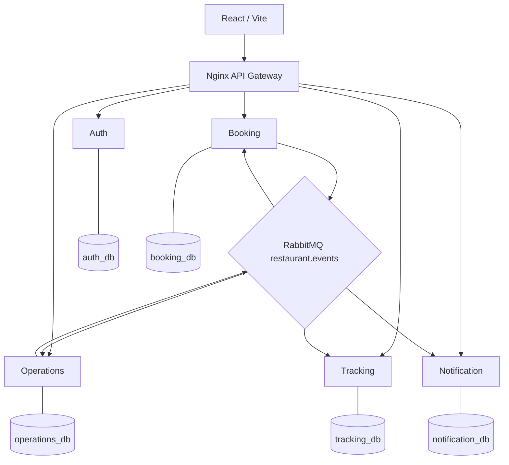
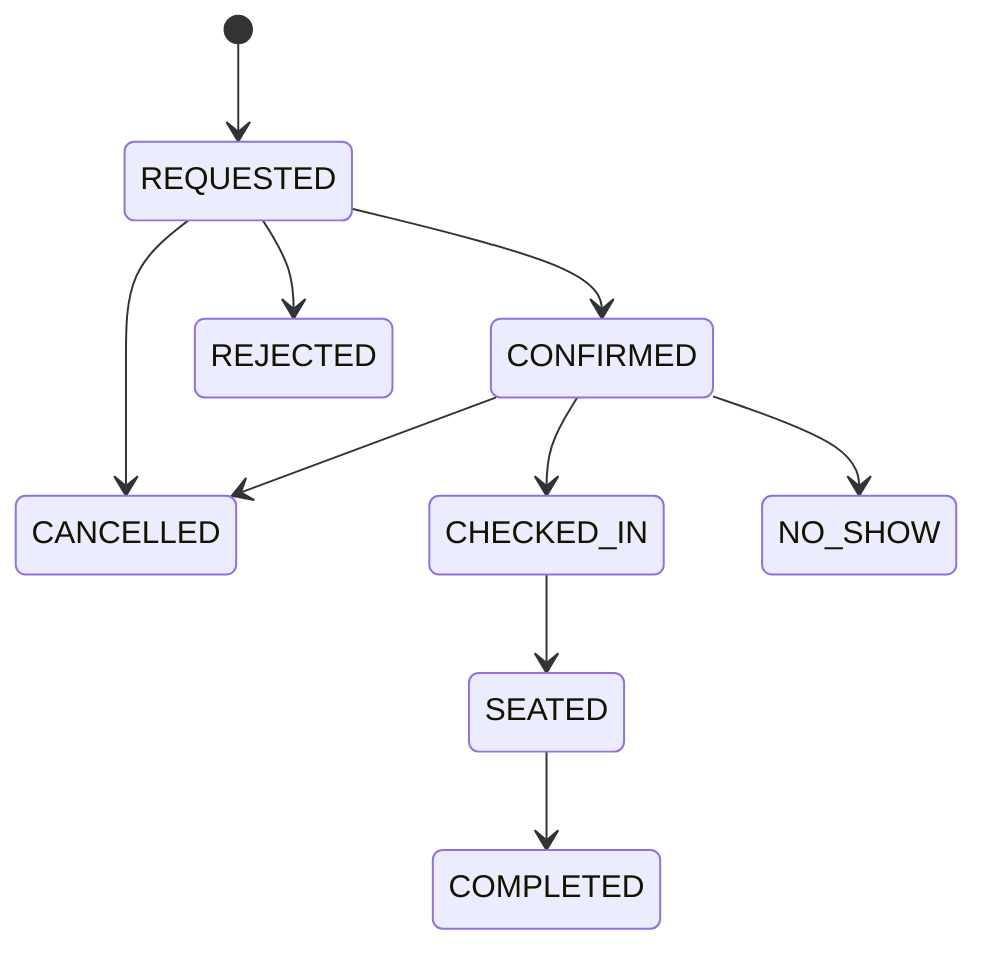
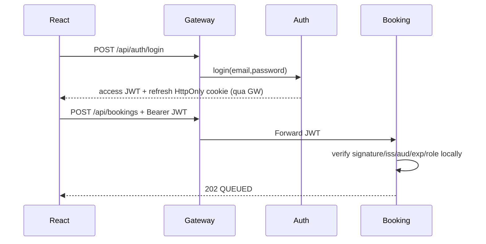
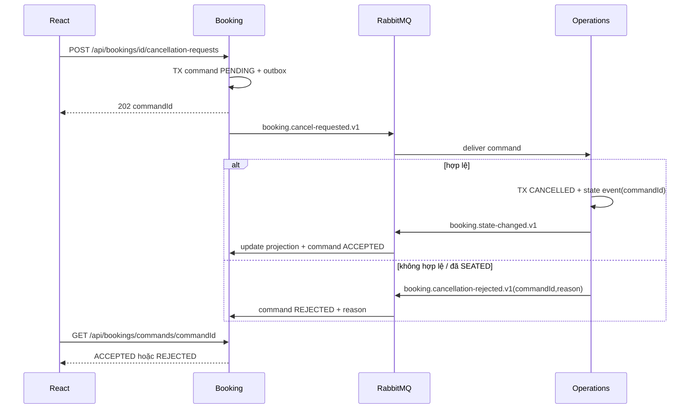
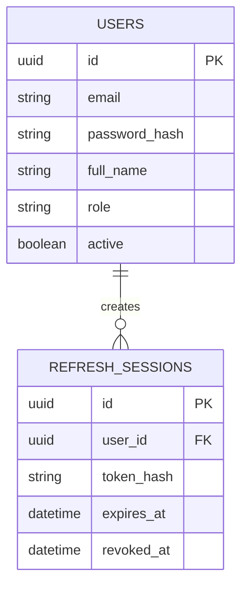
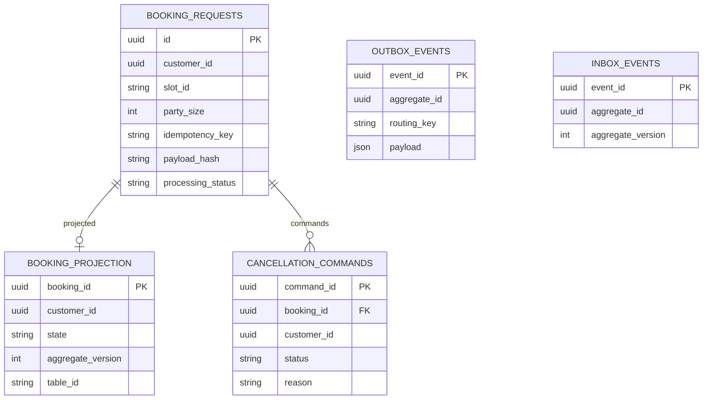
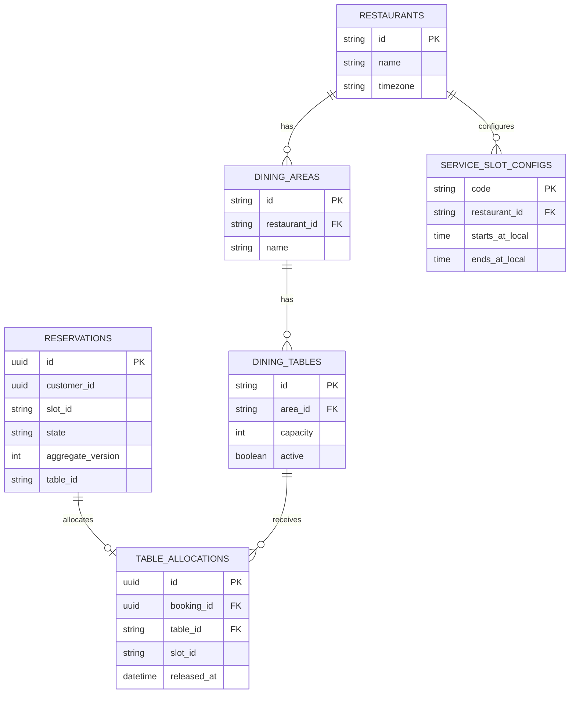
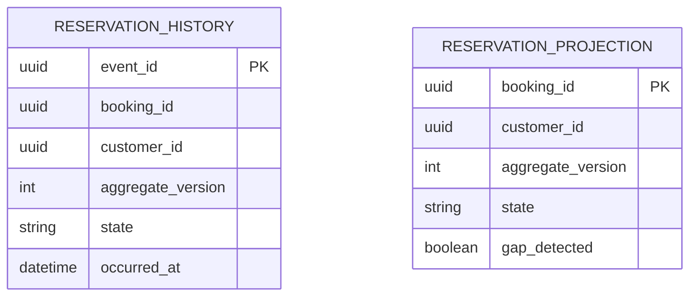
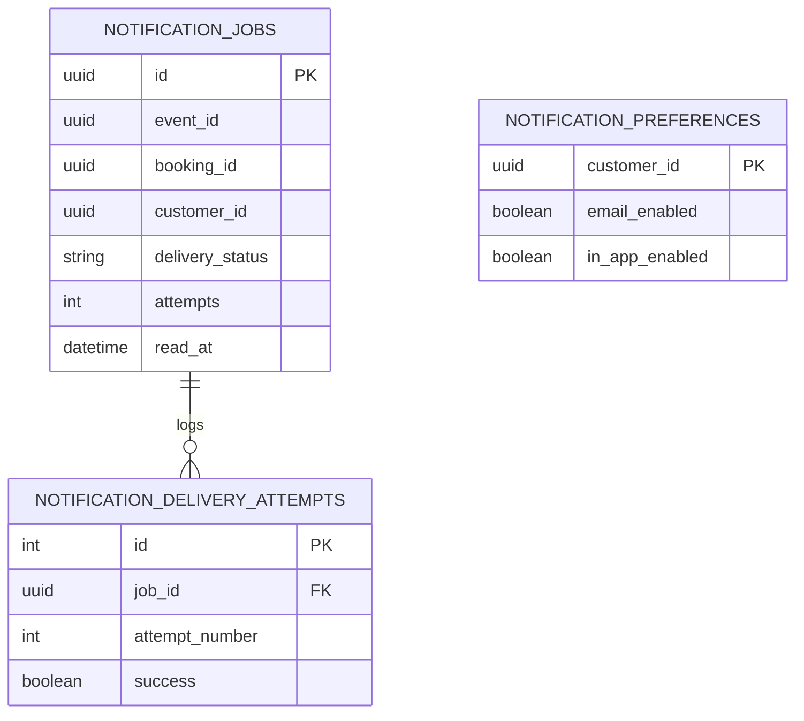

# TÀI LIỆU HƯỚNG DẪN TRIỂN KHAI NESTJS — 5 NGƯỜI

> Bản gộp đọc liên tục. SQL, JSON schemas, mock API và OpenAPI chi tiết nằm trong ZIP đầy đủ.


---

<!-- FILE: README.md -->

# IMPLEMENTATION PLAYBOOK — HỆ THỐNG ĐẶT BÀN NHÀ HÀNG (NESTJS)

**Bản dành cho nhóm 5 người – 05/11/2026.** Đây là **hướng dẫn thực hiện**, không phải tuyên bố đã viết xong 41 API. Nguồn thiết kế: bộ `restaurant-nestjs-v2-full-spec-mock.zip` và `restaurant-api-v2.yaml`. Mục tiêu: một nhà hàng, slot lunch/dinner, một booking giữ một bàn, không thanh toán/ghép bàn.

## Phân công được khóa theo nhóm

| Người | Phạm vi duy nhất được giao | Đầu ra phải bàn giao |
|---|---|---|
| **1** | **API Gateway + Auth Service + tích hợp hạ tầng** | JWT, role, 10 API Auth, route Gateway, Compose/CI; tài liệu token contract |
| **2** | **Restaurant Operations Service** | 17 API Operations, restaurant/area/table/slot, state machine, chống trùng bàn, events |
| **3** | **Tracking Service + Notification Service** | 2 API Tracking + 6 API Notification, timeline, email, jobs/retry/DLQ |
| **4** | **Booking Service** | 5 API Booking, idempotency, outbox, hủy, projection |
| **5** | **Frontend React** | UI 3 vai trò, mock-first API client, layout/routes/forms, e2e FE, phối hợp FE-BE |

**Tổng hợp đồng:** Auth 10 + Operations 17 + Booking 5 + Tracking 2 + Notification 6 + Gateway health 1 = **41 operations trong OpenAPI**. Một endpoint transition động `/{action}` đại diện nhiều trạng thái nghiệp vụ nhưng được tính 1 operation.

## Thứ tự đọc / giao file

1. `shared/00-QUY-UOC-CHUNG.md` — ranh giới, giao tiếp, trách nhiệm và nguyên tắc tích hợp.
2. Giao đúng 1 tài liệu cá nhân: `nguoi-1-auth-gateway/`, `nguoi-2-operations/`, `nguoi-3-tracking-notification/`, `nguoi-4-booking/`, `nguoi-5-frontend/`.
3. `contracts/openapi/restaurant-api-v2.yaml` — hợp đồng HTTP **nguồn chuẩn**; `contracts/events/*.schema.json` — hợp đồng RabbitMQ.
4. `sql/*_schema_V2.sql` — **target schema** từng service, `operations_seed.sql` — dữ liệu mẫu. Không chạy đè source NestJS V1 đang dùng schema cũ.
5. `shared/01-LUONG-END-TO-END.md`, `shared/02-MAPPING-V1-V2.md` — luồng và sửa chỗ lệch starter.
6. `testing/TEST-PLAN.md`, `deploy/GIT-LOCAL-CICD-PROD.md` — nghiệm thu, phối hợp, deployment.
7. `shared/07-BAN-GIAO-GIUA-CAC-NGUOI.md` — từng cặp service phải bàn giao contract và chứng minh đã tích hợp.
8. `mock-api/` — mock Node.js chạy riêng cho người 5 và FE integration.

## Kiến trúc thực hiện



- Cả 5 backend là **5 tiến trình/container** độc lập, được phát triển trong **1 backend monorepo** và có database/role riêng (có thể cùng một PostgreSQL instance trên máy demo).
- FE là repo thứ hai. Không có service nào JOIN hoặc ghi DB của service khác.
- **Operations duy nhất** quyết định `reservation.state`, `aggregateVersion`, `table_allocations`.
- Auth cấp JWT, các service khác kiểm tra JWT với public key ở local; không gọi Auth mỗi request.
- Booking yêu cầu bằng RabbitMQ; Operations xử lý và phát state event; Booking/Tracking/Notification tiêu thụ độc lập.
- UI dùng HTTP qua Gateway, không gọi thẳng cổng nội bộ.

## Trạng thái baseline thực tế

Theo bản source NestJS V1 trong gói V2: 19 operation `existing` (code mẫu), 21 `planned`, 1 `adapt`. Không có khẳng định rằng 19 operation đã vượt E2E trên Docker. Các file `sql/*_V2.sql` và `contracts/*` là **mục tiêu V2**, không tự tương thích code SQL V1. Chọn chuyển đổi V1 → V2 có migration, không dùng hai phiên bản schema cùng lúc.

## Cách ghép để nhóm làm độc lập

- Ngày đầu: người 1 phát hành JWT contract + Gateway route; người 2 và 4 chốt event contracts; người 3 chốt consumer tests; người 5 dùng mock + OpenAPI.
- Mỗi ngày: mỗi người mở PR nhỏ trong thư mục của mình; PR thay `shared`, `contracts`, `compose`, Gateway cần người bị ảnh hưởng review.
- Tích hợp thứ tự: **Auth → Booking Requested → Operations REQUESTED → Tracking → Notification → Confirm/Cancel → toàn bộ lifecycle → deploy**.
- Không merge `main` nếu unit test/contract test của service mình fail. Test notification outage và 2 nhân viên cùng gán 1 bàn là tiêu chí bắt buộc.

## Tài liệu đã kèm để chạy thử

```bash
# mock API riêng (Node 22)
cd mock-api
node server.mjs
# terminal khác
node test.mjs
```

Mock không tương đương backend thật, không chứa PostgreSQL hay RabbitMQ. Các ví dụ đường dẫn và tên bảng trong hướng dẫn đều bám target V2; đối chiếu file OpenAPI/SQL để lấy thông tin field chính xác khi code DTO.


---

<!-- FILE: shared/00-QUY-UOC-CHUNG.md -->

# 00 — Quy ước kiến trúc chung: 5 người làm song song nhưng không đụng nhau

## Ranh giới không được phá

1. **Database per service**: `auth_db` (Người 1); `operations_db` (Người 2); `tracking_db` và `notification_db` (Người 3, tách 2 container/service); `booking_db` (Người 4). Chỉ schema và migration trong DB của mình; không FK hoặc JOIN xuyên DB. Có thể dùng 1 PostgreSQL server cho tiết kiệm, nhưng tạo 5 database và 5 role.
2. **Single writer**: Operations là nguồn sự thật `Reservation`, quyết định trạng thái và phân bàn. Booking chỉ có request + read projection; Tracking là append-only history + read projection; Notification có job/thông báo. Không ai bên ngoài Operations đổi state qua SQL.
3. **Communication**: frontend → Gateway → NestJS là HTTP. Đặt và hủy: Booking → RabbitMQ → Operations. Cập nhật trạng thái: Operations → RabbitMQ → Booking/Tracking/Notification. Không dùng synchronous HTTP để thực hiện giao dịch giữa backend services trong hot path; không chờ email mới trả response xác nhận bàn.
4. **JWT**: Auth giữ private key, bốn service khác chỉ có public key. Token dùng `sub` UUID, `role` CUSTOMER|STAFF|MANAGER, `iss=restaurant-auth`, `aud=restaurant-api`, `exp`, có `email` nếu thực sự cần. Verify tại API service, không chỉ tại Gateway. `req.user.id` được map từ `sub`.
5. **Ownership**: CUSTOMER chỉ xem/hủy của mình; STAFF/MANAGER xem tài nguyên theo quyền. Không tin `customerId` từ request body; dùng `req.user.id`. `STAFF` không được làm việc MANAGER.
6. **Time**: DB event và timestamp dùng `TIMESTAMPTZ` UTC; Operations cấu hình thời gian ca theo `Asia/Ho_Chi_Minh`. Slot id `YYYY-MM-DD-lunch|dinner`; 1 booking = 1 bàn; party size 1–12. Check-in/cancel/no-show dùng cùng một bộ guard thời gian của Operations.
7. **Mã lỗi**: JSON `{code,message,correlationId,details}`, status 400 input sai, 401 token sai, 403 vai trò sai, 404 không tìm thấy/không được xem theo policy, 409 trạng thái cũ/idempotency/table conflicts, 503 lỗi hạ tầng tạm thời khi thích hợp.
8. **Idempotency**: HTTP Booking dùng `(customerId, Idempotency-Key)` unique và payloadHash. Event listener dùng unique `eventId`; tại Operations có thêm `(bookingId, aggregateVersion)` logic để tránh cập nhật trùng.
9. **Event durability**: producer ghi nghiệp vụ + outbox **trong cùng DB transaction**; relay gửi durable/persistent message, publisher confirms/mandatory returns; consumer lưu inbox + thay đổi dữ liệu trong DB transaction, **ACK sau commit**. Crash giữa broker confirm và mark sent có thể gửi trùng; inbox phải chịu trùng.
10. **Ordering**: không giả định RabbitMQ bảo đảm toàn bộ ordering qua retry/nhiều producer. Tracking chỉ thay projection nếu `aggregateVersion` tăng; có cờ gap. Cancel đến trước Requested phải lưu pending. Message poison sau retry hữu hạn → DLQ, có thao tác replay có kiểm soát.

## Files được phép sửa (CODEOWNERS đề xuất)

| Phạm vi | Owner | Người review khi thay đổi |
|---|---|---|
| `services/auth/**`, `db/auth/**` | 1 | 4 (đầu vào JWT/Booking) |
| `infra/gateway/**`, `deploy/**`, `compose*`, `.github/workflows/**` | 1 | 5 (FE), 2/3/4 nếu đổi route |
| `services/operations/**`, `db/operations/**` | 2 | 4 (event producer/consumer) |
| `services/tracking/**`, `services/notification/**`, `db/tracking/**`, `db/notification/**` | 3 | 2 (state event) |
| `services/booking/**`, `db/booking/**` | 4 | 2 (request event) |
| `restaurant-web/src/**` | 5 | Service owner liên quan tới API |
| `shared/**`, `contracts/**`, SQL init, shared events/rabbit | Theo PR đề xuất, không có người sửa đơn phương | **Ít nhất 2 bên producer–consumer hoặc owner Gateway/FE** |

## Contract freeze: thứ tự thỏa thuận trước khi code

- Người 1: cung cấp JWT dev public key, claim mẫu và test verify, các route `/api/**`, CORs/cookie policy, danh sách cổng.
- Người 2 + 4: thống nhất 4 event (tên/routing key/envelope), `aggregateVersion`, `commandId`, cancellation result, state transitions và thời gian slot. Người 3 ký duyệt payload `state-changed` phục vụ timeline/email.
- Người 5: `OpenAPI V2` + generated TypeScript types; không phát minh API trong FE, không sửa trực tiếp file generated.
- Cần thay contract? PR `contracts/...` riêng, có version mới khi breaking change. Hai phía cập nhật tests trước khi merge. Không đổi đồng thời field âm thầm (`email` → `contactEmail`, `version` → `aggregateVersion`).

## Definition of Ready → Done

**Ready:** API request/response mẫu; auth & role; DB owner; error cases; event payload; consumer behavior; test cases viết rõ.

**Done:** migration chạy từ DB trống; service run local và Docker; các API trong scope có success + errors tests; duplicate-safe event; log có correlationId; no DB cross-access; README và env example; smoke qua Gateway; PR được review; service hoạt động khi Notification down nếu không trực tiếp phụ thuộc nó.

## Quy tắc tránh conflict

- Repo `restaurant-platform` (backend monorepo), repo `restaurant-web` (FE). Tạo PR nhỏ 1 feature, không làm branch dài cả kỳ.
- Không commit secrets/keys, `.env`, `node_modules`, `dist`, database volumes. Chỉ commit `.env.example`.
- Người 1 sở hữu Compose + gateway; người 5 không tự sửa Compose khi muốn route FE mà mở issue/PR có review; người 2/3/4 không tự sửa shared helper để phù hợp DB mình mà báo cần thay contract.
- Khởi tạo DB bằng **migrations versioned**; không chạy SQL init V1 rồi thêm SQL target V2 lên trên mà không migration.
- `docker compose down -v` chỉ khi chủ động reset môi trường cá nhân, không dùng trên máy demo chung.

## Thứ tự release/integration

Tạo môi trường ở tuần 1 với broker + schema + Auth public key + Gateway healthy; tách e2e integration theo bước có thể chạy lặp. Tag image theo commit SHA, không deploy image `latest` không thể truy vết. Rollback bằng tag trước đó, với DB migration phải kiểm tra backward compatibility trước rollback.


---

<!-- FILE: nguoi-1-auth-gateway/HUONG-DAN.md -->

# NGƯỜI 1 — AUTH SERVICE + API GATEWAY + NỀN TẢNG DEPLOY

**Phạm vi code:** `services/auth/**`, `db/auth/**`, `infra/gateway/**`, `deploy/**`, `compose.yaml`, CI. **DB:** `auth_db` riêng. **Phối hợp:** đưa public key và JWT contract cho 2/3/4; route API và mock/FE proxy cho 5. **Phần kế hoạch chi tiết deploy:** `../deploy/GIT-LOCAL-CICD-PROD.md`.

## A. Chức năng và nghiệp vụ Auth

1. Đăng ký: khách tự đăng ký thành `CUSTOMER`, trạng thái `active=true`. Client không tự chọn STAFF/MANAGER. Email chuẩn hóa lowercase và unique case-insensitive; password không lưu plaintext.
2. Đăng nhập: email + password; nếu đúng và user active thì cấp **access JWT RS256** (gợi ý 15 phút), tạo refresh session. Sai credentials trả 401 chung, không tiết lộ tài khoản có tồn tại.
3. Refresh: sử dụng refresh token trong HttpOnly cookie; hash token vào database, dùng transaction khóa session cũ `FOR UPDATE` để **rotation** và chống reuse; trả access JWT mới, thay cookie.
4. Logout: revoke refresh session hiện hành, clear cookie. Access JWT cũ vẫn có thể dùng đến khi hết hạn nếu không dùng revocation list; nêu rõ giới hạn.
5. Profile: `GET/PATCH users/me` chỉ sửa `fullName`, `phone`; role/active/email không được thay bằng mass assignment.
6. Đổi password: xác thực password cũ, cập nhật hash, revoke tất cả refresh sessions thuộc tài khoản.
7. MANAGER tạo STAFF; quản lý danh sách nhân viên, khóa/mở nhân viên; manager đầu tiên tạo bằng bootstrap script an toàn, **không có public register manager**.
8. Tất cả service khác verify JWT cục bộ bằng **public key**; không cần Auth luôn online để xử lý access JWT còn hợp lệ.

## B. Schema `auth_db` (nguồn: `../sql/auth_schema_V2.sql`)

| Bảng | Cột bắt buộc | Constraint / transaction |
|---|---|---|
| `users` | `id UUID`, `email`, `password_hash`, `full_name`, `phone`, `role`, `active`, `created_at`, `updated_at` | PK `id`, unique `lower(email)`, `role` chỉ CUSTOMER/STAFF/MANAGER |
| `refresh_sessions` | `id`, `user_id`, `token_hash`, `expires_at`, `revoked_at`, `created_at`, `device_label`, `last_used_at` | FK tới users **cùng DB**; unique token_hash; index (user_id, expires_at) |

**Không gửi** `password_hash`, refresh token hoặc private key vào event RabbitMQ. Test/seed user qua API/CLI script tạo hash thật; không seed cố định mật khẩu vào SQL.

## C. Danh sách 10 API và đầu việc

| API | Input trọng tâm | Xử lý bắt buộc |
|---|---|---|
| `POST /api/auth/register` | email, password, fullName, phone? | Validate, normalize, hash, insert, duplicate 409 → 201 User |
| `POST /api/auth/login` | email, password | Verify hash, active, create session, set cookie → 200 AuthTokens |
| `POST /api/auth/refresh` | HttpOnly refresh cookie | Revoke old + insert new in **1 transaction** → 200 |
| `POST /api/auth/logout` | refresh cookie | Revoke (idempotent), clear cookie → 200 |
| `POST /api/auth/change-password` | oldPassword, newPassword | guard JWT, revoke all sessions, no password in response |
| `GET /api/users/me` | JWT | Get profile theo `sub`; 404 nếu user không còn tồn tại |
| `PATCH /api/users/me` | fullName?, phone? | Allowlist fields; không sửa role/active |
| `GET /api/users/staff` | page/limit? | chỉ MANAGER; pagination, không trả hash |
| `POST /api/users/staff` | email, password, fullName | chỉ MANAGER; role hardcoded STAFF |
| `PATCH /api/users/{id}/status` | active:boolean | chỉ MANAGER; chặn khóa manager cuối cùng nếu hỗ trợ |

**Response/DTO cụ thể phải dùng đúng** `contracts/openapi/restaurant-api-v2.yaml`. API V1 đã có register/login/refresh/logout/me/create-staff; còn lại triển khai mới hoặc sửa hành vi.

## D. Các file/module cần tạo từ starter

```text
services/auth/
├── main.ts                 # V1 entrypoint; tách logic dần
├── auth.module.ts
├── controllers/auth.controller.ts
├── controllers/users.controller.ts
├── dto/register.dto.ts, login.dto.ts, profile.dto.ts, staff.dto.ts
├── application/auth.service.ts, users.service.ts
├── infrastructure/user.repository.ts, refresh-session.repository.ts
├── security/jwt-issuer.service.ts, password.service.ts
└── migrations/001_create_auth.sql, 002_add_refresh.sql
infra/gateway/nginx.conf
scripts/bootstrap-manager.ts     # chỉ chạy quản trị, không public API
```

NestJS nên dùng DTO + ValidationPipe, hoặc validator đã thống nhất. Không bắt buộc TypeORM/Prisma; dự án V1 dùng `pg`, giữ `pg` với repository phân tầng sẽ ít thay đổi. `shared/identity.ts` phải map claims `sub` → `req.user.id` và validate `iss/aud/exp/alg`.

## E. JWT contract phải phát ngay cho các owner khác

```json
{
  "sub":"f6c2ae37-417c-4c08-9fb9-a13fe5c6797f",
  "email":"customer@example.test",
  "role":"CUSTOMER",
  "iss":"restaurant-auth",
  "aud":"restaurant-api",
  "iat":1793970000,
  "exp":1793970900
}
```

Thời gian trong ví dụ là cấu trúc minh họa; khi sign token thật phải dùng Unix timestamp từ runtime. Chỉ Auth giữ `private.pem`, bốn service khác mount `public.pem` read-only. Khi chuyển JWKS, có cache/rotation để server Auth tắt tạm thời không làm hỏng request JWT còn hiệu lực.

## F. API Gateway — công việc cụ thể

- V1 đang dùng Nginx (`infra/gateway/nginx.conf`). Chốt `/api/auth/**`, `/api/users/**` → auth; `/api/bookings/**` → booking; `/api/operations/**`, `/api/restaurants/**`, `/api/slots`, `/api/availability` → operations; `/api/tracking/**` → tracking; `/api/notifications/**` → notification; `/` → React static. Giữ API health `/api/health` của Gateway.
- Định tuyến **path giữ nguyên**. Nếu backend controller có prefix `api/`, proxy_pass phải test chính xác, tránh `/api/api` hoặc mất prefix.
- Bật request size limit, timeout phù hợp, request/correlation ID và HTTPS khi deploy. Rate limit login/refresh; có thể làm Nginx limit_req và app-level limit.
- Browser cùng origin `https://your-domain/` và `/api/...` để giảm CORS; cấu hình refresh cookie HttpOnly+Secure trong HTTPS, SameSite theo domain deploy. Không cho FE đọc refresh cookie từ JS.
- Gateway **không** được ghi DB hoặc quyết định trạng thái; không coi Gateway JWT check là thay thế service-level guards.
- RabbitMQ/PostgreSQL không public port; chỉ reverse proxy public 80/443. Giao diện RabbitMQ management chỉ truy cập nội bộ/VPN/SSH tunnel.
- Compose cho 5 backend + 1 web + gateway + broker + PostgreSQL + Mailpit; trên dev source V1 hiện `web` build từ `../restaurant-web` ⇒ clone 2 repo ở hai folder ngang hàng.

## G. Lộ trình implement (checklist tuần)

- [ ] **Tuần 1**: Khóa JWT contract + private/public key dev + 5 DB credentials tách biệt; Gateway route toàn bộ 41 API; Auth đăng ký/login/me; cung cấp access JWT demo cho từng người.
- [ ] **Tuần 2**: Refresh/logout rotation + profile/change-password; bootstrap manager; tests quyền; compose nội bộ; kiểm tra `/api/health`.
- [ ] **Tuần 3**: List/create/lock STAFF; cookie và error envelope chuẩn; cập nhật OpenAPI Auth; hỗ trợ người 5 login flow.
- [ ] **Tuần 4–5**: CI matrix test/build service theo path, Docker image tag SHA, healthchecks/readiness, staging; security test.
- [ ] **Tuần 6**: VPS HTTPS, secrets, backup, rollback và demo Auth container restart mà Booking vẫn verify JWT cũ hợp lệ.

## H. Test độc lập + tích hợp

- Register CUSTOMER không thể gửi `role=MANAGER`; email viết hoa trùng email viết thường → 409.
- Login sai password, user bị khóa → 401; role thiếu → 403; refresh reuse → 401; logout rồi refresh → 401.
- JWT giả, sai `aud`/`iss`, expired, signed bằng HS256 → 401 tại **Booking/Operations/Tracking/Notification**, không chỉ Gateway.
- CUSTOMER gọi `POST /api/users/staff` → 403; MANAGER thành công; PATCH profile không sửa role.
- Tắt Auth sau khi login, request GET Booking/Tracking bằng access JWT còn hạn vẫn được xác minh bởi service khác.
- Cùng một URL hoạt động bằng Gateway (không được dùng port service trực tiếp từ FE). Mở Postman collection và chạy dưới baseURL Gateway.

**Bàn giao cho nhóm:** `auth_db` migration; 10 endpoint; JWT test token + public key dev; env contract; Gateway nginx, Compose, CI, README và bảng route. Không cần RabbitMQ cho Auth MVP.


---

<!-- FILE: nguoi-2-operations/HUONG-DAN.md -->

# NGƯỜI 2 — RESTAURANT OPERATIONS SERVICE (17 API, 1 DB, 2 EVENT OUTPUT)

**Owner:** Người 2. **Source V1:** `services/operations/main.ts`. **Target:** tách modules, migration V2, 17 API. **Database duy nhất:** `operations_db` (`../sql/operations_schema_V2.sql`, `operations_seed.sql`). **Đầu vào event từ người 4:** `booking.requested.v1`, `booking.cancel-requested.v1`. **Đầu ra người 4 và 3:** `booking.state-changed.v1`, `booking.cancellation-rejected.v1`.

## A. Nghiệp vụ thực tế cần triển khai

1. Nhà hàng có khu vực (`main`, `garden`), mỗi khu vực có bàn (`T01` đến `T04`), mỗi bàn capacity và active status. Manager thêm/sửa khu vực, bàn và ca phục vụ; STAFF chỉ xem và điều phối.
2. Người dùng xem thông tin nhà hàng, khu vực, ca và tình trạng chỗ trống từ **Operations**. Availability là dữ liệu tham khảo tại thời điểm GET, **không phải giữ chỗ**; quyết định cuối cùng chỉ ở transaction confirm.
3. Booking được tạo ở Booking Service, Operations nhận `booking.requested.v1` → tạo reservation `REQUESTED`, `aggregate_version=1`, lưu inbox, tạo outbox `booking.state-changed.v1` trong **một transaction**. Không được tạo trực tiếp qua API từ FE.
4. STAFF chọn bàn và xác nhận: check role, `expectedVersion`, trạng thái `REQUESTED`, capacity đủ, bàn đang active, ca hợp lệ, bàn chưa có allocation cho slot. `INSERT table_allocations` + `UPDATE reservations` + outbox trong cùng transaction. DB partial unique index `(table_id, slot_id) WHERE released_at IS NULL` chống race.
5. STAFF từ chối yêu cầu `REQUESTED` với reason bắt buộc. Hoặc check-in khi khách đến trong cửa sổ giờ, seat sau check-in, complete sau seat, no-show khi quá thời điểm cho phép. Mọi chuyển state phát event.
6. Hủy: event từ Booking; nếu đúng chủ sở hữu, trạng thái cho phép và thỏa deadline thì chuyển `CANCELLED`, giải phóng allocation; nếu không phát `booking.cancellation-rejected.v1` có `commandId`/reason. Với cancel tới trước create, lưu pending rồi xử lý sau khi create tới.
7. Thống kê `stats/summary` từ Operations DB của riêng mình: theo ngày/ca số REQUESTED/CONFIRMED/COMPLETED/CANCELLED/NO_SHOW... Không truy vấn DB Tracking.

## B. Schema `operations_db` và vai trò từng bảng

| Bảng | Khóa, cột chủ đạo | Logic/ràng buộc |
|---|---|---|
| `restaurants` | `id TEXT PK`, `name`, `timezone`, `address`, `cancel_before_minutes`, `checkin_early_minutes`, `no_show_after_minutes` | Một nhà hàng MVP; timezone Asia/Ho_Chi_Minh, policy centralized |
| `dining_areas` | `id TEXT PK`, `restaurant_id FK`, `name`, `active` | Chỉ MANAGER chỉnh sửa |
| `dining_tables` | `id TEXT PK`, `area_id FK`, `capacity`, `active` | Bàn chỉ thuộc một khu vực; sửa active không làm đổi lịch sử |
| `service_slot_configs` | `code PK`, `restaurant_id FK`, `starts_at_local`, `ends_at_local`, `active` | MVP `lunch`, `dinner`; ca không qua nửa đêm |
| `reservations` | `id UUID PK`, `customer_id UUID`, `contact_email`, `slot_id`, `party_size`, `state`, `aggregate_version`, `table_id`, `updated_at` | **Nguồn chân lý duy nhất cho state**; `id` lấy từ Booking event aggregateId, không FK sang Booking DB |
| `table_allocations` | `id UUID`, `booking_id FK`, `table_id FK`, `slot_id`, `released_at` | Unique active `(table_id,slot_id)` và unique `booking_id`; release ở CANCELLED/NO_SHOW; giữ record COMPLETED |
| `pending_cancellations` | `command_id PK`, `booking_id`, `customer_id`, `received_at` | Cancel event tới trước request; xử lý/expire không kẹt vô hạn |
| `processed_commands` | `command_id PK`, `booking_id`, `result JSONB` | Idempotency của lệnh cancel & replay kết quả |
| `inbox_events` | `event_id UUID PK`, `aggregate_id`, `processed_at` | Dedup mỗi delivery event |
| `outbox_events` | `event_id`, `aggregate_id`, `routing_key`, `payload`, `published_at`, `attempts` | State event và rejected cancellation durable |

**Seed có sẵn:** `rest-001`, `main`, `garden`, T01(2), T02(4), T03(6), T04(4), lunch 11:30–13:00, dinner 18:00–19:30. Không dùng ID bàn như FK của các DB khác.

**Lưu ý ràng buộc:** Nếu `table_allocations` giữ `UNIQUE (booking_id)` thì MVP không hỗ trợ đổi bàn sau xác nhận. Nếu sau này có đổi bàn, phải có thiết kế allocation history riêng, không bỏ unique/index không kiểm soát.

## C. State machine và guard cụ thể



| Transition | Ai | Guard tối thiểu | Tác động DB |
|---|---|---|---|
| Create → REQUESTED | consumer | event valid; slot trong tương lai, partySize 1–12, request chưa tồn tại | reservations version=1 + inbox + outbox |
| REQUESTED → CONFIRMED | STAFF/MANAGER | đúng `expectedVersion`, bàn đủ chỗ/active, slot đặt được, chưa trùng | allocation + state version+1 + outbox |
| REQUESTED → REJECTED | STAFF/MANAGER | reason khác rỗng | state/version/outbox |
| REQUESTED/CONFIRMED → CANCELLED | consumer; staff extension | customerId khớp, trước deadline, trạng thái cho phép | state/version; release allocation nếu có |
| CONFIRMED → CHECKED_IN | STAFF/MANAGER | trong check-in window (ví dụ từ -30 đến +15 phút) | state/version/outbox |
| CHECKED_IN → SEATED | STAFF/MANAGER | đúng table; bàn sẵn sàng | state/version/outbox |
| SEATED → COMPLETED | STAFF/MANAGER | đã phục vụ; không cho complete ngược | state/version/outbox; **không** xóa allocation của slot đã phục vụ |
| CONFIRMED → NO_SHOW | STAFF/MANAGER hoặc job | đã quá start+15 phút, chưa check-in | state/version/outbox; release allocation |

Chốt policy thời gian chính xác trong `restaurants` và một `TimePolicyService`; không hardcode chỗ thì dùng -15 phút, chỗ thì -30 phút. `Date.now()` phụ thuộc máy chạy; test bằng injectable clock/fake clock.

## D. 17 API thuộc Operations (toàn bộ backlog)

| Method/path | Role | Logic/kiểm thử |
|---|---|---|
| `GET /api/restaurants/current` | PUBLIC | Công khai nhà hàng + chính sách, timezone |
| `GET /api/restaurants/current/areas` | PUBLIC | Lọc khu vực active |
| `GET /api/slots?date=YYYY-MM-DD` | PUBLIC | Dựa config ca + lịch ngày địa phương, `startsAt/endsAt/bookingOpen` |
| `GET /api/availability?date=...&partySize=...&slotCode=...` | PUBLIC | Đếm bàn đủ capacity và active chưa được allocate cho slot, cache ngắn nếu muốn |
| `GET /api/operations/reservations` | STAFF/MANAGER | Filter slot/state, pagination, ưu tiên ngày phục vụ |
| `GET /api/operations/reservations/{id}` | STAFF/MANAGER | Chi tiết reservation + tableId + version |
| `POST /api/operations/reservations/{id}/{action}` | STAFF/MANAGER | action=confirm/reject/check-in/seat/complete/no-show; reason/tableId/expectedVersion |
| `GET /api/operations/tables` | STAFF/MANAGER | Danh sách, active, capacity, area |
| `POST /api/operations/tables` | MANAGER | Validate id/area/capacity; 409 id trùng |
| `PATCH /api/operations/tables/{id}` | MANAGER | Chỉ fields cho phép; tránh làm vô hiệu bàn đã có đặt tương lai |
| `GET /api/operations/areas` | STAFF/MANAGER | Danh sách area |
| `POST /api/operations/areas` | MANAGER | Tạo area thuộc restaurant |
| `PATCH /api/operations/areas/{id}` | MANAGER | Sửa tên/active; kiểm soát bàn đang active |
| `GET /api/operations/slot-configs` | STAFF/MANAGER | Xem giờ mở ca & active |
| `POST /api/operations/slot-configs` | MANAGER | Thêm ca theo contract, tránh trùng code |
| `PATCH /api/operations/slot-configs/{code}` | MANAGER | Không retroactively phá booking đã confirm; đổi cho ngày tương lai có policy |
| `GET /api/operations/stats/summary` | MANAGER | Count theo slot/date/state, không truy cập DB Tracking |

**Cảnh báo OpenAPI:** `/{action}` là **một operation** trong 41, nhưng implement nhiều hành động với guard khác nhau. Với `action=cancel` của STAFF chỉ triển khai sau khi contract đã chốt; cancellation command từ Booking vẫn là luồng chính.

## E. Code/module đề nghị

```text
services/operations/
├── main.ts
├── operations.module.ts
├── controllers/{public,table,area,slot,reservation,statistics}.controller.ts
├── application/{reservation,allocation,calendar,availability}.service.ts
├── domain/{reservation-state,transition-policy,time-policy}.ts
├── infrastructure/{reservation,table,area,slot,outbox,inbox}.repository.ts
├── messaging/{requested.consumer,cancel-requested.consumer,state.publisher}.ts
├── dto/{transition,table,area,slot,availability}.dto.ts
└── migrations/001_init_operations.sql
```

**Transaction lõi khi confirm (pseudocode có chủ đích):**

```ts
await db.tx(async (tx) => {
  const reservation = await repo.lockById(tx, bookingId);  // SELECT ... FOR UPDATE
  assertExpectedVersion(reservation, dto.expectedVersion);
  assertTransition(reservation.state, 'CONFIRMED');
  assertSlotAndTablePolicy(reservation, table, now);
  await allocationRepo.insert(tx, bookingId, dto.tableId, reservation.slotId);
  await reservationRepo.transition(tx, bookingId, 'CONFIRMED', dto.tableId, reservation.aggregateVersion + 1);
  await outboxRepo.insert(tx, stateChangedEvent);  // cùng transaction
});
```

Bắt `SQLSTATE 23505` (unique violation) → HTTP 409 cho hai lễ tân tranh bàn. Không `SELECT rồi UPDATE` không khóa mà coi là đủ. Consumer requested/cancel phải `inbox eventId` và mutation trong 1 transaction; ACK chỉ sau khi callback resolve.

## F. Event contract bắt buộc bàn giao người 3/4

**Consume:** `operations.requests.q` được bind cả `booking.requested.v1` và `booking.cancel-requested.v1`. Phải xử lý duplicate eventId; cancel tới trước booking; retry hữu hạn/DLQ khi payload sai; không gọi Booking HTTP để lấy `customerId`.

**Produce:** `booking.state-changed.v1` có `eventId`, `aggregateId=bookingId`, `aggregateVersion`, `previousState`, `state`, `customerId`, `data.email`, `tableId`, `slotId`, `partySize`, `actorId`, `reason`, `commandId?`. `booking.cancellation-rejected.v1` mang `commandId`, `customerId`, `reason`. **JSON Schema đính kèm trong contracts/events là nguồn chuẩn**; nếu code V1 đang dùng `email` top-level event khác mẫu contract thì phải sửa cùng producer–consumer, không tự đổi một phía.

## G. Lệch source V1 cần xử lý

- V1 `reservations.version`, `email`, `dining_tables.area` khác V2 `aggregate_version`, `contact_email`, `area_id`; sửa query + DTO + migrations đồng loạt.
- V1 `pending_cancellations` dùng `created_at`, target V2 có `received_at`, `customer_id`; sửa insert/order. V1 `emitState()` đang không đầy đủ guard thời gian/ownership cho từng transition.
- V1 `shared/events.ts` enqueue chỉ ghi 3 cột, V2 outbox yêu cầu `aggregate_id`; inbox V2 yêu cầu `aggregate_id`. Không chạy V2 SQL trên V1 service mà không refactor helper.
- V1 chưa có public `/api/restaurants`, `/api/slots`, `/api/availability`, Gateway cũng chưa route. Người 1 phải review tuyến mới.
- V1 `active=false` của bàn bị chặn nếu có allocation lịch sử còn `released_at IS NULL`, gồm COMPLETED; cần policy chỉ ngăn đặt tương lai còn hiệu lực, không xóa lịch sử.
- Nguồn state event chỉ Operations được tăng version; Tracking có thể nhận version 3 trước 2, không phát state event bù từ Tracking.

## H. Bộ test của người 2

1. Seed đúng 4 bàn/2 ca; `GET availability` phản ánh capacity và allocation.
2. Nhận `booking.requested` → một reservation version=1, phát một state event; phát lại cùng `eventId` → không thêm bản ghi.
3. Hai lệnh confirm đồng thời cùng tableId/slotId → **một commit, một 409**.
4. Confirm table capacity 2 với booking partySize 4 → 409; bàn inactive → 409; slot đã qua → không xác nhận.
5. Stale `expectedVersion` → 409; complete trực tiếp từ REQUESTED → 409; reject thiếu reason → 400.
6. Cancel đúng quyền trước deadline → CANCELLED + outbox + release; cancel khi SEATED → rejected event, state giữ nguyên.
7. Cancel event trước Requested → lưu pending; Requested đến → xử lý hủy đúng thứ tự state versions.
8. NO_SHOW chỉ sau giờ bắt đầu + grace; CHECKED_IN chỉ đúng window; kiểm thử clock giả.
9. Dừng Notification rồi confirm: HTTP confirm commit, outbox phát, Tracking vẫn nhận, Notification queue tăng.
10. Bật lại Operations sau khi broker/down: outbox chờ và phát lại; inbox chịu duplicate.

**Bàn giao:** 17 API, SQL migration + seed, tài liệu TimePolicy, 4 event contract tương thích, 10 test trên và README env/run. Ưu tiên cao nhất của nhóm: confirm/allocate đồng thời và state event đúng.


---

<!-- FILE: nguoi-3-tracking-notification/HUONG-DAN.md -->

# NGƯỜI 3 — TRACKING SERVICE + NOTIFICATION SERVICE (2 DEPLOYMENTS, 2 DATABASES)

**Phạm vi:** `services/tracking/**`, `services/notification/**`, `db/tracking/**`, `db/notification/**`. **Hai service phải độc lập**: không được gộp controller, DB, transaction hay container chỉ vì một người làm cả hai. **Giao tiếp:** chỉ nhận `booking.state-changed.v1` từ Operations qua các **queue riêng**; frontend gọi HTTP qua Gateway.

## A. Tách nhiệm vụ rõ ràng

| Thành phần | Nhận input | Sở hữu dữ liệu | Đầu ra |
|---|---|---|---|
| **Tracking** | `tracking.lifecycle.q` từ `restaurant.events` | `tracking_db`: history và projection | 2 API GET timeline/status; KHÔNG phát state mới |
| **Notification** | `notification.lifecycle.q` từ exchange đó | `notification_db`: job, delivery attempt, preferences | 6 API thông báo; worker SMTP/Mailpit; KHÔNG thay đổi reservation state |

Nếu Notification tắt, Tracking vẫn nhận đủ sự kiện trên queue của mình. RabbitMQ phải tạo queue/binding của Notification **trước khi** Notification bị tắt; thông điệp persistent nằm trong durable queue cho tới lúc service chạy lại.

---

# PHẦN 1: TRACKING SERVICE

## B. Nghiệp vụ Tracking

1. Mỗi state event hợp lệ được ghi thành một dòng lịch sử bất biến theo `(bookingId, aggregateVersion)`; `eventId` unique. Không sửa state cũ đã ghi, không tự phát minh thêm state.
2. `reservation_projection` là bản sao trạng thái mới nhất cho chức năng đọc. Event version thấp đến sau vẫn có thể thêm vào history nhưng **không được ghi đè projection phiên bản cao hơn**.
3. Phát hiện gap (ví dụ nhận version=3 khi projection hiện version=1) → `gap_detected=true`, ghi metric/log và mở đường replay; không tự suy luận version=2.
4. Ownership: CUSTOMER chỉ xem timeline/status của `customerId` tương ứng với `req.user.id`; STAFF/MANAGER theo quyền. Không gọi Auth DB; so sánh principal từ JWT với `customer_id` của chính Tracking.
5. UI hiển thị timeline sort theo `aggregateVersion`, không sort theo `receivedAt` khi cần đúng thứ tự nghiệp vụ. Có thể hiển thị occurredAt và receivedAt riêng để debug.

## C. Database `tracking_db`

| Table | Các cột, khóa | Ý nghĩa |
|---|---|---|
| `reservation_history` | `event_id UUID PK`, `booking_id UUID`, `customer_id UUID`, `aggregate_version INT`, `previous_state`, `state`, `actor_id`, `reason`, `occurred_at`, `received_at` | Append-only; unique `(booking_id, aggregate_version)` |
| `reservation_projection` | `booking_id UUID PK`, `customer_id`, `state`, `aggregate_version`, `gap_detected`, `updated_at` | Read model, update chỉ khi version mới cao hơn |
| `inbox_events` | `event_id UUID PK`, `processed_at` | Idempotency event handler |

SQL: `../sql/tracking_schema_V2.sql`. Không FK đến Operations hoặc Booking. Cần index `(booking_id,aggregate_version)`.

## D. Hai API Tracking

1. `GET /api/tracking/bookings/{id}/timeline`: kiểm tra JWT và quyền; lấy history tăng dần theo version, trả `{data,meta}` hoặc shape chính xác trong OpenAPI; nếu không có quyền áp policy 404/403 đã chốt. Trạng thái `REQUESTED` có version=1.
2. `GET /api/tracking/bookings/{id}/status`: kiểm tra quyền; trả projection mới nhất cùng `aggregateVersion`, `gapDetected` nếu hợp đồng cho phép. Khi projection chưa có do eventual consistency, trả trạng thái pending/not-found theo policy rõ ràng, không tự truy vấn DB Operations.

## E. Tracking consumer transaction (mẫu logic)

```ts
await db.tx(async (tx) => {
  if (!(await inboxRepository.markIfNew(tx, ev.eventId))) return;
  await historyRepository.insertIfNotExists(tx, {
    eventId: ev.eventId, bookingId: ev.aggregateId,
    customerId: ev.data.customerId, version: ev.aggregateVersion,
    previousState: ev.data.previousState, state: ev.data.state,
    occurredAt: ev.occurredAt, actorId: ev.data.actorId, reason: ev.data.reason,
  });
  const old = await projectionRepository.lockOrRead(tx, ev.aggregateId);
  if (!old || ev.aggregateVersion > old.aggregateVersion) {
    await projectionRepository.upsertOnlyIfNewer(tx, ev, old);
  }
});
// handler thành công / DB commit -> RabbitMQ ACK. Failed -> retry (no ACK).
```

Để chống race khi concurrent workers, câu `UPSERT ... WHERE reservation_projection.aggregate_version < EXCLUDED.aggregate_version` phải được dùng; không chỉ compare trong JS. Nếu lỗi unique `(booking_id,aggregate_version)` với hai eventId khác nhau nhưng payload khác → báo inconsistency và chuyển xử lý thủ công, không lặng im ghi đè.

**Tests Tracking:** duplicate eventId chỉ 1 history; version 3 đến trước 2 projection vẫn 3; version 2 bổ sung history; eventId khác nhưng cùng version payload xung đột bị phát hiện; customer khác đọc 404/403; Notification down vẫn ghi lịch sử; broker tắt/restart không mất trạng thái đã commit.

---

# PHẦN 2: NOTIFICATION SERVICE

## F. Nghiệp vụ Notification

1. Nhận `booking.state-changed.v1`, validate schema, map state thành loại thông báo (REQUESTED nhận yêu cầu, CONFIRMED xác nhận, REJECTED từ chối, CANCELLED hủy, CHECKED_IN/SEATED/COMPLETED/NO_SHOW theo policy cần gửi). Không phải state nào cũng cần email, nhưng timeline/in-app có thể đầy đủ.
2. Trong transaction: dedup `eventId` inbox và insert `notification_jobs` (eventId unique), **không gửi SMTP bên trong transaction**. Sau commit, ACK RabbitMQ.
3. Worker riêng poll các job đến hạn, claim an toàn trong DB (`FOR UPDATE SKIP LOCKED` hoặc lease), gửi email qua SMTP/Mailpit, ghi `delivery_attempts`, đánh dấu SENT hoặc RETRY/FAILED theo backoff hữu hạn. Không giữ DB transaction đang mở trong lúc gửi SMTP.
4. Nếu email lỗi, **job vẫn tồn tại** và có thể retry. Nếu service tắt, queue Notification tích message; khi chạy lại inbox ngăn tạo job trùng. Gửi SMTP có thể bị trùng khi crash sau send trước mark SENT: báo đúng giới hạn at-least-once, cân nhắc message-id/provider idempotency.
5. Tách thông báo in-app và email preference. `email_enabled=false` có thể vẫn ghi in-app nếu `in_app_enabled=true`; preference không ảnh hưởng kết quả reservation tại Operations.
6. Chỉ customer sở hữu notification được xem/mark read; list phải phân trang; không đưa email cá nhân vào log lỗi/correlation traces một cách tùy tiện.

## G. Database `notification_db`

| Table | Cột và ràng buộc | Ý nghĩa |
|---|---|---|
| `notification_jobs` | `id UUID PK`, `event_id UUID UNIQUE`, `booking_id`, `customer_id`, `recipient_email`, `type`, `title`, `message`, `delivery_status`, `attempts`, `next_attempt_at`, `sent_at`, `last_error`, `read_at`, `created_at` | In-app + email job bền vững |
| `notification_delivery_attempts` | `id BIGSERIAL PK`, `job_id FK`, `attempt_number`, `success`, `error_message`, `attempted_at` | Lịch sử gửi; unique `(job_id,attempt_number)` |
| `notification_preferences` | `customer_id UUID PK`, `email_enabled`, `in_app_enabled`, `updated_at` | Sở thích nhận thông báo |
| `inbox_events` | `event_id UUID PK`, `processed_at` | Consumer dedup |

SQL: `../sql/notification_schema_V2.sql`. `customer_id` logic ref sang Auth nhưng **không FK**. `recipient_email` lấy snapshot `data.email` trong state event; Notification không gọi Auth mỗi event.

## H. Sáu API Notification

| API | Nghiệp vụ |
|---|---|
| `GET /api/notifications/mine` | Danh sách job của current user, sort mới nhất và pagination; không lộ người khác |
| `GET /api/notifications/unread-count` | Đếm job `read_at IS NULL` dành cho current user |
| `POST /api/notifications/{id}/read` | Mark read theo notification **id**; idempotent; nguồn V1 đang dùng `:eventId/read` nên **adapt** |
| `POST /api/notifications/read-all` | Đánh dấu tất cả current user; trả số dòng thay đổi |
| `GET /api/notifications/preferences` | Lấy prefs (default true/true nếu chưa tạo) |
| `PATCH /api/notifications/preferences` | Upsert prefs theo `req.user.id`, validate boolean |

Trường response dùng chuẩn OpenAPI, không return bản ghi raw snake_case. Tham chiếu API group Notification trong `contracts/openapi/restaurant-api-v2.yaml`.

## I. Cấu trúc modules nên tạo

```text
services/tracking/
├── main.ts
├── tracking.module.ts
├── controllers/{timeline,status}.controller.ts
├── messaging/state-changed.consumer.ts
├── application/history.service.ts
├── infrastructure/{history,projection,inbox}.repository.ts
└── migrations/001_tracking.sql
services/notification/
├── main.ts
├── notification.module.ts
├── controllers/{notification,preference}.controller.ts
├── messaging/state-changed.consumer.ts
├── application/{notification,delivery-worker,preference}.service.ts
├── infrastructure/{job,attempt,preference,inbox}.repository.ts
└── migrations/001_notification.sql
```

## J. Tuần làm việc (vì 2 service nên phải chia rõ)

- [ ] **Tuần 1:** test event schema với Người 2, chạy hai DB riêng; hoàn thành Tracking consumer + timeline cơ bản.
- [ ] **Tuần 2:** Tracking projection gap, ownership và status API, unit test out-of-order; chốt event fixture với Operations.
- [ ] **Tuần 3:** Notification consumer → persist job + ACK; `GET mine`, mark read; Mailpit worker.
- [ ] **Tuần 4:** Retry/backoff + delivery history; unread count/prefs/read-all; 6 API hoàn chỉnh.
- [ ] **Tuần 5:** Duplicate/DLQ/outage/recovery tests; dashboard RabbitMQ queue metrics và E2E với Người 2/4.
- [ ] **Tuần 6:** support FE timeline/notifs, demo tắt Notification, replay và báo cáo.

## K. Giao diện / đối soát với nhóm

- Người 2 bắt buộc phát event `state-changed` có `aggregateVersion`, `data.email`, `customerId`, `previousState/state`, `tableId`, `actorId`, occurredAt/commandId. Người 3 viết fixture schemas để CI phát hiện breaking changes.
- Người 4 không gọi Tracking để xác nhận có bàn; chỉ dùng Booking/Operations. Người 5 polling từ Booking/Tracking, không coi Notification là nguồn state.
- Người 1 phải provision **cả** `tracking.lifecycle.q` và `notification.lifecycle.q` trước khi ngắt service; nếu queue chưa từng được khai báo, sẽ không có backlog khi Notification tắt.

**Definition of Done:** Tracking 2 API + history/projection/out-of-order; Notification 6 API + inbox/job/worker/Mailpit/retry; hai DB migration; two containers; failover Notification test; docs env + ownership tests. Không cần phát thêm event từ hai service trong MVP.


---

<!-- FILE: nguoi-4-booking/HUONG-DAN.md -->

# NGƯỜI 4 — BOOKING SERVICE (5 API + YÊU CẦU/HỦY SỰ KIỆN)

**Owner:** Người 4. **Source V1:** `services/booking/main.ts`. **DB:** `booking_db`. **RabbitMQ:** produce `booking.requested.v1`, `booking.cancel-requested.v1`; consume `booking.state-changed.v1`, `booking.cancellation-rejected.v1`. **Tuyệt đối không gán tableId hay xác nhận booking tại đây** — Operations là single writer.

## A. Nghiệp vụ Booking

1. CUSTOMER/STAFF/MANAGER xác thực bằng JWT; lấy `customerId` theo `req.user.id` cho tự đặt. Nếu STAFF thay khách đặt hộ trong tương lai, cần contract đại diện khách và audit riêng, không tùy tiện chấp nhận `customerId` ở body.
2. Khách chọn ngày/ca (slot theo `YYYY-MM-DD-lunch|dinner`), số lượng 1–12, thông tin liên hệ/ghi chú; `POST /api/bookings` có `Idempotency-Key`. Validate input; nên kiểm tra slot trong tương lai theo format/clock và để Operations là authority xác nhận slot còn active/chỗ trống.
3. Ghi **`booking_requests` + `outbox_events` trong cùng PostgreSQL transaction**. Trả `202 Accepted` với `{bookingId, processingStatus:'QUEUED'}`; **không trả CONFIRMED** vì Operations chưa cấp bàn.
4. Relay phát event `booking.requested.v1`, confirm broker; Operations tạo REQUESTED và phát state event. Booking consume để cập nhật `booking_projection` và `processing_status=PROCESSED`. Frontend có thể polling GET mine/detail tới khi nhận state.
5. Khách yêu cầu hủy bằng `POST .../cancellation-requests`, chỉ owner, record `cancellation_commands` status PENDING + outbox `booking.cancel-requested.v1` atomic → 202. **Đây chưa phải đã hủy thành công**.
6. Operations quyết định: nếu hợp lệ phát `booking.state-changed.v1` state CANCELLED kèm `commandId`; Booking mark command ACCEPTED; nếu hủy không hợp lệ phát `booking.cancellation-rejected.v1`, Booking mark REJECTED + reason. Endpoint `GET .../commands/{commandId}` phải phản ánh trạng thái thật.
7. Không gọi Notifications hoặc Tracking đồng bộ; dữ liệu projection của Booking có thể chậm vài giây. Dùng `aggregateVersion` để tránh lùi state khi event đến sai thứ tự.

## B. Schema `booking_db`

SQL: `../sql/booking_schema_V2.sql`.

| Bảng | Cột chính/constraint | Dùng ở đâu |
|---|---|---|
| `booking_requests` | `id UUID PK`, `customer_id`, `contact_email`, `contact_phone`, `slot_id`, `party_size 1..12`, `note`, `idempotency_key`, `payload_hash`, `processing_status`, `created_at` | POST bookings, list mine, GET detail; unique `(customer_id,idempotency_key)` |
| `booking_projection` | `booking_id UUID PK`, `customer_id`, `state`, `aggregate_version`, `table_id`, `updated_at` | GET detail/mine, nhận state event; only update if new version higher |
| `cancellation_commands` | `command_id UUID PK`, `booking_id FK LOCAL`, `customer_id`, `status PENDING|ACCEPTED|REJECTED`, `reason`, `created_at`,`resolved_at` | POST cancel + GET command status |
| `outbox_events` | `event_id`, `aggregate_id`, `routing_key`, `payload JSONB`, `attempts`, `published_at` | Durable event publisher |
| `inbox_events` | `event_id`, `aggregate_id`, `aggregate_version`, `processed_at` | Consumer dedup |

Không FK sang Operations/Auth; `customer_id`/`booking_id` chỉ là logical identifiers. `payload_hash` tính từ canonicalized booking request (các trường có ảnh hưởng nghiệp vụ), cùng key + cùng payload trả cùng receipt; cùng key + payload khác trả **409**.

## C. 5 API và tất cả nhánh xử lý

| API | HTTP | Đầu vào / response | Cần xử lý |
|---|---|---|---|
| `POST /api/bookings` | 202 | Header `Idempotency-Key`, JSON `slotId, partySize, note, contactPhone?` | Validate 400, JWT 401, key reused different body 409; tx request+outbox |
| `GET /api/bookings/mine` | 200 | JWT; query page/limit | Chỉ trả owner, join **nội bộ** request+projection, pending khi projection chưa tới |
| `GET /api/bookings/{id}` | 200 | UUID id; JSON booking+state/version/table | Owner hoặc STAFF/MANAGER; 404 nếu không thuộc quyền theo policy |
| `POST /api/bookings/{id}/cancellation-requests` | 202 | JWT, optional reason/header idempotency theo contract | Tạo command PENDING + outbox; không sửa state tức thì; không nhận hủy người khác |
| `GET /api/bookings/commands/{commandId}` | 200 | UUID commandId | Trả PENDING/ACCEPTED/REJECTED và reason; owner check |

DTO, responses chi tiết và header naming **chốt trong OpenAPI V2**. Nếu OpenAPI yêu cầu `contactEmail` thì không dựa vào email body của khách làm identity; có thể dùng JWT email verified làm snapshot (hoặc user profile nếu chốt chính sách cập nhật). Không lộ booking của người khác qua ID đoán được.

## D. Luồng SQL transaction cần code

**Đặt bàn có Idempotency-Key**:

```ts
return db.tx(async tx => {
  const old = await requestRepo.findByCustomerAndKey(tx, user.id, key);
  if (old) {
    if (old.payloadHash !== hashCanonical(dto)) throw new ConflictException('IDEMPOTENCY_CONFLICT');
    return receipt(old); // không publish event mới
  }
  const bookingId = randomUUID();
  await requestRepo.insert(tx, {bookingId, customerId:user.id, ...dto, idempotencyKey:key});
  await outboxRepo.insert(tx, requestedEvent(bookingId, dto, user));
  return {bookingId, processingStatus:'QUEUED'};
});
```

**Cancellation**:

```ts
await db.tx(async tx => {
  const booking = await requestRepo.findOwned(tx, bookingId, user.id);
  if (!booking) throw new NotFoundException();
  const commandId = randomUUID();
  await cancellationRepo.insert(tx, {commandId, bookingId, customerId:user.id, status:'PENDING'});
  await outboxRepo.insert(tx, cancellationRequestedEvent(commandId, bookingId, user.id));
});
// Trả 202, FE hiển thị 'Đang xử lý yêu cầu hủy'.
```

Cancel lặp lại nhanh có thể tạo nhiều commands nếu không có policy; chọn **một pending cancellation cho mỗi booking** hoặc dùng command-level idempotency key, cập nhật schema/index nếu quyết định. Phải chốt với Người 2 trước tuần 2.

## E. Event contract (đồng bộ người 2 và 3)

| Event | Producer / consumer | Payload chính |
|---|---|---|
| `booking.requested.v1` | Booking → Operations queue | `aggregateId=bookingId`, `data: {customerId,email,slotId,partySize,note?,contactPhone?}` |
| `booking.cancel-requested.v1` | Booking → Operations queue | `aggregateId=bookingId`, `data:{commandId,customerId,reason?}` |
| `booking.state-changed.v1` | Operations → Booking lifecycle queue | `aggregateVersion`, `data:{previousState,state,customerId,email,tableId,slotId,partySize,actorId,reason,commandId?}` |
| `booking.cancellation-rejected.v1` | Operations → Booking lifecycle queue | `data:{commandId,customerId,reason}` |

Envelope bắt buộc có `eventId UUID`, `eventType`, `schemaVersion=1`, `aggregateId`, `occurredAt`, `producer`, `correlationId`. `aggregateVersion` **bắt buộc** cho state-changed. JSON Schema trong `contracts/events/` là chuẩn cuối, không sửa field khác nhau ở 2 codebases.

**ACK rule:** thao tác `INSERT inbox(eventId)` + `UPSERT projection` + `UPDATE cancellation_commands` cùng tx; ACK sau commit. Duplicate `eventId` → không làm lần 2; khi nhận version thấp: có thể cập nhật command status phù hợp nếu commandId chưa xử lý nhưng **không lùi projection state**.

## F. Cấu trúc mã cụ thể

```text
services/booking/
├── main.ts
├── booking.module.ts
├── controllers/{booking,cancellation}.controller.ts
├── dto/{create-booking,cancel,booking-query}.dto.ts
├── application/{booking,cancellation,projection}.service.ts
├── infrastructure/{request,projection,cancellation,outbox,inbox}.repository.ts
├── messaging/{state-changed.consumer,cancellation-rejected.consumer,outbox-relay}.ts
└── migrations/001_init_booking.sql
```

**Source V1 lệch target V2:** `booking_requests.email` → `contact_email`; `booking_projection.version` → `aggregate_version`, `state` có thể null khi processing; `outbox_events` target yêu cầu `aggregate_id` nhưng V1 helper chưa insert; `inbox_events` target yêu cầu `aggregate_id`. V1 validation max party 6, contract max 12; chuẩn hóa thành 1–12. Không chạy target SQL V2 trước khi cập nhật query/helper.

## G. Các test bắt buộc

1. POST không có Idempotency-Key → 400; cùng key/payload lặp 3 lần → **một row + một event**.
2. Cùng key khác payload → 409, không thêm booking.
3. Broker down khi POST: HTTP vẫn 202 nếu DB còn sống, outbox `published_at=NULL`; broker lên relay phát tiếp.
4. Operations chưa chạy: Booking vẫn nhận yêu cầu; FE thấy QUEUED; khi Ops lên state REQUESTED xuất hiện.
5. Operations trả state version 3 trước 2: projection giữ 3, không lùi CONFIRMED → REQUESTED.
6. Gửi lại state eventId: `inbox` chặn duplicate; không gửi cancel result hai lần.
7. Khách B GET/hủy booking của khách A → 404/403 theo policy, không lộ email.
8. Cancel khi CONFIRMED đúng deadline: POST 202, command PENDING → state CANCELLED + command ACCEPTED.
9. Cancel khi SEATED: POST 202, command REJECTED + reason, projection vẫn SEATED; FE không hiển thị hủy thành công.
10. Chạy request create/cancel sát nhau: Operations có pending cancellation durable để giải quyết thứ tự.

## H. Kế hoạch theo tuần và bàn giao

- **Tuần 1:** dựa JWT verifier người 1; DTO + migration + outbox; chốt event schema với người 2.
- **Tuần 2:** POST + 2 GET; Requested event xuyên RabbitMQ; projection update và read pending.
- **Tuần 3:** Cancel command flow, rejected handling, idempotency HTTP, tests quyền.
- **Tuần 4:** Sửa response V2 envelope/errors và tham số query; hỗ trợ FE người 5.
- **Tuần 5:** Retry/outbox recovery/duplicate/out-of-order và broker outage.
- **Tuần 6:** E2E + Postman/Swagger + video chứng minh Booking hoạt động khi Notification down.

**Bàn giao:** 5 API đúng OpenAPI, SQL migration, 2 producer/2 consumer events, outbox/inbox, unit/integration tests, README chạy độc lập và fixtures cho Người 2/3.


---

<!-- FILE: nguoi-5-frontend/HUONG-DAN.md -->

# NGƯỜI 5 — FRONTEND REACT + TYPESCRIPT (REPO RIÊNG)

**Owner:** Người 5. **Repo:** `restaurant-web`, tách khỏi `restaurant-platform`; dùng React/Vite, TypeScript. **Không truy cập DB, RabbitMQ hoặc service internal port**. HTTP duy nhất đến Gateway `/api`; dùng mock Node.js 4010 trong thời gian backend chưa xong.

## A. Danh sách chức năng theo vai trò (đủ scope đồ án)

### CUSTOMER

- Đăng ký, đăng nhập, đăng xuất, refresh session, xem/sửa profile, đổi mật khẩu.
- Trang chủ: thông tin nhà hàng, khu vực, ngày, lunch/dinner, số khách, bàn còn khả dụng dạng tham khảo.
- Form đặt bàn: ngày/ca, partySize (1–12), ghi chú, contactPhone, hiển thị điều kiện hủy; generate `Idempotency-Key` **mỗi lần bấm tạo mới**, giữ cùng key nếu retry network cùng payload.
- Sau POST 202: hiển thị `Đã nhận yêu cầu — đang xử lý`, **không** hiển thị `Đã xác nhận bàn`. Poll `GET /api/bookings/{id}` 2–3 giây (backoff nếu lâu) đến khi `REQUESTED/CONFIRMED/REJECTED`.
- Danh sách “Đặt bàn của tôi”, chi tiết booking, timeline; yêu cầu hủy hiển thị pending bằng `commandId`, poll command status. Không hiển thị CANCELLED khi command vẫn PENDING.
- Danh sách thông báo, unread count, mark read/read all, preferences email/in-app.

### STAFF

- Xem danh sách booking theo ngày/ca/state, tìm booking, xem chi tiết, timeline.
- Duyệt và chọn table phù hợp theo capacity/slot, từ chối kèm lý do.
- Check-in, seat, complete, no-show với UI chỉ hiện action hợp lệ. Vẫn xử lý HTTP 409 vì UI có thể cũ và hai nhân viên thao tác cùng lúc.
- Hiện `expectedVersion` từ GET reservation; gửi trong body transition. 409 → refetch và hiển thị thông báo cụ thể, không cố ghi đè.

### MANAGER

- Toàn bộ màn STAFF; CRUD bàn/khu vực/ca; quản lý nhân viên (tạo, list, khóa/mở), dashboard thống kê cơ bản.
- Không tự động tạo luồng nhiều chi nhánh, thanh toán, ghép bàn trong MVP.

## B. Sitemap và routes FE

```text
/
/login
/register
/account
/bookings/new                  CUSTOMER
/bookings                     CUSTOMER
/bookings/:id                 CUSTOMER/STAFF/MANAGER (ownership theo BE)
/notifications                authenticated
/notifications/preferences    authenticated
/staff/reservations           STAFF|MANAGER
/staff/reservations/:id       STAFF|MANAGER
/manager/tables               MANAGER
/manager/areas                MANAGER
/manager/slots                MANAGER
/manager/staff                MANAGER
/manager/statistics           MANAGER
```

Client route guards là để UX; mọi quyền truy cập thật phải được NestJS service kiểm tra bằng JWT/ownership. Đừng tin role trong localStorage mà coi đó là bảo mật.

## C. Cấu trúc thư mục tránh conflict FE

```text
restaurant-web/
├── src/app/router.tsx
├── src/app/providers.tsx
├── src/api/http-client.ts          # baseURL /api, bearer, 401 handling
├── src/api/generated/              # sinh từ OpenAPI; KHÔNG sửa bằng tay
├── src/features/auth/{pages,api,components}/
├── src/features/booking/{pages,api,components}/
├── src/features/operations/{pages,api,components}/
├── src/features/tracking/{pages,api,components}/
├── src/features/notifications/{pages,api,components}/
├── src/features/management/{pages,api,components}/
├── src/components/{layout,ui,form}/
└── src/styles/
```

FE là một người nên không xung đột code nội bộ, nhưng **không sửa API backend** khi thấy body thiếu field: tạo issue cho đúng owner, hai bên sửa contract bằng PR. Người 1 review `/api` base path; người 2 review STAFF pages; người 3 review timeline/notifications; người 4 review booking pages.

## D. API client — quy tắc tích hợp

- Dev mock: `Vite proxy /api → http://localhost:4010` hoặc dùng `.env.mock.example` đã có. Dev thật: proxy `/api → http://localhost:8080`. Production: same origin `/api` và `/` qua Nginx/HTTPS.
- Dùng OpenAPI `contracts/openapi/restaurant-api-v2.yaml` làm nguồn để generate type (`openapi-typescript` hoặc client tool tương tự). Mỗi response chuẩn kiểm tra `data/meta` theo schema thực tế; starter V1 có raw array/snake_case nên sửa BE hoặc adapter tạm, không làm FE phụ thuộc vào sự không nhất quán.
- Access token lưu memory state càng tốt; refresh HttpOnly cookie cùng origin; API `credentials:'include'` khi refresh/logout, không đọc cookie bằng JS. 401 một request: refresh tối đa một lượt rồi retry đúng request; không tạo refresh loop, khi refresh fail về login.
- `Idempotency-Key`: `crypto.randomUUID()` khi người dùng bắt đầu submit một request mới; giữ key+payload giống nhau khi retry nếu timeout; không tạo key mới mỗi retry tự động, tránh đặt 2 booking.
- State changes có eventual consistency: polling 2–3 giây hoặc nút refresh; UI phải hiển thị PENDING, timeout và lỗi kết nối trung thực.
- Dùng UTC/ISO timestamp từ API, render theo Asia/Ho_Chi_Minh; không tự lấy `new Date('2026-...')` thiếu offset để xác định giờ ca.

## E. FE–BE giao diện dữ liệu theo feature

| Trang / feature | API tiêu thụ | Trạng thái UX |
|---|---|---|
| Auth login/register | Auth register/login/refresh/logout/me | loading, wrong credentials 401, session expired |
| Home/booking form | GET restaurant/current, areas, slots, availability; POST bookings | empty slots, no available tables, submitting, 202 queued |
| My bookings | GET bookings/mine, GET bookings/{id} | QUEUED, REQUESTED, CONFIRMED, REJECTED, CANCELLED... |
| Cancel flow | POST cancellations, GET commands/{commandId} | PENDING → ACCEPTED/REJECTED |
| Timeline | GET tracking/bookings/{id}/timeline + /status | no history yet, history ordered by version |
| Staff board | GET operations/reservations, GET detail | filter, loading, role denied, stale 409 |
| Staff actions | POST operations/reservations/{id}/{action} | confirm needs tableId, reject needs reason, all need expectedVersion |
| Manager resources | GET/POST/PATCH operations tables, areas, slot-configs | validate field/capacity, conflict |
| Manager staff | GET/POST users/staff, PATCH users/{id}/status | only MANAGER, protect last manager |
| Statistics | GET operations/stats/summary | empty date, chart/table |
| Notifications | GET mine/unread-count/prefs, POST read/read-all, PATCH prefs | badge count, empty, delayed events |

## F. Ví dụ FE gọi Booking

```ts
export async function createBooking(input: {slotId:string;partySize:number;note?:string},
  token:string, idempotencyKey:string) {
  const response = await fetch('/api/bookings', {
    method:'POST',
    headers:{'Content-Type':'application/json','Authorization':`Bearer ${token}`,
      'Idempotency-Key':idempotencyKey},
    credentials:'include', body:JSON.stringify(input)
  });
  const body = await response.json();
  if (!response.ok) throw new Error(body.message || `HTTP ${response.status}`);
  return body; // OpenAPI BookingReceipt: bookingId, processingStatus, ...
}
```

Không lấy `customerId` từ form. Khi Operations trả HTTP 409 (stale version/table conflict), UI cần GET lại reservation/availability, hiển thị “Bàn đã được nhân viên khác xử lý”, không retry confirm tự động.

## G. Cách phát triển không chờ backend

1. **Tuần 1:** chạy mock: `cd restaurant-platform/mock-api && node server.mjs`, `node test.mjs`; FE `npm install && npm run dev`; cài proxy localhost:4010; tạo layout/router/auth context.
2. **Tuần 2:** build CUSTOMER pages với mock; đăng nhập ba role demo; form mới/mine/cancel/timeline.
3. **Tuần 3:** STAFF board + transition form; mock có stateful reservation; test double click/409/không có bàn.
4. **Tuần 4:** MANAGER tables/areas/slots/staff/stats; notification center; form errors/loading/empty.
5. **Tuần 5:** chuyển baseURL sang Gateway thật, chạy các ca E2E; thay adapter V1 theo OpenAPI V2, chốt FE với 4 chủ service.
6. **Tuần 6:** responsive, error boundary, test build production, demo script, screenshots và video.

## H. Test của FE

- Login đúng role → đúng menu, role CUSTOMER nhập URL `/manager/*` bị điều hướng, backend vẫn 403 khi gọi thẳng.
- Form gửi hai lần vì double click → cùng idempotency key hoặc disable submit, chỉ một booking.
- Nhận `202 QUEUED` không đánh nhầm thành CONFIRMED; poll đến khi REQUESTED/CONFIRMED.
- Hủy SEATED nhận command REJECTED vẫn giữ trạng thái SEATED và hiển thị reason.
- Hai nhân viên cùng chọn bàn: FE thứ hai nhận 409 và refetch.
- Notification Service tắt: Booking/Tracking pages vẫn hoạt động, notifications có thể chậm.
- Refresh expired: retry một lần rồi logout nếu thất bại, không loop; account input không rò password vào console.
- Build `npm run build` pass; dev proxy dùng đúng Gateway (`/api/...`).

**Bàn giao:** Repo `restaurant-web`, trang cho cả 3 vai trò, API client theo OpenAPI + mock support, docs env, FE tests, Docker image web và PR tích hợp người 1.


---

<!-- FILE: shared/01-LUONG-END-TO-END.md -->

# 01 — Luồng tích hợp end-to-end và phân quyền giữa các service

## 1. Đăng nhập và xác thực



**Điều kiện tích hợp:** Auth phát hành JWT RS256, mọi service dùng cùng `JWT_ISSUER`, `JWT_AUDIENCE`, public key; Gateway không phải nơi duy nhất kiểm tra quyền. Token đã hết hạn không được phép tạo booking.

## 2. Tạo booking → REQUESTED → CONFIRMED → Notification

```mermaid
sequenceDiagram
    participant FE as React
    participant GW as API Gateway
    participant B as Booking DB + Service
    participant MQ as RabbitMQ
    participant O as Operations DB + Service
    participant T as Tracking
    participant N as Notification
    FE->>GW: POST /api/bookings (Idempotency-Key)
    GW->>B: JWT + DTO
    B->>B: TX INSERT request + outbox
    B-->>FE: 202 bookingId/QUEUED
    B->>MQ: booking.requested.v1 (relay, confirm)
    MQ->>O: operations.requests.q
    O->>O: TX inbox + reservation REQUESTED v1 + outbox
    O-->>MQ: ACK after commit
    O->>MQ: booking.state-changed.v1 (v1)
    MQ->>B: booking.lifecycle.q
    MQ->>T: tracking.lifecycle.q
    MQ->>N: notification.lifecycle.q
    B->>B: projection version 1
    T->>T: history version 1
    N->>N: insert job; worker send later
    FE->>GW: POST /api/operations/reservations/id/confirm (STAFF)
    GW->>O: expectedVersion=1,tableId=T02
    O->>O: TX lock+allocation+CONFIRMED v2+outbox
    O-->>FE: 200 state/version 2
    O->>MQ: booking.state-changed.v1 (v2)
    MQ->>B: projection v2
    MQ->>T: append history v2
    MQ->>N: notification job v2
```

**Frontend:** Sau 202 phải hiển thị queued/pending; không coi lời nhận request là lời bảo đảm có bàn. Availability GET chỉ là thông tin tham khảo, confirm mới là commit cấp bàn.

## 3. Hủy bất đồng bộ, trường hợp race và từ chối



Nếu cancel đến trước requested, `pending_cancellations` ở Operations giữ command đến khi có reservation; cần timeout/alert nếu booking không bao giờ đến. Có thể xử lý duplicate event hoặc event đến sai thứ tự, không phụ thuộc thứ tự publish toàn cục.

## 4. Các điểm chạy độc lập chứng minh microservices

| Thành phần bị tắt | Kỳ vọng |
|---|---|
| Notification | Booking POST/confirm/Tracking vẫn tiếp tục; queue N backlog; bật lại tạo/send jobs sau |
| Tracking | Booking/Operations vẫn xử lý; queue T backlog, Tracking bắt kịp sau khi chạy lại |
| Auth | Với access JWT còn hạn, 4 service vẫn verify cục bộ; login/refresh mới không hoạt động |
| Operations | Booking vẫn tiếp nhận 202 và giữ outbox/request; reservation state QUEUED cho tới khi Ops hồi phục |
| RabbitMQ | Booking tiếp nhận vào DB/outbox; relay chưa publish, sẽ retry sau; không được báo CONFIRMED |
| Booking | STAFF còn có thể thao tác reservation đã được Operations lưu; nhưng khách không tạo/hủy mới |

**Không hứa** mọi tính năng vẫn hoạt động khi Gateway hoặc PostgreSQL bị tắt; một VPS/1 broker không phải high-availability production.

## 5. Common error contract + correlation

```json
{"code":"RESERVATION_VERSION_CONFLICT","message":"Reservation has changed","correlationId":"afbaefdb-cf3e-4d8b-ad90-f26b4b52e38b","details":{"expectedVersion":2,"actualVersion":3}}
```

Gateway chuyển hoặc phát `X-Correlation-Id`; producer đưa vào event `correlationId`. Các service log eventId/bookingId/commandId/trace id (không log password, refresh cookie, email plaintext không cần thiết). Khác biệt timestamp: `occurredAt` là thời điểm domain event; `receivedAt` là lúc consumer nhận.


---

<!-- FILE: shared/02-MAPPING-V1-V2.md -->

# 02 — MAPPING SOURCE NESTJS V1 SANG MÔ HÌNH V2 (BẮT BUỘC ĐỌC)

Bộ source `restaurant-nestjs-v2-full-spec-mock.zip` vẫn chứa NestJS starter V1: mỗi service 1 file `services/<name>/main.ts`, `pg`, `shared/events.ts`, `shared/rabbit.ts`, `shared/schemas.ts`. `contracts/openapi/restaurant-api-v2.yaml` và `db/*/schema.sql` trong ZIP là mục tiêu V2 **không tương thích tự động** với SQL auto-init V1.

| Điểm lệch | Source V1 | Target V2 | Owner phải sửa |
|---|---|---|---|
| Database init | `shared/schemas.ts` tự create V1 khi boot | migrations versioned trên DB target | 1 setup + mỗi DB owner |
| Booking email | `booking_requests.email` | `booking_requests.contact_email` | 4 |
| Booking state | `booking_projection.version` | `aggregate_version`; state có thể null/pending | 4 |
| Operations state | `reservations.version`, `reservations.email` | `aggregate_version`, `contact_email` | 2 |
| Tables | `dining_tables.area` text | `area_id` FK nội bộ, `dining_areas` | 2 |
| Slot config | `service_slots.starts_at/ends_at` | `service_slot_configs.starts_at_local/ends_at_local` | 2 |
| Pending cancel | V1 có `reason/created_at` | V2 có `customer_id/received_at` | 2 |
| Tracking history | `version` | `aggregate_version` và `received_at` | 3 |
| Notification job | `event_id` PK | `id UUID` PK, `event_id` unique, type/title/message | 3 |
| Outbox helper | `enqueue()` inserts 3 fields | outbox V2 needs `aggregate_id` too | 2 + 4 review `shared/events.ts` |
| Inbox helper | `inbox()` inserts only eventId | Booking/Operations V2 requires `aggregate_id` | 2 + 4, 3 review helper |
| Rabbit event DTO | V1 accepts `data.email` | Contract V2 currently also uses `data.email`, DB column is contact_email | 2 + 3 + 4: **keep event email** unless version bump |
| JWT | V1 public.pem/RS256 | Keep claim/alg/iss/aud, harden refresh, ownership | 1 |
| Notification mark read | V1 `POST /:eventId/read` | V2 `POST /:id/read` is notification job ID | 3 + 5 adapt |
| API response | Raw arrays/snake_case V1 | camelCase + `{data,meta}` where OpenAPI specifies | Mỗi API owner + 5 |
| Party size | V1 có giới hạn khác V2 ở một số chỗ | 1–12 theo OpenAPI V2 | 2 + 4 |
| Operations time guard | V1 chủ yếu canTransition() | Thêm check-in/cancel/no-show time policies | 2 |
| Gateway routing | V1 có routes một phần | Thêm `/api/restaurants`, `/api/slots`, `/api/availability` | 1 |
| SMTP job handling | V1 có thể gửi SMTP trong DB transaction | Transaction để claim/mark, SMTP bên ngoài tx | 3 |
| Shared queue provisioning | V1 mỗi instance assert topology | Provision toàn bộ queues trước demo outage; thống nhất deploy | 1 + 3 |

## Chiến lược migration an toàn được chốt

1. Tạo branch `chore/migrations-v2` và DB dev **mới**, không migrate phá dữ liệu DB V1 đang dùng khi chưa có script upgrade.
2. Mỗi owner đặt `migrations/001_init.sql` từ target `sql/*_schema_V2.sql`; tắt `shared/schemas.ts` auto-init khi chạy target V2 (feature flag hoặc remove).
3. Refactor `shared/events.ts` **được cả 2/3/4 review** để outbox/inbox sử dụng đúng schema. Có thể có `markInbox(client, eventId, aggregateId, aggregateVersion?)`; với Tracking/Notification schema inbox ít field hơn, nên chọn wrapper theo DB/service, không dùng một insert chung giả định mọi inbox có cùng cột.
4. Sửa toàn bộ query trong main.ts theo cột target; code TypeScript build + unit query integration tests trước khi chạy service.
5. FE dùng mock contract V2 cho tới khi backend API match; không biến V1 raw array thành chuẩn mới.
6. Chạy fresh Compose database, seed Operations; nếu cần upgrade DB dữ liệu thật, phải viết migration `ALTER TABLE` theo từng revision riêng (không dùng schema.sql V2 để upgrade dữ liệu cũ).

## Quy tắc kiểm tra migration

- Chạy SQL target trên DB trống, lần hai không tạo dữ liệu trùng.
- Role backend chỉ quyền CRUD database của mình, không quyền vào DB khác.
- Gọi đầy đủ API sau migration; đặc biệt INSERT outbox, INSERT inbox, event replay, version fields, `table_allocations` unique.
- Test nguồn V1 và target V2 trên **môi trường riêng**, không sử dụng chung volume Postgres.


---

<!-- FILE: shared/03-API-41-CHI-TIET.md -->

# 41 API — DANH MỤC VÀ CHECKLIST TRIỂN KHAI (OPENAPI V2)

> Nguồn hợp đồng cuối cùng: `contracts/openapi/restaurant-api-v2.yaml`; bảng này được sinh từ file YAML cùng ZIP. `existing` nghĩa là code mẫu, chưa chắc đã E2E. 41 operations gồm action route động một operation.

## Bảng 41 API theo người phụ trách

| # | Người | Service | Method | Gateway Path | Role | Stage | HTTP success |
|---:|---|---|---|---|---|---|---|
| 1 | Người 1 | Auth | `POST` | `/api/auth/register` | PUBLIC | `existing` | 201 |
| 2 | Người 1 | Auth | `POST` | `/api/auth/login` | PUBLIC | `existing` | 200 |
| 3 | Người 1 | Auth | `POST` | `/api/auth/refresh` | PUBLIC | `existing` | 200 |
| 4 | Người 1 | Auth | `POST` | `/api/auth/logout` | PUBLIC | `existing` | 200 |
| 5 | Người 1 | Auth | `POST` | `/api/auth/change-password` | CUSTOMER|STAFF|MANAGER | `planned` | 200 |
| 6 | Người 1 | Auth | `GET` | `/api/users/me` | CUSTOMER|STAFF|MANAGER | `existing` | 200 |
| 7 | Người 1 | Auth | `PATCH` | `/api/users/me` | CUSTOMER|STAFF|MANAGER | `planned` | 200 |
| 8 | Người 1 | Auth | `GET` | `/api/users/staff` | MANAGER | `planned` | 200 |
| 9 | Người 1 | Auth | `POST` | `/api/users/staff` | MANAGER | `existing` | 201 |
| 10 | Người 1 | Auth | `PATCH` | `/api/users/{id}/status` | MANAGER | `planned` | 200 |
| 11 | Người 2 | Operations | `GET` | `/api/restaurants/current` | PUBLIC | `planned` | 200 |
| 12 | Người 2 | Operations | `GET` | `/api/restaurants/current/areas` | PUBLIC | `planned` | 200 |
| 13 | Người 2 | Operations | `GET` | `/api/slots` | PUBLIC | `planned` | 200 |
| 14 | Người 2 | Operations | `GET` | `/api/availability` | PUBLIC | `planned` | 200 |
| 15 | Người 4 | Booking | `POST` | `/api/bookings` | CUSTOMER|STAFF|MANAGER | `existing` | 202 |
| 16 | Người 4 | Booking | `GET` | `/api/bookings/mine` | CUSTOMER|STAFF|MANAGER | `existing` | 200 |
| 17 | Người 4 | Booking | `GET` | `/api/bookings/{id}` | CUSTOMER|STAFF|MANAGER | `existing` | 200 |
| 18 | Người 4 | Booking | `POST` | `/api/bookings/{id}/cancellation-requests` | CUSTOMER|STAFF|MANAGER | `existing` | 202 |
| 19 | Người 4 | Booking | `GET` | `/api/bookings/commands/{commandId}` | CUSTOMER|STAFF|MANAGER | `existing` | 200 |
| 20 | Người 2 | Operations | `GET` | `/api/operations/reservations` | STAFF|MANAGER | `existing` | 200 |
| 21 | Người 2 | Operations | `GET` | `/api/operations/reservations/{id}` | STAFF|MANAGER | `planned` | 200 |
| 22 | Người 2 | Operations | `POST` | `/api/operations/reservations/{id}/{action}` | STAFF|MANAGER | `existing` | 200 |
| 23 | Người 2 | Operations | `GET` | `/api/operations/tables` | STAFF|MANAGER | `existing` | 200 |
| 24 | Người 2 | Operations | `POST` | `/api/operations/tables` | MANAGER | `existing` | 201 |
| 25 | Người 2 | Operations | `PATCH` | `/api/operations/tables/{id}` | MANAGER | `existing` | 200 |
| 26 | Người 2 | Operations | `GET` | `/api/operations/areas` | STAFF|MANAGER | `planned` | 200 |
| 27 | Người 2 | Operations | `POST` | `/api/operations/areas` | MANAGER | `planned` | 201 |
| 28 | Người 2 | Operations | `PATCH` | `/api/operations/areas/{id}` | MANAGER | `planned` | 200 |
| 29 | Người 2 | Operations | `GET` | `/api/operations/slot-configs` | STAFF|MANAGER | `planned` | 200 |
| 30 | Người 2 | Operations | `POST` | `/api/operations/slot-configs` | MANAGER | `planned` | 201 |
| 31 | Người 2 | Operations | `PATCH` | `/api/operations/slot-configs/{code}` | MANAGER | `planned` | 200 |
| 32 | Người 2 | Operations | `GET` | `/api/operations/stats/summary` | MANAGER | `planned` | 200 |
| 33 | Người 3 | Tracking | `GET` | `/api/tracking/bookings/{id}/timeline` | CUSTOMER|STAFF|MANAGER | `existing` | 200 |
| 34 | Người 3 | Tracking | `GET` | `/api/tracking/bookings/{id}/status` | CUSTOMER|STAFF|MANAGER | `planned` | 200 |
| 35 | Người 3 | Notification | `GET` | `/api/notifications/mine` | CUSTOMER|STAFF|MANAGER | `existing` | 200 |
| 36 | Người 3 | Notification | `GET` | `/api/notifications/unread-count` | CUSTOMER|STAFF|MANAGER | `planned` | 200 |
| 37 | Người 3 | Notification | `POST` | `/api/notifications/{id}/read` | CUSTOMER|STAFF|MANAGER | `adapt` | 200 |
| 38 | Người 3 | Notification | `POST` | `/api/notifications/read-all` | CUSTOMER|STAFF|MANAGER | `planned` | 200 |
| 39 | Người 3 | Notification | `GET` | `/api/notifications/preferences` | CUSTOMER|STAFF|MANAGER | `planned` | 200 |
| 40 | Người 3 | Notification | `PATCH` | `/api/notifications/preferences` | CUSTOMER|STAFF|MANAGER | `planned` | 200 |
| 41 | Người 1 | Gateway | `GET` | `/api/health` | PUBLIC | `existing` | 200 |

## Từng API: đầu vào, đầu ra, điểm kiểm tra

Các mô tả field bên dưới được sinh từ `components/schemas` của OpenAPI. Khi code, DTO phải có field validation đúng, không tự thêm field ngoài hợp đồng; mọi API protected phải kiểm tra JWT, role và ownership.

### 1. POST `/api/auth/register`
- **Chủ trì:** Người 1 (Auth); **trạng thái starter:** `existing`; **role:** `PUBLIC`.
- **Nghiệp vụ:** Khách đăng ký tài khoản. 
- **Path/query/header:** Không có tham số bắt buộc ngoài JWT nếu protected.
- **Request JSON:** `RegisterInput` — `email` (string, bắt buộc), `password` (string, bắt buộc), `fullName` (string, bắt buộc), `phone` (string, tùy chọn)
- **Success:** 201: `User` — `id` (string, bắt buộc), `email` (string, bắt buộc), `fullName` (string, bắt buộc), `phone` (string, tùy chọn), `role` (string/CUSTOMER|STAFF|MANAGER, bắt buộc), `active` (boolean, bắt buộc), `createdAt` (string, tùy chọn)
- **Test tối thiểu:** request hợp lệ; 400 nếu sai validation; 401 thiếu/sai token (nếu bảo vệ); 403 role sai; 404 tài nguyên không tồn tại hoặc không thuộc quyền; 409 cạnh tranh/trạng thái nếu có.

### 2. POST `/api/auth/login`
- **Chủ trì:** Người 1 (Auth); **trạng thái starter:** `existing`; **role:** `PUBLIC`.
- **Nghiệp vụ:** Đăng nhập lấy access token và refresh cookie. 
- **Path/query/header:** Không có tham số bắt buộc ngoài JWT nếu protected.
- **Request JSON:** `LoginInput` — `email` (string, bắt buộc), `password` (string, bắt buộc)
- **Success:** 200: `AuthTokens` — `accessToken` (string, bắt buộc), `tokenType` (string, bắt buộc), `expiresIn` (integer, bắt buộc), `user` (ref:User, bắt buộc)
- **Test tối thiểu:** request hợp lệ; 400 nếu sai validation; 401 thiếu/sai token (nếu bảo vệ); 403 role sai; 404 tài nguyên không tồn tại hoặc không thuộc quyền; 409 cạnh tranh/trạng thái nếu có.

### 3. POST `/api/auth/refresh`
- **Chủ trì:** Người 1 (Auth); **trạng thái starter:** `existing`; **role:** `PUBLIC`.
- **Nghiệp vụ:** Xoay vòng refresh session. 
- **Path/query/header:** Không có tham số bắt buộc ngoài JWT nếu protected.
- **Request JSON:** Không có JSON body.
- **Success:** 200: `AuthTokens` — `accessToken` (string, bắt buộc), `tokenType` (string, bắt buộc), `expiresIn` (integer, bắt buộc), `user` (ref:User, bắt buộc)
- **Test tối thiểu:** request hợp lệ; 400 nếu sai validation; 401 thiếu/sai token (nếu bảo vệ); 403 role sai; 404 tài nguyên không tồn tại hoặc không thuộc quyền; 409 cạnh tranh/trạng thái nếu có.

### 4. POST `/api/auth/logout`
- **Chủ trì:** Người 1 (Auth); **trạng thái starter:** `existing`; **role:** `PUBLIC`.
- **Nghiệp vụ:** Thu hồi refresh session. 
- **Path/query/header:** Không có tham số bắt buộc ngoài JWT nếu protected.
- **Request JSON:** Không có JSON body.
- **Success:** 200: `Ok` — `ok` (boolean, bắt buộc)
- **Test tối thiểu:** request hợp lệ; 400 nếu sai validation; 401 thiếu/sai token (nếu bảo vệ); 403 role sai; 404 tài nguyên không tồn tại hoặc không thuộc quyền; 409 cạnh tranh/trạng thái nếu có.

### 5. POST `/api/auth/change-password`
- **Chủ trì:** Người 1 (Auth); **trạng thái starter:** `planned`; **role:** `CUSTOMER|STAFF|MANAGER`.
- **Nghiệp vụ:** Đổi mật khẩu khi đã đăng nhập. 
- **Path/query/header:** Không có tham số bắt buộc ngoài JWT nếu protected.
- **Request JSON:** `PasswordChange` — `currentPassword` (string, bắt buộc), `newPassword` (string, bắt buộc)
- **Success:** 200: `Ok` — `ok` (boolean, bắt buộc)
- **Test tối thiểu:** request hợp lệ; 400 nếu sai validation; 401 thiếu/sai token (nếu bảo vệ); 403 role sai; 404 tài nguyên không tồn tại hoặc không thuộc quyền; 409 cạnh tranh/trạng thái nếu có.

### 6. GET `/api/users/me`
- **Chủ trì:** Người 1 (Auth); **trạng thái starter:** `existing`; **role:** `CUSTOMER|STAFF|MANAGER`.
- **Nghiệp vụ:** Xem tài khoản hiện tại. 
- **Path/query/header:** Không có tham số bắt buộc ngoài JWT nếu protected.
- **Request JSON:** Không có JSON body.
- **Success:** 200: `User` — `id` (string, bắt buộc), `email` (string, bắt buộc), `fullName` (string, bắt buộc), `phone` (string, tùy chọn), `role` (string/CUSTOMER|STAFF|MANAGER, bắt buộc), `active` (boolean, bắt buộc), `createdAt` (string, tùy chọn)
- **Test tối thiểu:** request hợp lệ; 400 nếu sai validation; 401 thiếu/sai token (nếu bảo vệ); 403 role sai; 404 tài nguyên không tồn tại hoặc không thuộc quyền; 409 cạnh tranh/trạng thái nếu có.

### 7. PATCH `/api/users/me`
- **Chủ trì:** Người 1 (Auth); **trạng thái starter:** `planned`; **role:** `CUSTOMER|STAFF|MANAGER`.
- **Nghiệp vụ:** Cập nhật họ tên/số điện thoại. 
- **Path/query/header:** Không có tham số bắt buộc ngoài JWT nếu protected.
- **Request JSON:** `UserPatch` — `fullName` (string, tùy chọn), `phone` (string, tùy chọn)
- **Success:** 200: `User` — `id` (string, bắt buộc), `email` (string, bắt buộc), `fullName` (string, bắt buộc), `phone` (string, tùy chọn), `role` (string/CUSTOMER|STAFF|MANAGER, bắt buộc), `active` (boolean, bắt buộc), `createdAt` (string, tùy chọn)
- **Test tối thiểu:** request hợp lệ; 400 nếu sai validation; 401 thiếu/sai token (nếu bảo vệ); 403 role sai; 404 tài nguyên không tồn tại hoặc không thuộc quyền; 409 cạnh tranh/trạng thái nếu có.

### 8. GET `/api/users/staff`
- **Chủ trì:** Người 1 (Auth); **trạng thái starter:** `planned`; **role:** `MANAGER`.
- **Nghiệp vụ:** Danh sách nhân viên. 
- **Path/query/header:** `query: page` (tùy chọn, integer); `query: limit` (tùy chọn, integer)
- **Request JSON:** Không có JSON body.
- **Success:** 200: `UserList` — `data` (array, bắt buộc), `meta` (ref:PageMeta, bắt buộc)
- **Test tối thiểu:** request hợp lệ; 400 nếu sai validation; 401 thiếu/sai token (nếu bảo vệ); 403 role sai; 404 tài nguyên không tồn tại hoặc không thuộc quyền; 409 cạnh tranh/trạng thái nếu có.

### 9. POST `/api/users/staff`
- **Chủ trì:** Người 1 (Auth); **trạng thái starter:** `existing`; **role:** `MANAGER`.
- **Nghiệp vụ:** Quản lý tạo tài khoản lễ tân. 
- **Path/query/header:** `query: page` (tùy chọn, integer); `query: limit` (tùy chọn, integer)
- **Request JSON:** `StaffCreate` — `email` (string, bắt buộc), `password` (string, bắt buộc), `fullName` (string, bắt buộc)
- **Success:** 201: `User` — `id` (string, bắt buộc), `email` (string, bắt buộc), `fullName` (string, bắt buộc), `phone` (string, tùy chọn), `role` (string/CUSTOMER|STAFF|MANAGER, bắt buộc), `active` (boolean, bắt buộc), `createdAt` (string, tùy chọn)
- **Test tối thiểu:** request hợp lệ; 400 nếu sai validation; 401 thiếu/sai token (nếu bảo vệ); 403 role sai; 404 tài nguyên không tồn tại hoặc không thuộc quyền; 409 cạnh tranh/trạng thái nếu có.

### 10. PATCH `/api/users/{id}/status`
- **Chủ trì:** Người 1 (Auth); **trạng thái starter:** `planned`; **role:** `MANAGER`.
- **Nghiệp vụ:** Khóa/mở tài khoản. 
- **Path/query/header:** `path: id` (bắt buộc, string)
- **Request JSON:** `AccountStatusInput` — `active` (boolean, bắt buộc)
- **Success:** 200: `User` — `id` (string, bắt buộc), `email` (string, bắt buộc), `fullName` (string, bắt buộc), `phone` (string, tùy chọn), `role` (string/CUSTOMER|STAFF|MANAGER, bắt buộc), `active` (boolean, bắt buộc), `createdAt` (string, tùy chọn)
- **Test tối thiểu:** request hợp lệ; 400 nếu sai validation; 401 thiếu/sai token (nếu bảo vệ); 403 role sai; 404 tài nguyên không tồn tại hoặc không thuộc quyền; 409 cạnh tranh/trạng thái nếu có.

### 11. GET `/api/restaurants/current`
- **Chủ trì:** Người 2 (Operations); **trạng thái starter:** `planned`; **role:** `PUBLIC`.
- **Nghiệp vụ:** Thông tin nhà hàng công khai. 
- **Path/query/header:** Không có tham số bắt buộc ngoài JWT nếu protected.
- **Request JSON:** Không có JSON body.
- **Success:** 200: `Restaurant` — `id` (string, bắt buộc), `name` (string, bắt buộc), `timezone` (string, bắt buộc), `address` (string, tùy chọn), `phone` (string, tùy chọn), `cancelBeforeMinutes` (integer, tùy chọn), `noShowAfterMinutes` (integer, tùy chọn), `checkinEarlyMinutes` (integer, tùy chọn)
- **Test tối thiểu:** request hợp lệ; 400 nếu sai validation; 401 thiếu/sai token (nếu bảo vệ); 403 role sai; 404 tài nguyên không tồn tại hoặc không thuộc quyền; 409 cạnh tranh/trạng thái nếu có.

### 12. GET `/api/restaurants/current/areas`
- **Chủ trì:** Người 2 (Operations); **trạng thái starter:** `planned`; **role:** `PUBLIC`.
- **Nghiệp vụ:** Danh sách khu vực công khai. 
- **Path/query/header:** Không có tham số bắt buộc ngoài JWT nếu protected.
- **Request JSON:** Không có JSON body.
- **Success:** 200: `AreaArray` — xem `#/components/schemas/AreaArray`
- **Test tối thiểu:** request hợp lệ; 400 nếu sai validation; 401 thiếu/sai token (nếu bảo vệ); 403 role sai; 404 tài nguyên không tồn tại hoặc không thuộc quyền; 409 cạnh tranh/trạng thái nếu có.

### 13. GET `/api/slots`
- **Chủ trì:** Người 2 (Operations); **trạng thái starter:** `planned`; **role:** `PUBLIC`.
- **Nghiệp vụ:** Danh sách ca phục vụ theo ngày. 
- **Path/query/header:** `query: date` (bắt buộc, string)
- **Request JSON:** Không có JSON body.
- **Success:** 200: `SlotArray` — xem `#/components/schemas/SlotArray`
- **Test tối thiểu:** request hợp lệ; 400 nếu sai validation; 401 thiếu/sai token (nếu bảo vệ); 403 role sai; 404 tài nguyên không tồn tại hoặc không thuộc quyền; 409 cạnh tranh/trạng thái nếu có.

### 14. GET `/api/availability`
- **Chủ trì:** Người 2 (Operations); **trạng thái starter:** `planned`; **role:** `PUBLIC`.
- **Nghiệp vụ:** Tra cứu bàn có khả năng đáp ứng (không giữ bàn). 
- **Path/query/header:** `query: date` (bắt buộc, string); `query: slotCode` (bắt buộc, string); `query: partySize` (bắt buộc, integer)
- **Request JSON:** Không có JSON body.
- **Success:** 200: `Availability` — `date` (string, bắt buộc), `slotCode` (string, bắt buộc), `partySize` (integer, bắt buộc), `available` (boolean, bắt buộc), `availableTableCount` (integer, bắt buộc), `note` (string, tùy chọn)
- **Test tối thiểu:** request hợp lệ; 400 nếu sai validation; 401 thiếu/sai token (nếu bảo vệ); 403 role sai; 404 tài nguyên không tồn tại hoặc không thuộc quyền; 409 cạnh tranh/trạng thái nếu có.

### 15. POST `/api/bookings`
- **Chủ trì:** Người 4 (Booking); **trạng thái starter:** `existing`; **role:** `CUSTOMER|STAFF|MANAGER`.
- **Nghiệp vụ:** Tạo yêu cầu đặt bàn bất đồng bộ, cần Idempotency-Key. 
- **Path/query/header:** `header: Idempotency-Key` (bắt buộc, string)
- **Request JSON:** `BookingInput` — `slotId` (string, bắt buộc), `partySize` (integer, bắt buộc), `note` (string, tùy chọn), `contactPhone` (string, tùy chọn)
- **Success:** 202: `BookingReceipt` — `bookingId` (string, bắt buộc), `processingStatus` (string/QUEUED, bắt buộc), `createdAt` (string, tùy chọn)
- **Test tối thiểu:** request hợp lệ; 400 nếu sai validation; 401 thiếu/sai token (nếu bảo vệ); 403 role sai; 404 tài nguyên không tồn tại hoặc không thuộc quyền; 409 cạnh tranh/trạng thái nếu có.

### 16. GET `/api/bookings/mine`
- **Chủ trì:** Người 4 (Booking); **trạng thái starter:** `existing`; **role:** `CUSTOMER|STAFF|MANAGER`.
- **Nghiệp vụ:** Liệt kê đặt bàn của tài khoản hiện tại. 
- **Path/query/header:** `query: state` (tùy chọn, string); `query: page` (tùy chọn, integer); `query: limit` (tùy chọn, integer)
- **Request JSON:** Không có JSON body.
- **Success:** 200: `BookingList` — `data` (array, bắt buộc), `meta` (ref:PageMeta, bắt buộc)
- **Test tối thiểu:** request hợp lệ; 400 nếu sai validation; 401 thiếu/sai token (nếu bảo vệ); 403 role sai; 404 tài nguyên không tồn tại hoặc không thuộc quyền; 409 cạnh tranh/trạng thái nếu có.

### 17. GET `/api/bookings/{id}`
- **Chủ trì:** Người 4 (Booking); **trạng thái starter:** `existing`; **role:** `CUSTOMER|STAFF|MANAGER`.
- **Nghiệp vụ:** Chi tiết đặt bàn, kiểm tra ownership. 
- **Path/query/header:** `path: id` (bắt buộc, string)
- **Request JSON:** Không có JSON body.
- **Success:** 200: `Booking` — `bookingId` (string, bắt buộc), `customerId` (string, bắt buộc), `slotId` (string, bắt buộc), `partySize` (integer, bắt buộc), `note` (string, tùy chọn), `state` (string/REQUESTED|CONFIRMED|REJECTED|CANCELLED|CHECKED_IN|SEATED|COMPLETED|NO_SHOW, bắt buộc), `version` (integer, bắt buộc), `tableId` (string, tùy chọn), `createdAt` (string, tùy chọn), `updatedAt` (string, tùy chọn)
- **Test tối thiểu:** request hợp lệ; 400 nếu sai validation; 401 thiếu/sai token (nếu bảo vệ); 403 role sai; 404 tài nguyên không tồn tại hoặc không thuộc quyền; 409 cạnh tranh/trạng thái nếu có.

### 18. POST `/api/bookings/{id}/cancellation-requests`
- **Chủ trì:** Người 4 (Booking); **trạng thái starter:** `existing`; **role:** `CUSTOMER|STAFF|MANAGER`.
- **Nghiệp vụ:** Gửi yêu cầu hủy, chưa hủy ngay. 
- **Path/query/header:** `path: id` (bắt buộc, string)
- **Request JSON:** `CancelInput` — `reason` (string, tùy chọn)
- **Success:** 202: `CancellationReceipt` — `commandId` (string, bắt buộc), `bookingId` (string, bắt buộc), `status` (string/PENDING, bắt buộc)
- **Test tối thiểu:** request hợp lệ; 400 nếu sai validation; 401 thiếu/sai token (nếu bảo vệ); 403 role sai; 404 tài nguyên không tồn tại hoặc không thuộc quyền; 409 cạnh tranh/trạng thái nếu có.

### 19. GET `/api/bookings/commands/{commandId}`
- **Chủ trì:** Người 4 (Booking); **trạng thái starter:** `existing`; **role:** `CUSTOMER|STAFF|MANAGER`.
- **Nghiệp vụ:** Xem kết quả xử lý yêu cầu hủy. 
- **Path/query/header:** `path: commandId` (bắt buộc, string)
- **Request JSON:** Không có JSON body.
- **Success:** 200: `CancellationCommand` — `commandId` (string, bắt buộc), `bookingId` (string, bắt buộc), `status` (string/PENDING|ACCEPTED|REJECTED, bắt buộc), `reason` (string, tùy chọn), `createdAt` (string, tùy chọn), `resolvedAt` (string, tùy chọn)
- **Test tối thiểu:** request hợp lệ; 400 nếu sai validation; 401 thiếu/sai token (nếu bảo vệ); 403 role sai; 404 tài nguyên không tồn tại hoặc không thuộc quyền; 409 cạnh tranh/trạng thái nếu có.

### 20. GET `/api/operations/reservations`
- **Chủ trì:** Người 2 (Operations); **trạng thái starter:** `existing`; **role:** `STAFF|MANAGER`.
- **Nghiệp vụ:** Danh sách điều phối, lọc state/date/slotId. 
- **Path/query/header:** `query: date` (tùy chọn, string); `query: slotId` (tùy chọn, string); `query: state` (tùy chọn, string); `query: page` (tùy chọn, integer); `query: limit` (tùy chọn, integer)
- **Request JSON:** Không có JSON body.
- **Success:** 200: `ReservationList` — `data` (array, bắt buộc), `meta` (ref:PageMeta, bắt buộc)
- **Test tối thiểu:** request hợp lệ; 400 nếu sai validation; 401 thiếu/sai token (nếu bảo vệ); 403 role sai; 404 tài nguyên không tồn tại hoặc không thuộc quyền; 409 cạnh tranh/trạng thái nếu có.

### 21. GET `/api/operations/reservations/{id}`
- **Chủ trì:** Người 2 (Operations); **trạng thái starter:** `planned`; **role:** `STAFF|MANAGER`.
- **Nghiệp vụ:** Chi tiết đặt bàn cho nhân viên. 
- **Path/query/header:** `path: id` (bắt buộc, string)
- **Request JSON:** Không có JSON body.
- **Success:** 200: `Reservation` — `bookingId` (string, bắt buộc), `customerId` (string, bắt buộc), `slotId` (string, bắt buộc), `partySize` (integer, bắt buộc), `state` (string/REQUESTED|CONFIRMED|REJECTED|CANCELLED|CHECKED_IN|SEATED|COMPLETED|NO_SHOW, bắt buộc), `version` (integer, bắt buộc), `tableId` (string, tùy chọn), `createdAt` (string, tùy chọn), `updatedAt` (string, tùy chọn)
- **Test tối thiểu:** request hợp lệ; 400 nếu sai validation; 401 thiếu/sai token (nếu bảo vệ); 403 role sai; 404 tài nguyên không tồn tại hoặc không thuộc quyền; 409 cạnh tranh/trạng thái nếu có.

### 22. POST `/api/operations/reservations/{id}/{action}`
- **Chủ trì:** Người 2 (Operations); **trạng thái starter:** `existing`; **role:** `STAFF|MANAGER`.
- **Nghiệp vụ:** Chuyển trạng thái: confirm/reject/check-in/seat/complete/no-show/cancel. Phải kiểm tra expectedVersion; confirm bắt buộc tableId; reject/cancel cần reason; guards thời gian chưa có trong starter.
- **Path/query/header:** `path: id` (bắt buộc, string); `path: action` (bắt buộc, string)
- **Request JSON:** `TransitionInput` — `expectedVersion` (integer, bắt buộc), `tableId` (string, tùy chọn), `reason` (string, tùy chọn)
- **Success:** 200: `TransitionResult` — `bookingId` (string, bắt buộc), `state` (string/REQUESTED|CONFIRMED|REJECTED|CANCELLED|CHECKED_IN|SEATED|COMPLETED|NO_SHOW, bắt buộc), `version` (integer, bắt buộc), `tableId` (string, tùy chọn)
- **Test tối thiểu:** request hợp lệ; 400 nếu sai validation; 401 thiếu/sai token (nếu bảo vệ); 403 role sai; 404 tài nguyên không tồn tại hoặc không thuộc quyền; 409 cạnh tranh/trạng thái nếu có.

### 23. GET `/api/operations/tables`
- **Chủ trì:** Người 2 (Operations); **trạng thái starter:** `existing`; **role:** `STAFF|MANAGER`.
- **Nghiệp vụ:** Danh sách bàn có trạng thái hoạt động. 
- **Path/query/header:** Không có tham số bắt buộc ngoài JWT nếu protected.
- **Request JSON:** Không có JSON body.
- **Success:** 200: `TableArray` — xem `#/components/schemas/TableArray`
- **Test tối thiểu:** request hợp lệ; 400 nếu sai validation; 401 thiếu/sai token (nếu bảo vệ); 403 role sai; 404 tài nguyên không tồn tại hoặc không thuộc quyền; 409 cạnh tranh/trạng thái nếu có.

### 24. POST `/api/operations/tables`
- **Chủ trì:** Người 2 (Operations); **trạng thái starter:** `existing`; **role:** `MANAGER`.
- **Nghiệp vụ:** Tạo bàn. 
- **Path/query/header:** Không có tham số bắt buộc ngoài JWT nếu protected.
- **Request JSON:** `TableInput` — `id` (string, bắt buộc), `areaId` (string, bắt buộc), `name` (string, tùy chọn), `capacity` (integer, bắt buộc)
- **Success:** 201: `Table` — `id` (string, bắt buộc), `areaId` (string, bắt buộc), `name` (string, tùy chọn), `capacity` (integer, bắt buộc), `active` (boolean, bắt buộc)
- **Test tối thiểu:** request hợp lệ; 400 nếu sai validation; 401 thiếu/sai token (nếu bảo vệ); 403 role sai; 404 tài nguyên không tồn tại hoặc không thuộc quyền; 409 cạnh tranh/trạng thái nếu có.

### 25. PATCH `/api/operations/tables/{id}`
- **Chủ trì:** Người 2 (Operations); **trạng thái starter:** `existing`; **role:** `MANAGER`.
- **Nghiệp vụ:** Sửa bàn/khóa bàn. 
- **Path/query/header:** `path: id` (bắt buộc, string)
- **Request JSON:** `TablePatch` — `areaId` (string, tùy chọn), `name` (string, tùy chọn), `capacity` (integer, tùy chọn), `active` (boolean, tùy chọn)
- **Success:** 200: `Table` — `id` (string, bắt buộc), `areaId` (string, bắt buộc), `name` (string, tùy chọn), `capacity` (integer, bắt buộc), `active` (boolean, bắt buộc)
- **Test tối thiểu:** request hợp lệ; 400 nếu sai validation; 401 thiếu/sai token (nếu bảo vệ); 403 role sai; 404 tài nguyên không tồn tại hoặc không thuộc quyền; 409 cạnh tranh/trạng thái nếu có.

### 26. GET `/api/operations/areas`
- **Chủ trì:** Người 2 (Operations); **trạng thái starter:** `planned`; **role:** `STAFF|MANAGER`.
- **Nghiệp vụ:** Quản lý khu vực. 
- **Path/query/header:** Không có tham số bắt buộc ngoài JWT nếu protected.
- **Request JSON:** Không có JSON body.
- **Success:** 200: `AreaArray` — xem `#/components/schemas/AreaArray`
- **Test tối thiểu:** request hợp lệ; 400 nếu sai validation; 401 thiếu/sai token (nếu bảo vệ); 403 role sai; 404 tài nguyên không tồn tại hoặc không thuộc quyền; 409 cạnh tranh/trạng thái nếu có.

### 27. POST `/api/operations/areas`
- **Chủ trì:** Người 2 (Operations); **trạng thái starter:** `planned`; **role:** `MANAGER`.
- **Nghiệp vụ:** Thêm khu vực. 
- **Path/query/header:** Không có tham số bắt buộc ngoài JWT nếu protected.
- **Request JSON:** `AreaInput` — `id` (string, bắt buộc), `name` (string, bắt buộc), `active` (boolean, tùy chọn)
- **Success:** 201: `Area` — `id` (string, bắt buộc), `name` (string, bắt buộc), `active` (boolean, bắt buộc)
- **Test tối thiểu:** request hợp lệ; 400 nếu sai validation; 401 thiếu/sai token (nếu bảo vệ); 403 role sai; 404 tài nguyên không tồn tại hoặc không thuộc quyền; 409 cạnh tranh/trạng thái nếu có.

### 28. PATCH `/api/operations/areas/{id}`
- **Chủ trì:** Người 2 (Operations); **trạng thái starter:** `planned`; **role:** `MANAGER`.
- **Nghiệp vụ:** Sửa khu vực. 
- **Path/query/header:** `path: id` (bắt buộc, string)
- **Request JSON:** `AreaInput` — `id` (string, bắt buộc), `name` (string, bắt buộc), `active` (boolean, tùy chọn)
- **Success:** 200: `Area` — `id` (string, bắt buộc), `name` (string, bắt buộc), `active` (boolean, bắt buộc)
- **Test tối thiểu:** request hợp lệ; 400 nếu sai validation; 401 thiếu/sai token (nếu bảo vệ); 403 role sai; 404 tài nguyên không tồn tại hoặc không thuộc quyền; 409 cạnh tranh/trạng thái nếu có.

### 29. GET `/api/operations/slot-configs`
- **Chủ trì:** Người 2 (Operations); **trạng thái starter:** `planned`; **role:** `STAFF|MANAGER`.
- **Nghiệp vụ:** Danh sách định nghĩa ca. 
- **Path/query/header:** Không có tham số bắt buộc ngoài JWT nếu protected.
- **Request JSON:** Không có JSON body.
- **Success:** 200: `SlotConfigArray` — xem `#/components/schemas/SlotConfigArray`
- **Test tối thiểu:** request hợp lệ; 400 nếu sai validation; 401 thiếu/sai token (nếu bảo vệ); 403 role sai; 404 tài nguyên không tồn tại hoặc không thuộc quyền; 409 cạnh tranh/trạng thái nếu có.

### 30. POST `/api/operations/slot-configs`
- **Chủ trì:** Người 2 (Operations); **trạng thái starter:** `planned`; **role:** `MANAGER`.
- **Nghiệp vụ:** Tạo ca. 
- **Path/query/header:** Không có tham số bắt buộc ngoài JWT nếu protected.
- **Request JSON:** `SlotConfigInput` — `code` (string, bắt buộc), `startsAtLocal` (string, bắt buộc), `endsAtLocal` (string, bắt buộc), `active` (boolean, tùy chọn)
- **Success:** 201: `SlotConfig` — `code` (string, bắt buộc), `startsAtLocal` (string, bắt buộc), `endsAtLocal` (string, bắt buộc), `active` (boolean, bắt buộc)
- **Test tối thiểu:** request hợp lệ; 400 nếu sai validation; 401 thiếu/sai token (nếu bảo vệ); 403 role sai; 404 tài nguyên không tồn tại hoặc không thuộc quyền; 409 cạnh tranh/trạng thái nếu có.

### 31. PATCH `/api/operations/slot-configs/{code}`
- **Chủ trì:** Người 2 (Operations); **trạng thái starter:** `planned`; **role:** `MANAGER`.
- **Nghiệp vụ:** Sửa ca. 
- **Path/query/header:** `path: code` (bắt buộc, string)
- **Request JSON:** `SlotConfigInput` — `code` (string, bắt buộc), `startsAtLocal` (string, bắt buộc), `endsAtLocal` (string, bắt buộc), `active` (boolean, tùy chọn)
- **Success:** 200: `SlotConfig` — `code` (string, bắt buộc), `startsAtLocal` (string, bắt buộc), `endsAtLocal` (string, bắt buộc), `active` (boolean, bắt buộc)
- **Test tối thiểu:** request hợp lệ; 400 nếu sai validation; 401 thiếu/sai token (nếu bảo vệ); 403 role sai; 404 tài nguyên không tồn tại hoặc không thuộc quyền; 409 cạnh tranh/trạng thái nếu có.

### 32. GET `/api/operations/stats/summary`
- **Chủ trì:** Người 2 (Operations); **trạng thái starter:** `planned`; **role:** `MANAGER`.
- **Nghiệp vụ:** Thống kê theo trạng thái trong DB Operations. 
- **Path/query/header:** `query: date` (bắt buộc, string)
- **Request JSON:** Không có JSON body.
- **Success:** 200: `StatsSummary` — `date` (string, bắt buộc), `total` (integer, bắt buộc), `requested` (integer, tùy chọn), `confirmed` (integer, tùy chọn), `checkedIn` (integer, tùy chọn), `completed` (integer, tùy chọn), `cancelled` (integer, tùy chọn), `noShow` (integer, tùy chọn)
- **Test tối thiểu:** request hợp lệ; 400 nếu sai validation; 401 thiếu/sai token (nếu bảo vệ); 403 role sai; 404 tài nguyên không tồn tại hoặc không thuộc quyền; 409 cạnh tranh/trạng thái nếu có.

### 33. GET `/api/tracking/bookings/{id}/timeline`
- **Chủ trì:** Người 3 (Tracking); **trạng thái starter:** `existing`; **role:** `CUSTOMER|STAFF|MANAGER`.
- **Nghiệp vụ:** Timeline các state event; đảm bảo owner/role. 
- **Path/query/header:** `path: id` (bắt buộc, string)
- **Request JSON:** Không có JSON body.
- **Success:** 200: `Timeline` — `bookingId` (string, bắt buộc), `currentState` (string/REQUESTED|CONFIRMED|REJECTED|CANCELLED|CHECKED_IN|SEATED|COMPLETED|NO_SHOW, tùy chọn), `version` (integer, tùy chọn), `gapDetected` (boolean, tùy chọn), `events` (array, bắt buộc)
- **Test tối thiểu:** request hợp lệ; 400 nếu sai validation; 401 thiếu/sai token (nếu bảo vệ); 403 role sai; 404 tài nguyên không tồn tại hoặc không thuộc quyền; 409 cạnh tranh/trạng thái nếu có.

### 34. GET `/api/tracking/bookings/{id}/status`
- **Chủ trì:** Người 3 (Tracking); **trạng thái starter:** `planned`; **role:** `CUSTOMER|STAFF|MANAGER`.
- **Nghiệp vụ:** Read model trạng thái và phiên bản mới nhất. 
- **Path/query/header:** `path: id` (bắt buộc, string)
- **Request JSON:** Không có JSON body.
- **Success:** 200: `Booking` — `bookingId` (string, bắt buộc), `customerId` (string, bắt buộc), `slotId` (string, bắt buộc), `partySize` (integer, bắt buộc), `note` (string, tùy chọn), `state` (string/REQUESTED|CONFIRMED|REJECTED|CANCELLED|CHECKED_IN|SEATED|COMPLETED|NO_SHOW, bắt buộc), `version` (integer, bắt buộc), `tableId` (string, tùy chọn), `createdAt` (string, tùy chọn), `updatedAt` (string, tùy chọn)
- **Test tối thiểu:** request hợp lệ; 400 nếu sai validation; 401 thiếu/sai token (nếu bảo vệ); 403 role sai; 404 tài nguyên không tồn tại hoặc không thuộc quyền; 409 cạnh tranh/trạng thái nếu có.

### 35. GET `/api/notifications/mine`
- **Chủ trì:** Người 3 (Notification); **trạng thái starter:** `existing`; **role:** `CUSTOMER|STAFF|MANAGER`.
- **Nghiệp vụ:** Thông báo tài khoản hiện tại. 
- **Path/query/header:** `query: page` (tùy chọn, integer); `query: limit` (tùy chọn, integer); `query: unreadOnly` (tùy chọn, boolean)
- **Request JSON:** Không có JSON body.
- **Success:** 200: `NotificationList` — `data` (array, bắt buộc), `meta` (ref:PageMeta, bắt buộc), `unreadCount` (integer, bắt buộc)
- **Test tối thiểu:** request hợp lệ; 400 nếu sai validation; 401 thiếu/sai token (nếu bảo vệ); 403 role sai; 404 tài nguyên không tồn tại hoặc không thuộc quyền; 409 cạnh tranh/trạng thái nếu có.

### 36. GET `/api/notifications/unread-count`
- **Chủ trì:** Người 3 (Notification); **trạng thái starter:** `planned`; **role:** `CUSTOMER|STAFF|MANAGER`.
- **Nghiệp vụ:** Số thông báo chưa đọc. 
- **Path/query/header:** Không có tham số bắt buộc ngoài JWT nếu protected.
- **Request JSON:** Không có JSON body.
- **Success:** 200: `UnreadCount` — `unreadCount` (integer, bắt buộc)
- **Test tối thiểu:** request hợp lệ; 400 nếu sai validation; 401 thiếu/sai token (nếu bảo vệ); 403 role sai; 404 tài nguyên không tồn tại hoặc không thuộc quyền; 409 cạnh tranh/trạng thái nếu có.

### 37. POST `/api/notifications/{id}/read`
- **Chủ trì:** Người 3 (Notification); **trạng thái starter:** `adapt`; **role:** `CUSTOMER|STAFF|MANAGER`.
- **Nghiệp vụ:** Đánh dấu đã đọc; starter hiện dùng eventId. 
- **Path/query/header:** `path: id` (bắt buộc, string)
- **Request JSON:** Không có JSON body.
- **Success:** 200: `Notification` — `id` (string, bắt buộc), `eventId` (string, tùy chọn), `bookingId` (string, bắt buộc), `type` (string, tùy chọn), `title` (string, bắt buộc), `message` (string, bắt buộc), `readAt` (string, tùy chọn), `createdAt` (string, bắt buộc), `deliveryStatus` (string, tùy chọn)
- **Test tối thiểu:** request hợp lệ; 400 nếu sai validation; 401 thiếu/sai token (nếu bảo vệ); 403 role sai; 404 tài nguyên không tồn tại hoặc không thuộc quyền; 409 cạnh tranh/trạng thái nếu có.

### 38. POST `/api/notifications/read-all`
- **Chủ trì:** Người 3 (Notification); **trạng thái starter:** `planned`; **role:** `CUSTOMER|STAFF|MANAGER`.
- **Nghiệp vụ:** Đánh dấu tất cả đã đọc. 
- **Path/query/header:** Không có tham số bắt buộc ngoài JWT nếu protected.
- **Request JSON:** Không có JSON body.
- **Success:** 200: `Ok` — `ok` (boolean, bắt buộc)
- **Test tối thiểu:** request hợp lệ; 400 nếu sai validation; 401 thiếu/sai token (nếu bảo vệ); 403 role sai; 404 tài nguyên không tồn tại hoặc không thuộc quyền; 409 cạnh tranh/trạng thái nếu có.

### 39. GET `/api/notifications/preferences`
- **Chủ trì:** Người 3 (Notification); **trạng thái starter:** `planned`; **role:** `CUSTOMER|STAFF|MANAGER`.
- **Nghiệp vụ:** Xem tùy chọn thông báo. 
- **Path/query/header:** Không có tham số bắt buộc ngoài JWT nếu protected.
- **Request JSON:** Không có JSON body.
- **Success:** 200: `NotificationPreferences` — `emailEnabled` (boolean, bắt buộc), `inAppEnabled` (boolean, bắt buộc)
- **Test tối thiểu:** request hợp lệ; 400 nếu sai validation; 401 thiếu/sai token (nếu bảo vệ); 403 role sai; 404 tài nguyên không tồn tại hoặc không thuộc quyền; 409 cạnh tranh/trạng thái nếu có.

### 40. PATCH `/api/notifications/preferences`
- **Chủ trì:** Người 3 (Notification); **trạng thái starter:** `planned`; **role:** `CUSTOMER|STAFF|MANAGER`.
- **Nghiệp vụ:** Cập nhật tùy chọn thông báo. 
- **Path/query/header:** Không có tham số bắt buộc ngoài JWT nếu protected.
- **Request JSON:** `NotificationPreferences` — `emailEnabled` (boolean, bắt buộc), `inAppEnabled` (boolean, bắt buộc)
- **Success:** 200: `NotificationPreferences` — `emailEnabled` (boolean, bắt buộc), `inAppEnabled` (boolean, bắt buộc)
- **Test tối thiểu:** request hợp lệ; 400 nếu sai validation; 401 thiếu/sai token (nếu bảo vệ); 403 role sai; 404 tài nguyên không tồn tại hoặc không thuộc quyền; 409 cạnh tranh/trạng thái nếu có.

### 41. GET `/api/health`
- **Chủ trì:** Người 1 (Gateway); **trạng thái starter:** `existing`; **role:** `PUBLIC`.
- **Nghiệp vụ:** Health của Gateway (hiện trả gateway ok). 
- **Path/query/header:** Không có tham số bắt buộc ngoài JWT nếu protected.
- **Request JSON:** Không có JSON body.
- **Success:** 200: `GatewayHealth` — `gateway` (string, bắt buộc), `ok` (boolean, tùy chọn)
- **Test tối thiểu:** request hợp lệ; 400 nếu sai validation; 401 thiếu/sai token (nếu bảo vệ); 403 role sai; 404 tài nguyên không tồn tại hoặc không thuộc quyền; 409 cạnh tranh/trạng thái nếu có.

## Quy tắc CI

1. Build/contract test phải đọc `contracts/openapi/restaurant-api-v2.yaml`; FE generate types từ cùng nguồn.
2. Đổi request/response schema: cần owner backend + người 5 review. Đổi event cần cả producer và consumer review.
3. API `existing` không đồng nghĩa xong; mỗi owner chuyển sang done **sau khi** migration, test và E2E gateway đạt.


---

<!-- FILE: shared/04-RABBITMQ-CONTRACT-VA-RELIABILITY.md -->

# 04 — RabbitMQ: exchange, queue, event contracts, outbox/inbox, retry

## Topology chính (khởi tạo trước khi demo)

- Exchange topic durable: `restaurant.events`; DLX: `restaurant.dlx`; retry exchange: `restaurant.retry` trong starter.
- Các producer **không** publish trực tiếp từ transaction nghiệp vụ: ghi `outbox_events`, relay publish với persistent messages + publisher confirms, xử lý mandatory return/unroutable, rồi đánh dấu published.
- Mỗi consumer có queue riêng và manual ACK sau DB commit. `notifications` queue có thể tích backlog khi service tắt.

| Queue chính | Routing keys bind | Consumer | DLQ theo queue |
|---|---|---|---|
| `operations.requests.q` | `booking.requested.v1`, `booking.cancel-requested.v1` | Operations (người 2) | `operations.requests.q.dlq` |
| `booking.lifecycle.q` | `booking.state-changed.v1`, `booking.cancellation-rejected.v1` | Booking (người 4) | `booking.lifecycle.q.dlq` |
| `tracking.lifecycle.q` | `booking.state-changed.v1` | Tracking (người 3) | `tracking.lifecycle.q.dlq` |
| `notification.lifecycle.q` | `booking.state-changed.v1` | Notification (người 3) | `notification.lifecycle.q.dlq` |

RabbitMQ với một queue chung Tracking/Notification sẽ làm hai consumer **cạnh tranh** messages — sai yêu cầu pub/sub. Queue riêng phải tồn tại trước khi producer publish; queue durable chỉ giữ được message nếu tồn tại tại thời điểm publish và message persistent. Dùng named Docker volumes cho broker; tắt container/restart không xóa volume.

## Envelope cố định V1

```json
{
  "eventId":"5f72539a-8e42-488d-94df-42bd1b1cb4f1",
  "eventType":"booking.state-changed.v1",
  "schemaVersion":1,
  "aggregateId":"6e74a0a8-213c-47f8-8cce-f72f24407d94",
  "aggregateVersion":2,
  "occurredAt":"2026-11-10T11:00:00Z",
  "producer":"operations-service",
  "correlationId":"d4e7e5a7-5baf-4cc8-b894-21568b37e10a",
  "data":{
    "previousState":"REQUESTED",
    "state":"CONFIRMED",
    "customerId":"f6c2ae37-417c-4c08-9fb9-a13fe5c6797f",
    "email":"guest@example.test",
    "tableId":"T02",
    "slotId":"2026-11-10-dinner",
    "partySize":4,
    "actorId":"staff-01",
    "reason":null
  }
}
```

**Cẩn thận:** JSON Schema V2 trong gói đặt tên `data.email`, **không phải** `notificationTarget.email`. DB V2 đặt `contact_email`, đây là mapping tầng persistence, không được đổi event payload mà không cập nhật contract. `eventId` dùng UUID mới cho mỗi domain event, `aggregateId` là bookingId, `aggregateVersion` tăng trong Operations; `schemaVersion` là version của event payload, không phải state version. Với `booking.requested`, `booking.cancel-requested` không bắt buộc `aggregateVersion`.

## Bốn loại event

1. **`booking.requested.v1`** — Booking producer; `data.customerId`, `data.email`, `data.slotId`, `data.partySize`, `data.note?`, `contactPhone?`. Operations validate và tạo REQUESTED v1.
2. **`booking.cancel-requested.v1`** — Booking producer; `data.commandId`, `customerId`, `reason?`. Operations đánh giá state + deadline, nếu chưa có reservation thì lưu `pending_cancellations`.
3. **`booking.state-changed.v1`** — Operations producer; chứa state, previousState, contact snapshot `email`, version, tableId, actor/reason, `commandId?`. Booking cập nhật projection/command, Tracking history, Notification job.
4. **`booking.cancellation-rejected.v1`** — Operations producer; `data.commandId`, `customerId`, `reason`. Booking update cancellation command REJECTED, không đổi state.

Không thêm sự kiện `user.login`, `notification.sent`, `tracking.updated` vào MVP nếu không có use case; không làm bộ message lớn không cần thiết.

## Transactional outbox chuẩn và cạm bẫy V1

Target schema Booking/Operations có `outbox_events(event_id, aggregate_id, routing_key, payload, attempts, created_at, published_at)`; V1 `enqueue` thiếu `aggregate_id`. Sửa helper hoặc repository riêng theo target:

```sql
INSERT INTO outbox_events(event_id, aggregate_id, routing_key, payload)
VALUES($1::uuid, $2::uuid, $3::text, $4::jsonb);
```

Relay tìm hàng `published_at IS NULL` theo thứ tự đã chốt, `SELECT ... FOR UPDATE SKIP LOCKED` để nhiều worker không lấy cùng row. Không publish và mark sent trước commit nghiệp vụ. Khi broker confirm rồi relay crash trước UPDATE, event được gửi lại; inbox bảo đảm at-least-once xử lý không lặp hiệu ứng.

**Lưu ý hiệu năng:** không giữ transaction quá lâu trong khi mạng RabbitMQ chậm; với đồ án tối giản có thể giữ lock đợt nhỏ, với production nên thiết kế claim/lease và xử lý sau publish để không giữ DB transaction qua network call. Chọn một mô hình rõ ràng trước khi triển khai production.

## Inbox/ACK đúng cách

- Trong cùng DB transaction: `INSERT inbox_events(event_id,... ) ON CONFLICT DO NOTHING`, nếu mới thì mutate local tables/projection/job, commit.
- Nếu trùng `eventId` thì return success; ACK để broker không lặp vô hạn.
- Nếu DB commit thất bại thì throw → `nack`, queue retry; ACK chỉ sau khi callback listener resolve.
- **Không** dùng `noAck:true` để tạo cảm giác consumer luôn thành công.
- `inbox_events` V2 có cấu trúc khác nhau giữa service: Operations/Booking cần `aggregate_id` và Booking có version; Tracking/Notification chỉ eventId. Không dùng một SQL helper `INSERT event_id` cho mọi DB như V1.

## Retry / DLQ / poison message

- Lỗi tạm (DB unavailable, SMTP transient) retry có backoff, giới hạn lượt; lỗi không sửa được schema/poison vào DLQ với correlation/eventId để debug.
- Starter V1 đã có retry queue TTL ~5 giây và .dlq; kiểm tra số lần retry, `x-death` header và việc republish to DLX **bằng test**, không chỉ đọc code.
- Khi replay từ DLQ phải giữ nguyên `eventId` để inbox dedup; đối với một event lỗi do schema, trước tiên sửa code/contract rồi replay.
- Khi Notification worker SMTP lỗi không phải tự động NACK event nếu đã lưu job thành công; mail retry nằm ở job worker DB, không đẩy đi đẩy lại state event.

## Rules version & đồng bộ

- Operations tăng `aggregateVersion` trong cùng transaction mỗi lần state transition; REQUESTED version=1.
- Booking/Tracking projection update với điều kiện **database** `WHERE current.aggregate_version < excluded.aggregate_version`.
- Tracking lưu mọi event hợp lệ và unique `(booking_id,aggregate_version)`; event version cũ có thể bổ sung history sau này nhưng không đẩy projection lùi.
- Không tin vào ordering do broker khi có retry/restart/multiple publishers; có cơ chế pending cancel theo bookingId.

## Ma trận test RabbitMQ trước khi chấm

- [ ] 4 queue + retry + DLQ tồn tại **trước** khi gửi event, cả khi Notification process chưa khởi động.
- [ ] Notification off: Booking/Operations/Tracking vẫn chạy; queue notification backlog tăng; on → backlog tiêu thụ.
- [ ] Hai event cùng eventId: mỗi consumer chỉ tạo một hiệu ứng.
- [ ] Broker off 1–2 phút: outbox vẫn pending, broker back → publish và marking sent.
- [ ] Event bad JSON → retry hữu hạn → DLQ; service không block message mãi mãi.
- [ ] State version 3 trước 2: Tracking history đủ 2,3, projection giữ version 3.
- [ ] Cancel đến trước Requested: operations không mất command; không thay state vô căn cứ.


---

<!-- FILE: shared/05-DATABASE-ERD-MIGRATION.md -->

# 05 — DATABASE OWNER MAP, ERD VÀ CÁCH TẠO SCHEMA THỰC TẾ

**Nguồn SQL chuẩn:** `/sql/auth_schema_V2.sql`, `booking_schema_V2.sql`, `operations_schema_V2.sql`, `tracking_schema_V2.sql`, `notification_schema_V2.sql`, `operations_seed.sql`. SQL này là **target schema V2** để lập trình theo, chưa phải script upgrade từ DB NestJS V1.

## A. Không dùng shared database trong microservices

5 database logic (`auth_db`, `booking_db`, `operations_db`, `tracking_db`, `notification_db`) có thể được host chung một PostgreSQL instance để tiết kiệm RAM, nhưng phải tạo **5 DB users/roles khác nhau**. Mỗi service chỉ nhận **một** `DATABASE_URL` của chính mình. Không có database foreign key từ Booking sang Operations, Tracking sang Auth. Quan hệ giữa DB là **logical reference IDs**, kiểm tra qua JWT/event contract.

## B. ERD cục bộ per service

### Auth (Người 1)



### Booking (Người 4)



### Operations (Người 2)



### Tracking + Notification (Người 3, 2 DBs)





Các dòng không vẽ quan hệ xuyên DB là **chủ ý**. `reservation_history.booking_id` tham chiếu logic đến Operations reservation, nhưng **không tạo FK qua DB**.

## C. Constraint thiết yếu phải kiểm thử trong PostgreSQL

```sql
-- Tránh cấp một bàn cho 2 booking trong cùng ca
CREATE UNIQUE INDEX IF NOT EXISTS ux_active_table_slot
  ON table_allocations(table_id, slot_id)
  WHERE released_at IS NULL;

-- Một booking request + một idempotency key của cùng user
ALTER TABLE booking_requests
  ADD CONSTRAINT ux_request_idempotency UNIQUE(customer_id, idempotency_key);

-- Một event version trong lịch sử Tracking
ALTER TABLE reservation_history
  ADD CONSTRAINT ux_history_booking_version UNIQUE(booking_id, aggregate_version);
```

Ba constraint trên đã có trong schema V2, **không cần chạy lệnh ALTER thêm lần nữa**; snippet minh họa điều kiện cần tồn tại sau migration. Tránh migration lặp gây duplicate constraint names. `table_allocations` sau COMPLETED giữ lịch sử slot (không release), check availability với ngày/ca tương lai chứ không xóa allocation cũ để “giải phóng bàn”.

## D. Chạy schema cho DB mới, không ghi đè bản cũ

```bash
# Ví dụ khi chạy PostgreSQL bằng Docker và database/role đã được tạo
psql "$AUTH_DATABASE_URL"         -v ON_ERROR_STOP=1 -f sql/auth_schema_V2.sql
psql "$BOOKING_DATABASE_URL"      -v ON_ERROR_STOP=1 -f sql/booking_schema_V2.sql
psql "$OPERATIONS_DATABASE_URL"   -v ON_ERROR_STOP=1 -f sql/operations_schema_V2.sql
psql "$OPERATIONS_DATABASE_URL"   -v ON_ERROR_STOP=1 -f sql/operations_seed.sql
psql "$TRACKING_DATABASE_URL"     -v ON_ERROR_STOP=1 -f sql/tracking_schema_V2.sql
psql "$NOTIFICATION_DATABASE_URL" -v ON_ERROR_STOP=1 -f sql/notification_schema_V2.sql
```

**Trong repo thật nên chuyển thành migration versioned** (ví dụ `services/booking/migrations/001_init.sql` với `node-pg-migrate`, Prisma migrations nếu được thống nhất, hoặc SQL migration runner) và chạy từ CI/CD trước service startup. Schema tạo một lần không đồng nghĩa có đường upgrade dữ liệu an toàn.

## E. Tạo 5 database và 5 roles (DBA bootstrap ở môi trường dev)

File `infra/postgres-init.sql` của starter có quyền dùng trong môi trường demo; người 1 kiểm tra role permissions. Ví dụ template (điền secrets từ `.env`, không commit password thật):

```sql
CREATE ROLE auth_user LOGIN PASSWORD '<DEV_SECRET_AUTH>';
CREATE ROLE booking_user LOGIN PASSWORD '<DEV_SECRET_BOOKING>';
CREATE ROLE operations_user LOGIN PASSWORD '<DEV_SECRET_OPERATIONS>';
CREATE ROLE tracking_user LOGIN PASSWORD '<DEV_SECRET_TRACKING>';
CREATE ROLE notification_user LOGIN PASSWORD '<DEV_SECRET_NOTIFICATION>';
CREATE DATABASE auth_db OWNER auth_user;
CREATE DATABASE booking_db OWNER booking_user;
CREATE DATABASE operations_db OWNER operations_user;
CREATE DATABASE tracking_db OWNER tracking_user;
CREATE DATABASE notification_db OWNER notification_user;
```

**Chú ý:** `CREATE DATABASE` không chạy trong transaction block; chạy bootstrap SQL dưới superuser chỉ một lần trong container init hoặc script riêng. Dấu placeholder `<...>` là để bạn thay bằng credential dev, không phải chạy nguyên văn. Trên production không dùng role admin cho NestJS.

## F. Dữ liệu mẫu và timestamp

- `rest-001` / timezone `Asia/Ho_Chi_Minh`; hai khu vực `main`, `garden`; bàn T01(2), T02(4), T03(6), T04(4); ca lunch/dinner trong `operations_seed.sql`.
- Đối với booking, tạo dữ liệu mẫu **qua API thực và event thật** để có history, outbox, allocations đúng transaction; đừng INSERT trực tiếp các state để phục vụ demo rồi giả sử consumer đã nhận.
- Manager/Staff/Customer demo phải được tạo bằng script bootstrap/Auth API với bcrypt hash; mock credentials của `mock-api/README.md` không phải tài khoản SQL production.
- Không hardcode ngày nhận bàn đã qua; e2e test phải tạo `slotId` của **ngày tương lai** theo timezone nhà hàng.


---

<!-- FILE: shared/06-KE-HOACH-6-TUAN.md -->

# 06 — KẾ HOẠCH 6 TUẦN CHO ĐÚNG 5 NGƯỜI

| Tuần | Người 1: Auth + Gateway | Người 2: Operations | Người 3: Tracking+Notification | Người 4: Booking | Người 5: FE | Mốc tích hợp |
|---|---|---|---|---|---|---|
| **1** | Chốt JWT, routes, Compose, 5 DB roles, key dev | Schema/seed, state policy, event requested contract | Schema 2 DB, state event fixture, Tracking consumer skeleton | Schema Booking, request/cancel event fixture, outbox | Repo web, router/layout, mock, typed client | Broker/queue/5 containers/health, contracts frozen |
| **2** | Auth register/login/refresh/me + JWT verifier | Consume Requested → REQUESTED v1, GET restaurant/slots/availability | Tracking history + timeline + projection version | POST bookings 202, GET mine/detail, idempotency | Auth pages + form booking + pending status | **Golden path 1:** FE login → Booking POST → Operations REQUESTED → Tracking |
| **3** | Profile/change-password, MANAGER staff + RBAC | Confirm/reject/table allocation + time guards | Tracking status complete; Notification consume→job/inbox | Cancellation command flow + projection, rejected handling | Staff board, confirm/reject, cancel UI | **Golden path 2:** STAFF confirm/REJECT; Booking state v2 + timeline |
| **4** | Security + complete Auth API, Gateway routes mới | Checkin/seat/complete/no-show; areas/tables/slots/stats | Notification SMTP worker + 6 API + retry/prefs | Error envelope, idempotency/race tests | Manager panels + notifications/timeline | **Golden path 3:** full lifecycle và hủy, Mailpit |
| **5** | CI build/push SHA images, Compose staging | Concurrent confirm, cancel-before-request, time policy tests | Outage + duplicate/out-of-order/DLQ tests | Broker down/outbox recovery + ownership tests | E2E FE Gateway, 401/403/409/polling | **Fault tests:** Notification down/back, broker down/back, concurrency |
| **6** | VPS + HTTPS, demo, backup/restore, release | Stabilize API, event version + docs | Timeline/Notification reliability + screenshots | Integration regression + Postman | Polish FE + demo flow + screenshots/video | Full clean deploy/seed, test suite pass, báo cáo |

## Daily sync 10 phút (tránh conflict lớn)

1. Mỗi người báo: API/event đã hoàn thành, PR mở, blockers.
2. Người 1 cập nhật release manifest, người 5 cập nhật mock→real readiness; người 2/3/4 cảnh báo thay đổi contract.
3. Mỗi ngày ít nhất một PR nhỏ được merge hoặc review; không để tới tuần cuối mới tích hợp.
4. Mỗi tuần một buổi tích hợp 30–60 phút, chạy demo giai đoạn theo bảng trên. Người tạo lỗi sửa service mình, không đẩy cho integration lead.

## Checklist file bàn giao cuối mỗi tuần

- **Người 1:** JWT public key/test claims, Gateway route map, CI/Compose, Auth API test.
- **Người 2:** Operations schema/migration, REST + domain policies, state event fixture, race test.
- **Người 3:** Tracking history/version tests, Notification jobs/worker/queue tests, DLQ screenshots.
- **Người 4:** Booking API/request idempotency, producer/consumer contract fixtures, outbox/broker tests.
- **Người 5:** FE built routes & screenshots, mock API run, API client status, FE E2E test.

## Risk ưu tiên theo mức độ

1. **Cao:** Schema V1/V2 lệch — migrate ngay tuần 1, không để sprint cuối.
2. **Cao:** Confirm đụng bàn — DB unique + transaction phải test tuần 3.
3. **Cao:** Event payload thay tên giữa producer/consumer — schema tests và review trước merge.
4. **Cao:** Notification outage không có backlog vì queue chưa provision — test topology ngày đầu.
5. **Trung bình:** Người 1 ôm Gateway+Auth+CI và người 3 ôm 2 service — giảm UI/hạ tầng trang trí, ưu tiên nghiệp vụ trước; owner khác tự viết tests và Dockerfile module mình.
6. **Trung bình:** FE dùng raw response V1 — chốt adapter/mock OpenAPI V2, dọn adapter trước demo.

## Definition of Finished cả dự án

- **Code:** đủ 41 operations theo OpenAPI V2, 5 DB + migrations, 4 event contracts và FE theo vai trò.
- **Chức năng:** login → requested → confirmed → checked-in → seated → completed; reject/cancel/no-show hợp lệ, idempotency, rollback tại DB transaction khi bàn trùng.
- **Chịu lỗi:** Notification down không chặn luồng; broker down giữ outbox; duplicate/out-of-order không làm sai state; bounded retry+DLQ.
- **Vận hành:** demo bằng một Compose, HTTPS staging nếu public, volumes/backup, image tags, repo README.
- **Báo cáo:** ERD từng DB, State Diagram, Sequence Pub/Sub, test evidence và phân công công việc.


---

<!-- FILE: shared/07-BAN-GIAO-GIUA-CAC-NGUOI.md -->

# 07 — INTERFACE HANDOFF CHECKLIST: 5 NGƯỜI GHÉP SERVICE KHÔNG LỆCH NHAU

Tài liệu này không thay thế OpenAPI và JSON Schema: dùng nó làm **biên bản bàn giao**. Khi một bên ghi nhận “done” thì bên nhận phải có test chứng minh dữ liệu đã đọc được từ contract thật (không chỉ mock).

## Handoff 1: Người 1 → Người 2, 3, 4, 5 (Auth/JWT/Gateway)

**Người 1 bàn giao:** key public dev (không private), sample JWT signed thật, `iss=restaurant-auth`, `aud=restaurant-api`, `alg=RS256`, claim `sub` UUID/`role`/`email`, mapping `req.user.id=sub`, cách verify và lỗi token. Gateway route table + Postman base URL.

**Người 2/3/4 test:** gọi ít nhất 1 GET protected với token CUSTOMER/STAFF/MANAGER, token expired, token wrong audience; không cần gọi Auth HTTP khi request đang được xử lý.

**Người 5 test:** login/refresh cookie, `/api` proxy và role menu; logout sạch; client không truy cập private key/refresh token.

## Handoff 2: Người 4 → Người 2 (Booking requested/cancel)

| Field | `booking.requested.v1` | `booking.cancel-requested.v1` |
|---|---|---|
| `eventId` | UUID mới, không đổi khi retry | UUID mới, không đổi khi retry |
| `aggregateId` | bookingId UUID | bookingId UUID |
| `data.customerId` | JWT `sub` | JWT `sub` |
| `data.email` | email snapshot | Không bắt buộc |
| `data.slotId` | YYYY-MM-DD-lunch/dinner | Không bắt buộc |
| `data.partySize` | 1–12 | Không bắt buộc |
| `data.commandId` | Không cần | UUID command |

**Người 2 nhận xong:** Operations consumer dedup, tạo REQUESTED v1 và phát state-changed; cancel before request đưa vào pending. **Người 4 kiểm tra ngược:** `booking_projection` nhận version 1 và command status phản ánh ACCEPTED/REJECTED sau này.

## Handoff 3: Người 2 → Người 3 và 4 (State & cancellation result)

**Operations phát:**

- `booking.state-changed.v1`: `aggregateId=bookingId`, `aggregateVersion>=1`, `data.previousState`, `state`, `customerId`, `email`, `slotId`, `partySize`, `tableId?`, `actorId`, `reason?`, `commandId?`.
- `booking.cancellation-rejected.v1`: commandId, customerId, reason; không phát state-changed giả.

**Booking nhận:** cập nhật projection nếu version cao hơn; update cancellation_commands theo `commandId`; không dùng receivedAt sắp state.

**Tracking nhận:** history mỗi version một dòng, projection luôn latest; cho version 3 rồi 2 không lùi state.

**Notification nhận:** lưu job + inbox trong DB rồi ACK; SMTP ngoài transaction. Khi N tắt, queue riêng có backlog.

**Điều kiện đóng handoff:** producer fixture validate JSON Schema trong `contracts/events`; consumer có test cùng fixture; E2E qua broker thật chạy được ít nhất REQUESTED → CONFIRMED.

## Handoff 4: Người 2/3/4/1 → Người 5 (HTTP API real)

- BE owner tự viết đúng response wrapper/camelCase theo OpenAPI; FE dùng generated types, không viết mapping snake_case cố định khi V2 đã chuẩn.
- Người 1 cung cấp base path `/api` qua Gateway, cookie/auth/response error; FE không hardcode tên container/port.
- Người 4 cung cấp POST 202, GET mine/detail, cancellation command pending/accepted/rejected.
- Người 2 cung cấp public availability/slots và STAFF transitions với expectedVersion, 409.
- Người 3 cung cấp timeline/status, Notification mine/unread/prefs; người 5 phải test dữ liệu chậm do eventual consistency.

## Handoff 5: Tích hợp CI/Compose (Người 1 lead)

Mỗi owner phải gửi một đoạn README của service mình: `DATABASE_URL`, `RABBITMQ_URL` (nếu dùng), `JWT_PUBLIC_KEY_PATH`, `SERVICE`, `PORT`, dependencies, migration command, health path, test command, event queues. Người 1 không tự đoán env.

## Mẫu checklist PR hàng ngày

```markdown
- Owner: Người ? / Service ?
- Contract thay đổi? Nếu có: OpenAPI/event JSON Schema + reviewers
- Migration: tên và cách chạy; backup/compatibility
- Code: controller/service/repository/consumer/outbox
- HTTP tests: success + validation + auth/ownership + conflict
- Messaging tests: duplicate + retry + ACK after commit
- E2E đã chạy qua Gateway/RabbitMQ? Logs hoặc test name
- FE impact: trang nào, error code nào, mock adapter cần sửa không
- Secrets: không có secret key/password/log PII
```

## Trình tự “đúng người đúng việc” khi có bug

- 401 ở mọi service: Người 1 kiểm tra issuer/key/clock/token mapping; nếu chỉ một service lỗi, owner service đó kiểm tra guard của mình.
- POST Booking 202 nhưng Ops không có record: Người 4 kiểm tra outbox, exchange routing/broker; Người 2 kiểm tra queue/inbox/DLQ.
- Ops đã CONFIRMED nhưng FE vẫn REQUESTED: Người 2 kiểm tra outbox publish; Người 4 projection; Người 5 polling/response adapter.
- Tracking không có version 2: Người 3 queue/history/inbox; Người 2 event payload/schema.
- Email không tới nhưng state đúng: Người 3 job worker/Mailpit/prefs; không rollback Booking/Operations.
- Dữ liệu bàn trùng: Người 2 chịu trách nhiệm DB transaction/index và code confirm (không đẩy cho FE/Booking).
- FE 404 do Gateway chưa route `/api/slots`: Người 1 sửa route, Người 5 review path.

## Mốc tích hợp chấp nhận được

- **M1:** request JWT của Người 1, Người 4 POST 202, Người 2 nhận REQUESTED, Người 3 Tracking GET được version1.
- **M2:** Người 2 CONFIRMED v2, Người 4 projection v2, Người 3 timeline version2 + notification job, FE Người 5 nhìn thấy.
- **M3:** cancel Accepted/Rejected, duplicate/ordering/race test, FE stale 409.
- **M4:** stop/start Notification + RabbitMQ downtime, Compose clean deploy/VPS, 30 test cases.


---

<!-- FILE: testing/TEST-PLAN.md -->

# TEST PLAN — UNIT → CONTRACT → INTEGRATION → E2E → FAULT INJECTION

**Mục tiêu:** 5 người code riêng nhưng vẫn chạy ổn trên một Compose. Không được thay toàn bộ integration tests bằng test `health` hoặc chỉ xem một email Mailpit. Dùng DB và RabbitMQ riêng cho integration tests; chạy migration target V2 trên DB mới. Mock chỉ kiểm thử FE/contract, không thay được broker/SQL thật.

## A. Mức test và người chịu trách nhiệm

| Level | Phạm vi | Owner | Tiêu chí |
|---|---|---|---|
| Unit | Domain policy/DTO/normalization | Owner service | Không cần DB/AMQP, lặp lại ổn định |
| Repository integration | PostgreSQL riêng cho từng service | Owner service | Constraint, rollback, migration, transaction đúng |
| Messaging contract | JSON Schema của 4 events | Người 2+3+4 | Producer sample validate, consumer xử lý được |
| Service integration | RabbitMQ + 1 DB + service | Owner service | Outbox/inbox/retry/ACK, không phải mock handler |
| Cross-service integration | Booking + Operations + Tracking + Notification | 2+3+4 | Trạng thái/versions nhất quán cuối cùng, eventual consistency rõ |
| Gateway E2E | FE→Gateway→5 services | 1+5 | JWT/role, cookie, routes, body, response codes |
| Failure injection | kill Notification/RabbitMQ, duplicate/out-of-order, race | 1 coordinator, 2/3/4 chạy | Recovery không mất dữ liệu/không sai trạng thái |

## B. 30 ca nghiệm thu ưu tiên (ID dùng trong PR)

| ID | Owner | Kịch bản | Kỳ vọng |
|---|---|---|---|
| AUTH-01 | 1 | Register CUSTOMER hợp lệ | 201, password hash DB, không có passwordHash response |
| AUTH-02 | 1 | Register email trùng khác chữ hoa/thường | 409 |
| AUTH-03 | 1 | Đăng ký body role MANAGER | Không thể tự nâng quyền |
| AUTH-04 | 1 | Login sai/disabled | 401 |
| AUTH-05 | 1 | JWT sai chữ ký/audience/hết hạn | 401 tại mọi protected service |
| AUTH-06 | 1 | Refresh rotation + logout | Reuse token cũ 401; logout revoke session |
| AUTH-07 | 1 | STAFF tự tạo STAFF/đổi role | 403; profile không mass-assign |
| BK-01 | 4 | POST booking hợp lệ | 202 QUEUED + một request/outbox |
| BK-02 | 4 | Same Idempotency-Key + same body retry | Một booking; receipt như cũ |
| BK-03 | 4 | Same key + different body | 409 |
| BK-04 | 4 | Khách A GET/hủy booking B | Denied, không lộ dữ liệu |
| BK-05 | 4 | RabbitMQ down khi create | DB commit, outbox pending; recover publish |
| BK-06 | 4+2 | Cancel hợp lệ | 202 PENDING → CANCELLED, ACCEPTED |
| BK-07 | 4+2 | Cancel sau SEATED | 202 PENDING → REJECTED, state vẫn SEATED |
| BK-08 | 4+2 | Cancel event đến trước booking requested | Pending command được xử lý, không mất event |
| OPS-01 | 2 | Event requested valid/duplicated | 1 row REQUESTED v1, 1 state event |
| OPS-02 | 2 | Confirm capacity không đủ | 409, no allocation |
| OPS-03 | 2 | Hai staff cùng confirm cùng bàn/slot | 1 success, 1 409, 1 active allocation |
| OPS-04 | 2 | expectedVersion cũ | 409; không tăng version |
| OPS-05 | 2 | REQUESTED → COMPLETED trực tiếp | 409 |
| OPS-06 | 2 | Reject thiếu reason | 400 |
| OPS-07 | 2 | CHECKED_IN ngoài time window | 409 hoặc lỗi domain đã chốt; DB không đổi |
| OPS-08 | 2 | NO_SHOW quá sớm | 409, DB không đổi |
| OPS-09 | 2 | COMPLETE sau SEATED | COMPLETED, slot lịch sử không bị cấp lại vô tình |
| TR-01 | 3 | Duplicate state eventId | Một history row |
| TR-02 | 3 | Version 3 nhận trước version 2 | Projection giữ 3, history chứa 2 và 3 |
| NT-01 | 3 | Notification offline | Broker queue backlog; Booking/Operations/Tracking không lỗi |
| NT-02 | 3 | Notification hồi phục | Job được lưu một lần, backlog giảm |
| NT-03 | 3 | SMTP lỗi tạm thời | Job RETRY, delivery attempts tăng; không rollback reservation |
| FULL-01 | 1+2+3+4+5 | Từ React: login → book → confirm → check-in → seat → complete | Đúng role, 5 state events, timeline và notifications, không trùng allocation |

## C. API contract test matrix theo endpoint

Mỗi owner mở `shared/03-API-41-CHI-TIET.md`: tạo test với 200/201/202 đúng, 400 invalid DTO, 401, 403, 404/409 theo logic. Không yêu cầu 400/409 từ một GET không có conflict nếu hợp đồng không nêu; tập trung vào các tình huống thực tế của endpoint đó.

## D. Script demo cuối kỳ (chạy thủ công hoặc tự động hóa)

1. Start fresh `docker compose up -d --build`, seed `rest-001`, tables T01/T02/T03/T04, lunch/dinner; kiểm tra 5 service, gateway, postgres, broker, mailpit healthy.
2. Login CUSTOMER, STAFF, MANAGER qua `/api/auth/login`, lưu token tương ứng.
3. CUSTOMER đặt bàn 4 người dinner tương lai với Idempotency-Key; nhận 202/QUEUED. Đợi Booking GET chuyển REQUESTED.
4. STAFF xác nhận T02 version=1; nhận CONFIRMED version=2. CUSTOMER xem booking, Tracking timeline version1/2, Notification mine.
5. CUSTOMER hủy một booking khác khi CONFIRMED; command ACCEPTED và timeline CANCELLED. Thử hủy booking đã SEATED; command REJECTED.
6. Gửi hai confirm vào cùng table-slot bằng hai STAFF sessions; kiểm tra 1 thành công, 1 conflict.
7. **Dừng Notification:** `docker compose stop notification`; tạo/xác nhận 2 booking mới; Tracking và Booking vẫn cập nhật. Dùng RabbitMQ management chứng minh queue notification backlog tăng.
8. `docker compose start notification`; queue giảm về 0 (sau khi xử lý), job được lưu, mail vào Mailpit theo policy. Replay eventId duplicate kiểm tra không trùng.
9. Tắt RabbitMQ (không `down -v`), tạo booking; outbox pending; bật lại broker và chứng minh relay publish.
10. Xuất ảnh/screenshot: state diagram, sequence, inbox/outbox rows, queue, DB constraints, compose containers, FE flows, CI test results.

## E. Kịch bản retry/DLQ cần quan sát

- Nếu payload invalid không parse được, consumer không được ACK sớm; message được retry hữu hạn và đưa DLQ. Tránh requeue tight loop.
- Replaying một event đã commit nhưng chưa ACK phải không gây side effect lần hai.
- Notification SMTP lỗi không làm RabbitMQ event đi vòng mãi nếu job đã persist.

## F. Điều kiện khóa merge/release

Mỗi PR có test phù hợp với service scope + contract fixtures và build. Kỳ cuối chỉ release khi chạy lại được demo từ database clean (có seed) **không sửa code tay giữa các bước**. Dùng ngày/slot tương lai động trong test; không hardcode ngày cố định sẽ hết hạn.


---

<!-- FILE: deploy/GIT-LOCAL-CICD-PROD.md -->

# GIT, LOCAL DEV, COMPOSE, CI/CD VÀ DEPLOY — NGƯỜI 1 CHỦ TRÌ, CẢ NHÓM PHỐI HỢP

## A. Hai repo và quyền sửa

```text
restaurant-platform/                    # Git repo 1: người 1 quản lý integration
  services/auth/                        # Owner người 1
  services/operations/                  # Owner người 2
  services/tracking/                    # Owner người 3
  services/notification/                # Owner người 3
  services/booking/                     # Owner người 4
  shared/                               # PR review 2 bên khi sửa hợp đồng
  db/{auth,operations,booking,tracking,notification}/
  contracts/{openapi,events}/           # Single source of truth
  infra/gateway/nginx.conf              # Owner người 1
  compose.yaml, deploy/, .github/workflows/
restaurant-web/                         # Git repo 2: người 5
  src/features/{auth,booking,operations,tracking,notifications,management}/
  src/api/generated/
  Dockerfile
```

Backend monorepo không làm 5 services thành monolith nếu mỗi service có entrypoint/container, DB role, migration, deploy image độc lập. FE repo riêng **không** cần git submodule. Clone hai repo ngang hàng vì V1 `compose.yaml` build web context `../restaurant-web`.

## B. GitHub/GitLab workflow (ví dụ)

- Branch chuẩn: `feat/auth-refresh`, `feat/ops-confirm`, `feat/tracking-projection`, `feat/notif-worker`, `feat/booking-cancel`, `feat/fe-staff-board`, `chore/compose-healthchecks`.
- `main` protected; một PR = một chức năng có migration/DTO/test; reviewer owner bị ảnh hưởng; status checks pass. Merge sớm mỗi 1–2 ngày.
- Tránh mọi người cùng sửa `compose.yaml`/`shared/events.ts`/OpenAPI. Người 1 là người merge cuối cùng file hạ tầng; người 2/3/4 cùng approve event contract.
- Commit image tag bằng full/short SHA; không chỉ dùng `latest`; release manifest ghi 5 backend image tags + 1 FE tag tương thích nhau.
- Code review checklist: không query DB khác, no secret, JWT guards, migrations, errors, tests, event version, idempotency.

## C. Chạy local từ source baseline

**Yêu cầu:** Node 22, Docker Desktop/Engine + Compose. Đảm bảo có `.env` dev không commit và key dev.

```bash
# hai thư mục ngang cấp
# workspace/restaurant-platform
# workspace/restaurant-web
cd restaurant-platform
node scripts/generate-keys.mjs
docker compose up -d --build
docker compose ps
docker compose logs --tail=100 booking operations tracking notification auth gateway
```

V1 dùng `postgres:16-alpine`, `rabbitmq:3.13-management-alpine`, `nginx`, `mailpit`, năm NestJS service, một `web` container. **Các tag trong V1 là baseline, không phải khuyến nghị security pin production**; production pin image digest/version được kiểm thử. Host Gateway `http://localhost:8080`; Mailpit `http://localhost:8025`; management RabbitMQ local `http://localhost:15672` (chỉ localhost).

**Quan trọng:** Nếu đang chuyển V1→V2 SQL, **không chạy bộ source/query V1 trên DB schema V2**. Tạo compose override mới + migration V2 trên volume DB mới; kiểm tra `shared/schemas.ts` auto-init đã tắt trước khi run.

FE độc lập dùng Vite: trong `restaurant-web` chạy `npm install`, `npm run dev`; proxy `/api` trỏ tới Gateway 8080. Mock-only (khi backend chưa xong): `cd restaurant-platform/mock-api && node server.mjs`; FE proxy tới 4010.

## D. Docker Compose phải chứa thành phần nào và public gì?

| Container | Số lượng | Network | Công khai? |
|---|---:|---|---|
| HTTPS reverse proxy / API Gateway Nginx | 1 (có thể hợp nhất chức năng) | frontend + backend | Chỉ 80/443 production |
| React web static | 1 | public/internal | Qua HTTPS proxy |
| auth, booking, operations, tracking, notification | 5 | backend | Không public direct port |
| RabbitMQ + management plugin | 1 | backend | Không public 5672/15672; admin qua SSH tunnel |
| PostgreSQL | 1 server + 5 **logical DBs/roles** | backend | Không public 5432 |
| Mailpit | 1 dev/test only | backend | Không public production |

Đăng nhập vào VPS và chạy `docker compose` không cần cài Node trên VPS nếu image đã build/publish từ CI; **không copy repo FE source vào backend repo để deploy**.

## E. CI pipeline thực tế nên có

1. PR backend: lint/typecheck, NestJS tests từng service, contract test JSON Schema/OpenAPI, integration test DB/broker cho service bị đổi.
2. PR FE: typecheck, tests và `npm run build` + smoke mock/contract.
3. Merge `main`: build 5 images backend riêng theo `SERVICE=<name>` (source V1 Dockerfile có build context chung), build 1 image FE; push GHCR/GitLab Registry với SHA; scan cơ bản.
4. Staging deploy: kéo image/tag đã pin, chạy migrations compatible trước khi restart; smoke Gateway + 5 /health và E2E golden path.
5. Promote production/demo: deploy đúng release manifest; tag rollback, backup và changelog. Có thể cho CI chỉ build và người 1 bấm deploy thủ công để giảm rủi ro kỳ đồ án.

## F. Deploy một VPS (tối thiểu cho demo thật)

- Cài Docker Engine + Compose plugin, thiết lập firewall chỉ inbound 22 (giới hạn IP), 80, 443. Cấu hình domain và TLS qua Caddy/Nginx/Traefik; Gateway có thể kiêm reverse proxy, không phải bắt buộc 2 gateway.
- Set env/secret an toàn: DB passwords, `RABBITMQ_PASSWORD`, JWT private key (chỉ auth), public key mount vào 4 services, SMTP credentials, domain cookie. Dùng file secrets bên ngoài Git hoặc secret store; không in ra CI logs.
- Docker network `backend` riêng, không publish DB/AMQP ports; volumes persistent `pg_data`, `rabbit_data`. Production cần backup PostgreSQL, kiểm thử restore; RabbitMQ single node không phải HA.
- Provision queues/bindings **một lần cho tất cả services** trước khi phát messages; nếu broker dữ liệu bị reset cần bootstrap topology trước khi đưa hệ thống nhận traffic. Đặc biệt phải có notification queue ngay cả khi Notification container không chạy.
- Healthchecks HTTP của services, DB pg_isready, broker diagnostics. `depends_on healthy` giúp thứ tự startup nhưng không thay thế **connection retry** trong NestJS khi mạng/broker tạm mất.
- Logging cấu trúc tối thiểu: service, timestamp, level, correlationId, eventId, bookingId; không log JWT, refresh cookies, password/email không cần.
- Backup/restore định kỳ và thử 1 lần trước demo; môi trường demo dùng Mailpit, sản phẩm thực tế dùng SMTP provider được cấu hình bảo mật.

### Các lệnh chạy minh họa (sau khi tạo prod overlay)

```bash
# Trên VPS, compose.yaml + prod overlay tham chiếu registry images có tag theo SHA
# Thực thi migration đã được CI kiểm thử và sao lưu DB trước khi upgrade
docker compose --env-file .env.prod -f compose.yaml -f deploy/compose.prod.yaml pull
docker compose --env-file .env.prod -f compose.yaml -f deploy/compose.prod.yaml up -d --no-build
docker compose ps
# Rollback: đổi IMAGE_TAG về release trước và up -d (chú ý migration DB compatibility)
```

`deploy/compose.prod.yaml` là **file cần người 1 tạo**, không có sẵn đầy đủ trong starter V1. Không chạy ngay nếu chưa viết manifest production.

## G. Giám sát và quyền truy cập

- Prometheus/Grafana/ELK là mở rộng, không bắt buộc. Với đồ án hãy ít nhất có Docker logs, queue depth (`messages_ready`), consumer count, DLQ count, outbox pending và SMTP attempts.
- Cấu hình policy auto cleanup dữ liệu demo riêng; retention PII, backup encryption nếu đưa lên Internet; HTTPS luôn bật.
- Rate-limit login/register; cookie Secure/SameSite phù hợp; kiểm soát CORS, CSRF cho refresh-cookie operations, role guards và ownership.

## H. Phân công DevOps không làm người 1 bị quá tải

Người 1 là **chủ tích hợp** Gateway/Compose/CI; người 2/3/4 **tự viết Dockerfile/service health/test**, sửa file riêng, cung cấp env và migration; người 5 tự build FE image, docs FE env và PR cấu hình route. Người 1 review/merge thay đổi hạ tầng, không tự gỡ lỗi toàn bộ business logic cho cả nhóm.


---

<!-- FILE: VALIDATION.md -->

# Verification log (05/11/2026)

## Đã kiểm tra trong môi trường tạo tài liệu

- `contracts/openapi/restaurant-api-v2.yaml` parse YAML thành công: **41 OpenAPI operations**; stage flags: **19 existing**, **21 planned**, **1 adapt** (theo baseline source V1, không phải kết quả chạy BE thật).
- 5 JSON Schema event và envelope parse + validate draft 2020-12 thành công; sample `booking.state-changed.v1` validate với schema tương ứng.
- Stateful Mock API Node.js `node --test mock-api/test.mjs`: **1 test suite pass**, có login roles, idempotency, booking→confirm, table conflict, cancellation, timeline, notification, staff RBAC.
- 6 file SQL schema/seed đã được copy từ bản V2 do nhóm thống nhất; kiểm tra tồn tại, **chưa chạy thực tế trên PostgreSQL trong lượt tạo tài liệu này**.
- Các tệp .md và hợp đồng được đóng gói, kiểm tra ZIP CRC trước bàn giao.

## Chưa xác minh và không được coi là đã xong

- Chưa chạy build/typecheck source NestJS V1→V2 sau khi sửa các trường dữ liệu hoặc viết các API planned.
- Chưa chạy 5 service + PostgreSQL + RabbitMQ + Gateway bằng Docker Compose trong lượt này.
- Chưa chạy toàn bộ 41 endpoint với backend thật, chưa chạy race/notification outage trên broker thật.
- Chưa tạo code migration upgrade V1→V2 hay overlay production hoàn chỉnh; các file SQL được bàn giao là **target schema**, không phải migration từ DB đã có dữ liệu.

**Hướng hành động:** Các thành viên dùng tài liệu này để code đúng V2, chạy test contract + integration tại môi trường nhóm; chỉ khi test qua Gateway/RabbitMQ thật mới đánh dấu feature DONE.
