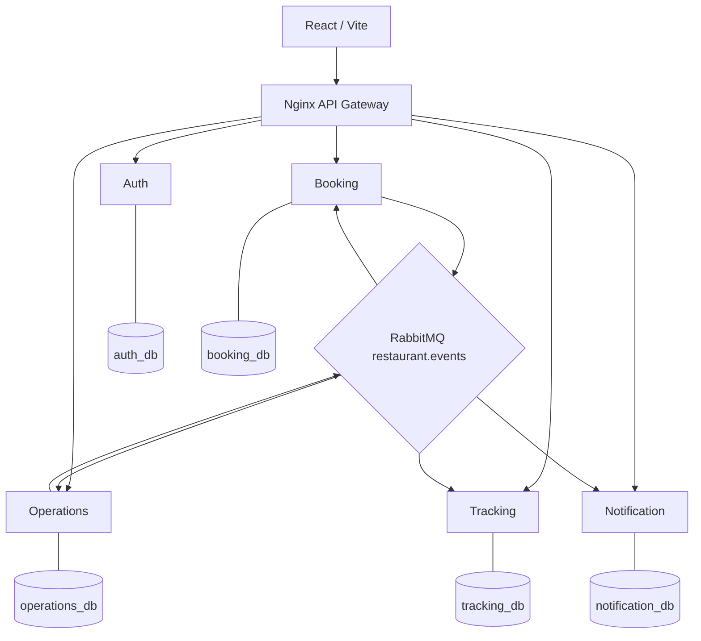

# IMPLEMENTATION PLAYBOOK — HỆ THỐNG ĐẶT BÀN NHÀ HÀNG (NESTJS)

**Bản dành cho nhóm 5 người – 05/11/2026.** Đây là **hướng dẫn thực hiện**, không phải tuyên bố đã viết xong 41 API. Nguồn thiết kế: bộ `restaurant-nestjs-v2-full-spec-mock.zip` và `restaurant-api-v2.yaml`. Mục tiêu: một nhà hàng, slot lunch/dinner, một booking giữ một bàn, không thanh toán/ghép bàn.

## Phân công được khóa theo nhóm

| Người | Phạm vi duy nhất được giao | Đầu ra phải bàn giao |
|---|---|---|
| **1** | **API Gateway + Auth Service + tích hợp hạ tầng** | JWT, role, 10 API Auth, route Gateway, Compose/CI; tài liệu token contract |
| **2** | **Restaurant Operations Service** | 17 API Operations, restaurant/area/table/slot, state machine, chống trùng bàn, events |
| **3** | **Tracking Service + Notification Service** | 2 API Tracking + 6 API Notification, timeline, email, jobs/retry/DLQ |
| **4** | **Booking Service** | 5 API Booking, idempotency, outbox, hủy, projection |
| **5** | **Frontend React** | UI 3 vai trò, mock-first API client, layout/routes/forms, e2e FE, phối hợp FE-BE |

**Tổng hợp đồng:** Auth 10 + Operations 17 + Booking 5 + Tracking 2 + Notification 6 + Gateway health 1 = **41 operations trong OpenAPI**. Một endpoint transition động `/{action}` đại diện nhiều trạng thái nghiệp vụ nhưng được tính 1 operation.

## Thứ tự đọc / giao file

1. `shared/00-QUY-UOC-CHUNG.md` — ranh giới, giao tiếp, trách nhiệm và nguyên tắc tích hợp.
2. Giao đúng 1 tài liệu cá nhân: `nguoi-1-auth-gateway/`, `nguoi-2-operations/`, `nguoi-3-tracking-notification/`, `nguoi-4-booking/`, `nguoi-5-frontend/`.
3. `contracts/openapi/restaurant-api-v2.yaml` — hợp đồng HTTP **nguồn chuẩn**; `contracts/events/*.schema.json` — hợp đồng RabbitMQ.
4. `sql/*_schema_V2.sql` — **target schema** từng service, `operations_seed.sql` — dữ liệu mẫu. Không chạy đè source NestJS V1 đang dùng schema cũ.
5. `shared/01-LUONG-END-TO-END.md`, `shared/02-MAPPING-V1-V2.md` — luồng và sửa chỗ lệch starter.
6. `testing/TEST-PLAN.md`, `deploy/GIT-LOCAL-CICD-PROD.md` — nghiệm thu, phối hợp, deployment.
7. `shared/07-BAN-GIAO-GIUA-CAC-NGUOI.md` — từng cặp service phải bàn giao contract và chứng minh đã tích hợp.
8. `mock-api/` — mock Node.js chạy riêng cho người 5 và FE integration.

## Kiến trúc thực hiện



- Cả 5 backend là **5 tiến trình/container** độc lập, được phát triển trong **1 backend monorepo** và có database/role riêng (có thể cùng một PostgreSQL instance trên máy demo).
- FE là repo thứ hai. Không có service nào JOIN hoặc ghi DB của service khác.
- **Operations duy nhất** quyết định `reservation.state`, `aggregateVersion`, `table_allocations`.
- Auth cấp JWT, các service khác kiểm tra JWT với public key ở local; không gọi Auth mỗi request.
- Booking yêu cầu bằng RabbitMQ; Operations xử lý và phát state event; Booking/Tracking/Notification tiêu thụ độc lập.
- UI dùng HTTP qua Gateway, không gọi thẳng cổng nội bộ.

## Trạng thái baseline thực tế

Theo bản source NestJS V1 trong gói V2: 19 operation `existing` (code mẫu), 21 `planned`, 1 `adapt`. Không có khẳng định rằng 19 operation đã vượt E2E trên Docker. Các file `sql/*_V2.sql` và `contracts/*` là **mục tiêu V2**, không tự tương thích code SQL V1. Chọn chuyển đổi V1 → V2 có migration, không dùng hai phiên bản schema cùng lúc.

## Cách ghép để nhóm làm độc lập

- Ngày đầu: người 1 phát hành JWT contract + Gateway route; người 2 và 4 chốt event contracts; người 3 chốt consumer tests; người 5 dùng mock + OpenAPI.
- Mỗi ngày: mỗi người mở PR nhỏ trong thư mục của mình; PR thay `shared`, `contracts`, `compose`, Gateway cần người bị ảnh hưởng review.
- Tích hợp thứ tự: **Auth → Booking Requested → Operations REQUESTED → Tracking → Notification → Confirm/Cancel → toàn bộ lifecycle → deploy**.
- Không merge `main` nếu unit test/contract test của service mình fail. Test notification outage và 2 nhân viên cùng gán 1 bàn là tiêu chí bắt buộc.

## Tài liệu đã kèm để chạy thử

```bash
# mock API riêng (Node 22)
cd mock-api
node server.mjs
# terminal khác
node test.mjs
```

Mock không tương đương backend thật, không chứa PostgreSQL hay RabbitMQ. Các ví dụ đường dẫn và tên bảng trong hướng dẫn đều bám target V2; đối chiếu file OpenAPI/SQL để lấy thông tin field chính xác khi code DTO.
