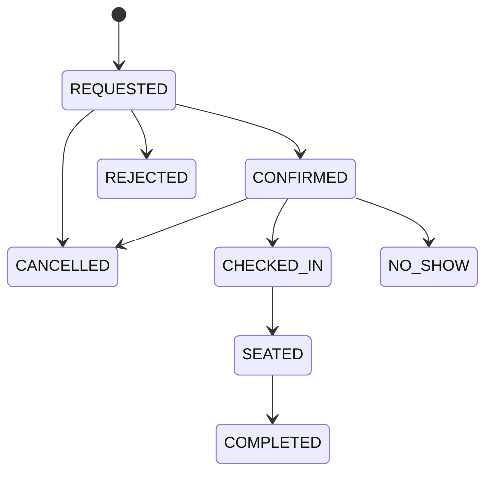

# NGƯỜI 2 — RESTAURANT OPERATIONS SERVICE (17 API, 1 DB, 2 EVENT OUTPUT)

**Owner:** Người 2. **Source V1:** `services/operations/main.ts`. **Target:** tách modules, migration V2, 17 API. **Database duy nhất:** `operations_db` (`../sql/operations_schema_V2.sql`, `operations_seed.sql`). **Đầu vào event từ người 4:** `booking.requested.v1`, `booking.cancel-requested.v1`. **Đầu ra người 4 và 3:** `booking.state-changed.v1`, `booking.cancellation-rejected.v1`.

## A. Nghiệp vụ thực tế cần triển khai

1. Nhà hàng có khu vực (`main`, `garden`), mỗi khu vực có bàn (`T01` đến `T04`), mỗi bàn capacity và active status. Manager thêm/sửa khu vực, bàn và ca phục vụ; STAFF chỉ xem và điều phối.
2. Người dùng xem thông tin nhà hàng, khu vực, ca và tình trạng chỗ trống từ **Operations**. Availability là dữ liệu tham khảo tại thời điểm GET, **không phải giữ chỗ**; quyết định cuối cùng chỉ ở transaction confirm.
3. Booking được tạo ở Booking Service, Operations nhận `booking.requested.v1` → tạo reservation `REQUESTED`, `aggregate_version=1`, lưu inbox, tạo outbox `booking.state-changed.v1` trong **một transaction**. Không được tạo trực tiếp qua API từ FE.
4. STAFF chọn bàn và xác nhận: check role, `expectedVersion`, trạng thái `REQUESTED`, capacity đủ, bàn đang active, ca hợp lệ, bàn chưa có allocation cho slot. `INSERT table_allocations` + `UPDATE reservations` + outbox trong cùng transaction. DB partial unique index `(table_id, slot_id) WHERE released_at IS NULL` chống race.
5. STAFF từ chối yêu cầu `REQUESTED` với reason bắt buộc. Hoặc check-in khi khách đến trong cửa sổ giờ, seat sau check-in, complete sau seat, no-show khi quá thời điểm cho phép. Mọi chuyển state phát event.
6. Hủy: event từ Booking; nếu đúng chủ sở hữu, trạng thái cho phép và thỏa deadline thì chuyển `CANCELLED`, giải phóng allocation; nếu không phát `booking.cancellation-rejected.v1` có `commandId`/reason. Với cancel tới trước create, lưu pending rồi xử lý sau khi create tới.
7. Thống kê `stats/summary` từ Operations DB của riêng mình: theo ngày/ca số REQUESTED/CONFIRMED/COMPLETED/CANCELLED/NO_SHOW... Không truy vấn DB Tracking.

## B. Schema `operations_db` và vai trò từng bảng

| Bảng | Khóa, cột chủ đạo | Logic/ràng buộc |
|---|---|---|
| `restaurants` | `id TEXT PK`, `name`, `timezone`, `address`, `cancel_before_minutes`, `checkin_early_minutes`, `no_show_after_minutes` | Một nhà hàng MVP; timezone Asia/Ho_Chi_Minh, policy centralized |
| `dining_areas` | `id TEXT PK`, `restaurant_id FK`, `name`, `active` | Chỉ MANAGER chỉnh sửa |
| `dining_tables` | `id TEXT PK`, `area_id FK`, `capacity`, `active` | Bàn chỉ thuộc một khu vực; sửa active không làm đổi lịch sử |
| `service_slot_configs` | `code PK`, `restaurant_id FK`, `starts_at_local`, `ends_at_local`, `active` | MVP `lunch`, `dinner`; ca không qua nửa đêm |
| `reservations` | `id UUID PK`, `customer_id UUID`, `contact_email`, `slot_id`, `party_size`, `state`, `aggregate_version`, `table_id`, `updated_at` | **Nguồn chân lý duy nhất cho state**; `id` lấy từ Booking event aggregateId, không FK sang Booking DB |
| `table_allocations` | `id UUID`, `booking_id FK`, `table_id FK`, `slot_id`, `released_at` | Unique active `(table_id,slot_id)` và unique `booking_id`; release ở CANCELLED/NO_SHOW; giữ record COMPLETED |
| `pending_cancellations` | `command_id PK`, `booking_id`, `customer_id`, `received_at` | Cancel event tới trước request; xử lý/expire không kẹt vô hạn |
| `processed_commands` | `command_id PK`, `booking_id`, `result JSONB` | Idempotency của lệnh cancel & replay kết quả |
| `inbox_events` | `event_id UUID PK`, `aggregate_id`, `processed_at` | Dedup mỗi delivery event |
| `outbox_events` | `event_id`, `aggregate_id`, `routing_key`, `payload`, `published_at`, `attempts` | State event và rejected cancellation durable |

**Seed có sẵn:** `rest-001`, `main`, `garden`, T01(2), T02(4), T03(6), T04(4), lunch 11:30–13:00, dinner 18:00–19:30. Không dùng ID bàn như FK của các DB khác.

**Lưu ý ràng buộc:** Nếu `table_allocations` giữ `UNIQUE (booking_id)` thì MVP không hỗ trợ đổi bàn sau xác nhận. Nếu sau này có đổi bàn, phải có thiết kế allocation history riêng, không bỏ unique/index không kiểm soát.

## C. State machine và guard cụ thể



| Transition | Ai | Guard tối thiểu | Tác động DB |
|---|---|---|---|
| Create → REQUESTED | consumer | event valid; slot trong tương lai, partySize 1–12, request chưa tồn tại | reservations version=1 + inbox + outbox |
| REQUESTED → CONFIRMED | STAFF/MANAGER | đúng `expectedVersion`, bàn đủ chỗ/active, slot đặt được, chưa trùng | allocation + state version+1 + outbox |
| REQUESTED → REJECTED | STAFF/MANAGER | reason khác rỗng | state/version/outbox |
| REQUESTED/CONFIRMED → CANCELLED | consumer; staff extension | customerId khớp, trước deadline, trạng thái cho phép | state/version; release allocation nếu có |
| CONFIRMED → CHECKED_IN | STAFF/MANAGER | trong check-in window (ví dụ từ -30 đến +15 phút) | state/version/outbox |
| CHECKED_IN → SEATED | STAFF/MANAGER | đúng table; bàn sẵn sàng | state/version/outbox |
| SEATED → COMPLETED | STAFF/MANAGER | đã phục vụ; không cho complete ngược | state/version/outbox; **không** xóa allocation của slot đã phục vụ |
| CONFIRMED → NO_SHOW | STAFF/MANAGER hoặc job | đã quá start+15 phút, chưa check-in | state/version/outbox; release allocation |

Chốt policy thời gian chính xác trong `restaurants` và một `TimePolicyService`; không hardcode chỗ thì dùng -15 phút, chỗ thì -30 phút. `Date.now()` phụ thuộc máy chạy; test bằng injectable clock/fake clock.

## D. 17 API thuộc Operations (toàn bộ backlog)

| Method/path | Role | Logic/kiểm thử |
|---|---|---|
| `GET /api/restaurants/current` | PUBLIC | Công khai nhà hàng + chính sách, timezone |
| `GET /api/restaurants/current/areas` | PUBLIC | Lọc khu vực active |
| `GET /api/slots?date=YYYY-MM-DD` | PUBLIC | Dựa config ca + lịch ngày địa phương, `startsAt/endsAt/bookingOpen` |
| `GET /api/availability?date=...&partySize=...&slotCode=...` | PUBLIC | Đếm bàn đủ capacity và active chưa được allocate cho slot, cache ngắn nếu muốn |
| `GET /api/operations/reservations` | STAFF/MANAGER | Filter slot/state, pagination, ưu tiên ngày phục vụ |
| `GET /api/operations/reservations/{id}` | STAFF/MANAGER | Chi tiết reservation + tableId + version |
| `POST /api/operations/reservations/{id}/{action}` | STAFF/MANAGER | action=confirm/reject/check-in/seat/complete/no-show; reason/tableId/expectedVersion |
| `GET /api/operations/tables` | STAFF/MANAGER | Danh sách, active, capacity, area |
| `POST /api/operations/tables` | MANAGER | Validate id/area/capacity; 409 id trùng |
| `PATCH /api/operations/tables/{id}` | MANAGER | Chỉ fields cho phép; tránh làm vô hiệu bàn đã có đặt tương lai |
| `GET /api/operations/areas` | STAFF/MANAGER | Danh sách area |
| `POST /api/operations/areas` | MANAGER | Tạo area thuộc restaurant |
| `PATCH /api/operations/areas/{id}` | MANAGER | Sửa tên/active; kiểm soát bàn đang active |
| `GET /api/operations/slot-configs` | STAFF/MANAGER | Xem giờ mở ca & active |
| `POST /api/operations/slot-configs` | MANAGER | Thêm ca theo contract, tránh trùng code |
| `PATCH /api/operations/slot-configs/{code}` | MANAGER | Không retroactively phá booking đã confirm; đổi cho ngày tương lai có policy |
| `GET /api/operations/stats/summary` | MANAGER | Count theo slot/date/state, không truy cập DB Tracking |

**Cảnh báo OpenAPI:** `/{action}` là **một operation** trong 41, nhưng implement nhiều hành động với guard khác nhau. Với `action=cancel` của STAFF chỉ triển khai sau khi contract đã chốt; cancellation command từ Booking vẫn là luồng chính.

## E. Code/module đề nghị

```text
services/operations/
├── main.ts
├── operations.module.ts
├── controllers/{public,table,area,slot,reservation,statistics}.controller.ts
├── application/{reservation,allocation,calendar,availability}.service.ts
├── domain/{reservation-state,transition-policy,time-policy}.ts
├── infrastructure/{reservation,table,area,slot,outbox,inbox}.repository.ts
├── messaging/{requested.consumer,cancel-requested.consumer,state.publisher}.ts
├── dto/{transition,table,area,slot,availability}.dto.ts
└── migrations/001_init_operations.sql
```

**Transaction lõi khi confirm (pseudocode có chủ đích):**

```ts
await db.tx(async (tx) => {
  const reservation = await repo.lockById(tx, bookingId);  // SELECT ... FOR UPDATE
  assertExpectedVersion(reservation, dto.expectedVersion);
  assertTransition(reservation.state, 'CONFIRMED');
  assertSlotAndTablePolicy(reservation, table, now);
  await allocationRepo.insert(tx, bookingId, dto.tableId, reservation.slotId);
  await reservationRepo.transition(tx, bookingId, 'CONFIRMED', dto.tableId, reservation.aggregateVersion + 1);
  await outboxRepo.insert(tx, stateChangedEvent);  // cùng transaction
});
```

Bắt `SQLSTATE 23505` (unique violation) → HTTP 409 cho hai lễ tân tranh bàn. Không `SELECT rồi UPDATE` không khóa mà coi là đủ. Consumer requested/cancel phải `inbox eventId` và mutation trong 1 transaction; ACK chỉ sau khi callback resolve.

## F. Event contract bắt buộc bàn giao người 3/4

**Consume:** `operations.requests.q` được bind cả `booking.requested.v1` và `booking.cancel-requested.v1`. Phải xử lý duplicate eventId; cancel tới trước booking; retry hữu hạn/DLQ khi payload sai; không gọi Booking HTTP để lấy `customerId`.

**Produce:** `booking.state-changed.v1` có `eventId`, `aggregateId=bookingId`, `aggregateVersion`, `previousState`, `state`, `customerId`, `data.email`, `tableId`, `slotId`, `partySize`, `actorId`, `reason`, `commandId?`. `booking.cancellation-rejected.v1` mang `commandId`, `customerId`, `reason`. **JSON Schema đính kèm trong contracts/events là nguồn chuẩn**; nếu code V1 đang dùng `email` top-level event khác mẫu contract thì phải sửa cùng producer–consumer, không tự đổi một phía.

## G. Lệch source V1 cần xử lý

- V1 `reservations.version`, `email`, `dining_tables.area` khác V2 `aggregate_version`, `contact_email`, `area_id`; sửa query + DTO + migrations đồng loạt.
- V1 `pending_cancellations` dùng `created_at`, target V2 có `received_at`, `customer_id`; sửa insert/order. V1 `emitState()` đang không đầy đủ guard thời gian/ownership cho từng transition.
- V1 `shared/events.ts` enqueue chỉ ghi 3 cột, V2 outbox yêu cầu `aggregate_id`; inbox V2 yêu cầu `aggregate_id`. Không chạy V2 SQL trên V1 service mà không refactor helper.
- V1 chưa có public `/api/restaurants`, `/api/slots`, `/api/availability`, Gateway cũng chưa route. Người 1 phải review tuyến mới.
- V1 `active=false` của bàn bị chặn nếu có allocation lịch sử còn `released_at IS NULL`, gồm COMPLETED; cần policy chỉ ngăn đặt tương lai còn hiệu lực, không xóa lịch sử.
- Nguồn state event chỉ Operations được tăng version; Tracking có thể nhận version 3 trước 2, không phát state event bù từ Tracking.

## H. Bộ test của người 2

1. Seed đúng 4 bàn/2 ca; `GET availability` phản ánh capacity và allocation.
2. Nhận `booking.requested` → một reservation version=1, phát một state event; phát lại cùng `eventId` → không thêm bản ghi.
3. Hai lệnh confirm đồng thời cùng tableId/slotId → **một commit, một 409**.
4. Confirm table capacity 2 với booking partySize 4 → 409; bàn inactive → 409; slot đã qua → không xác nhận.
5. Stale `expectedVersion` → 409; complete trực tiếp từ REQUESTED → 409; reject thiếu reason → 400.
6. Cancel đúng quyền trước deadline → CANCELLED + outbox + release; cancel khi SEATED → rejected event, state giữ nguyên.
7. Cancel event trước Requested → lưu pending; Requested đến → xử lý hủy đúng thứ tự state versions.
8. NO_SHOW chỉ sau giờ bắt đầu + grace; CHECKED_IN chỉ đúng window; kiểm thử clock giả.
9. Dừng Notification rồi confirm: HTTP confirm commit, outbox phát, Tracking vẫn nhận, Notification queue tăng.
10. Bật lại Operations sau khi broker/down: outbox chờ và phát lại; inbox chịu duplicate.

**Bàn giao:** 17 API, SQL migration + seed, tài liệu TimePolicy, 4 event contract tương thích, 10 test trên và README env/run. Ưu tiên cao nhất của nhóm: confirm/allocate đồng thời và state event đúng.
