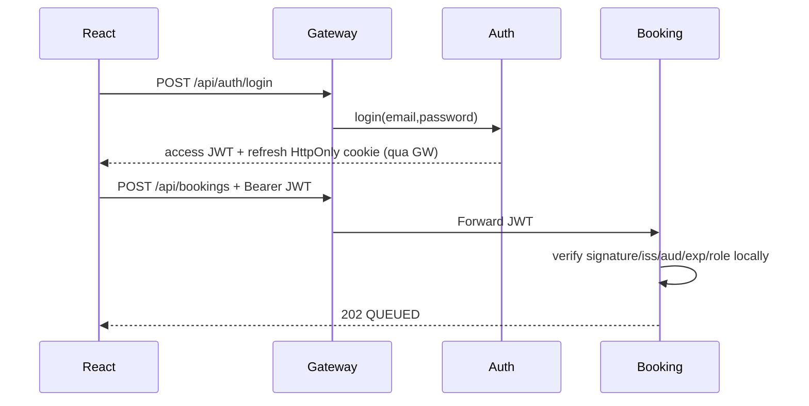
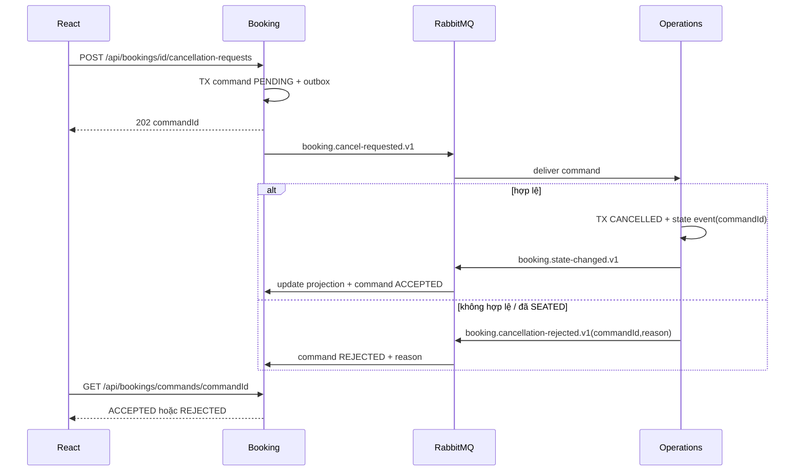

# 01 — Luồng tích hợp end-to-end và phân quyền giữa các service

## 1. Đăng nhập và xác thực



**Điều kiện tích hợp:** Auth phát hành JWT RS256, mọi service dùng cùng `JWT_ISSUER`, `JWT_AUDIENCE`, public key; Gateway không phải nơi duy nhất kiểm tra quyền. Token đã hết hạn không được phép tạo booking.

## 2. Tạo booking → REQUESTED → CONFIRMED → Notification

```mermaid
sequenceDiagram
    participant FE as React
    participant GW as API Gateway
    participant B as Booking DB + Service
    participant MQ as RabbitMQ
    participant O as Operations DB + Service
    participant T as Tracking
    participant N as Notification
    FE->>GW: POST /api/bookings (Idempotency-Key)
    GW->>B: JWT + DTO
    B->>B: TX INSERT request + outbox
    B-->>FE: 202 bookingId/QUEUED
    B->>MQ: booking.requested.v1 (relay, confirm)
    MQ->>O: operations.requests.q
    O->>O: TX inbox + reservation REQUESTED v1 + outbox
    O-->>MQ: ACK after commit
    O->>MQ: booking.state-changed.v1 (v1)
    MQ->>B: booking.lifecycle.q
    MQ->>T: tracking.lifecycle.q
    MQ->>N: notification.lifecycle.q
    B->>B: projection version 1
    T->>T: history version 1
    N->>N: insert job; worker send later
    FE->>GW: POST /api/operations/reservations/id/confirm (STAFF)
    GW->>O: expectedVersion=1,tableId=T02
    O->>O: TX lock+allocation+CONFIRMED v2+outbox
    O-->>FE: 200 state/version 2
    O->>MQ: booking.state-changed.v1 (v2)
    MQ->>B: projection v2
    MQ->>T: append history v2
    MQ->>N: notification job v2
```

**Frontend:** Sau 202 phải hiển thị queued/pending; không coi lời nhận request là lời bảo đảm có bàn. Availability GET chỉ là thông tin tham khảo, confirm mới là commit cấp bàn.

## 3. Hủy bất đồng bộ, trường hợp race và từ chối



Nếu cancel đến trước requested, `pending_cancellations` ở Operations giữ command đến khi có reservation; cần timeout/alert nếu booking không bao giờ đến. Có thể xử lý duplicate event hoặc event đến sai thứ tự, không phụ thuộc thứ tự publish toàn cục.

## 4. Các điểm chạy độc lập chứng minh microservices

| Thành phần bị tắt | Kỳ vọng |
|---|---|
| Notification | Booking POST/confirm/Tracking vẫn tiếp tục; queue N backlog; bật lại tạo/send jobs sau |
| Tracking | Booking/Operations vẫn xử lý; queue T backlog, Tracking bắt kịp sau khi chạy lại |
| Auth | Với access JWT còn hạn, 4 service vẫn verify cục bộ; login/refresh mới không hoạt động |
| Operations | Booking vẫn tiếp nhận 202 và giữ outbox/request; reservation state QUEUED cho tới khi Ops hồi phục |
| RabbitMQ | Booking tiếp nhận vào DB/outbox; relay chưa publish, sẽ retry sau; không được báo CONFIRMED |
| Booking | STAFF còn có thể thao tác reservation đã được Operations lưu; nhưng khách không tạo/hủy mới |

**Không hứa** mọi tính năng vẫn hoạt động khi Gateway hoặc PostgreSQL bị tắt; một VPS/1 broker không phải high-availability production.

## 5. Common error contract + correlation

```json
{"code":"RESERVATION_VERSION_CONFLICT","message":"Reservation has changed","correlationId":"afbaefdb-cf3e-4d8b-ad90-f26b4b52e38b","details":{"expectedVersion":2,"actualVersion":3}}
```

Gateway chuyển hoặc phát `X-Correlation-Id`; producer đưa vào event `correlationId`. Các service log eventId/bookingId/commandId/trace id (không log password, refresh cookie, email plaintext không cần thiết). Khác biệt timestamp: `occurredAt` là thời điểm domain event; `receivedAt` là lúc consumer nhận.
