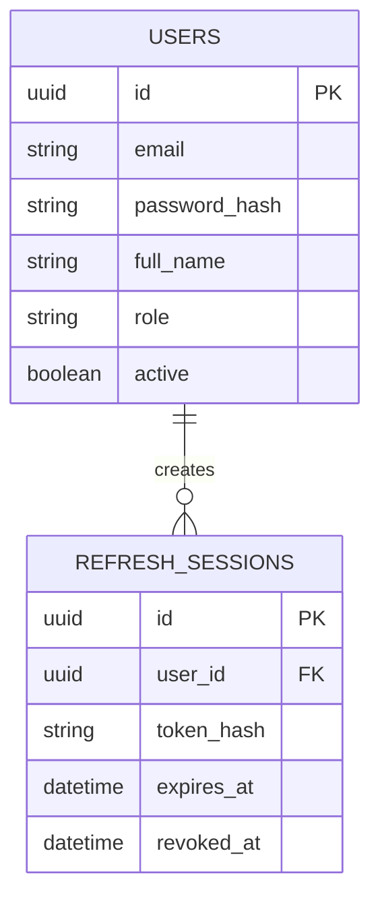
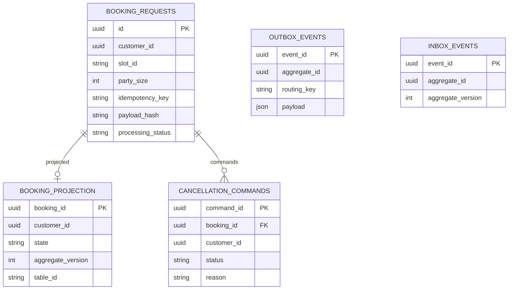
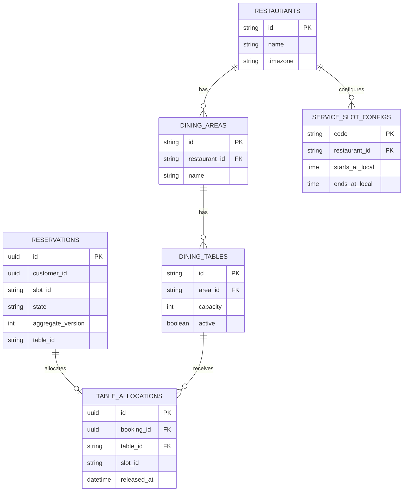
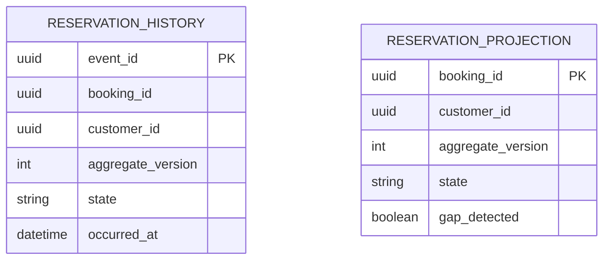
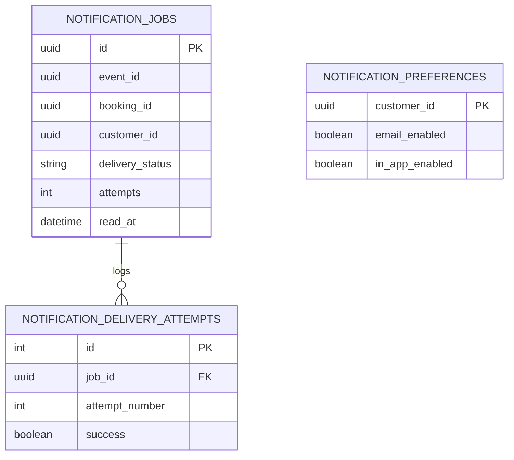

# 05 — DATABASE OWNER MAP, ERD VÀ CÁCH TẠO SCHEMA THỰC TẾ

**Nguồn SQL chuẩn:** `/sql/auth_schema_V2.sql`, `booking_schema_V2.sql`, `operations_schema_V2.sql`, `tracking_schema_V2.sql`, `notification_schema_V2.sql`, `operations_seed.sql`. SQL này là **target schema V2** để lập trình theo, chưa phải script upgrade từ DB NestJS V1.

## A. Không dùng shared database trong microservices

5 database logic (`auth_db`, `booking_db`, `operations_db`, `tracking_db`, `notification_db`) có thể được host chung một PostgreSQL instance để tiết kiệm RAM, nhưng phải tạo **5 DB users/roles khác nhau**. Mỗi service chỉ nhận **một** `DATABASE_URL` của chính mình. Không có database foreign key từ Booking sang Operations, Tracking sang Auth. Quan hệ giữa DB là **logical reference IDs**, kiểm tra qua JWT/event contract.

## B. ERD cục bộ per service

### Auth (Người 1)



### Booking (Người 4)



### Operations (Người 2)



### Tracking + Notification (Người 3, 2 DBs)





Các dòng không vẽ quan hệ xuyên DB là **chủ ý**. `reservation_history.booking_id` tham chiếu logic đến Operations reservation, nhưng **không tạo FK qua DB**.

## C. Constraint thiết yếu phải kiểm thử trong PostgreSQL

```sql
-- Tránh cấp một bàn cho 2 booking trong cùng ca
CREATE UNIQUE INDEX IF NOT EXISTS ux_active_table_slot
  ON table_allocations(table_id, slot_id)
  WHERE released_at IS NULL;

-- Một booking request + một idempotency key của cùng user
ALTER TABLE booking_requests
  ADD CONSTRAINT ux_request_idempotency UNIQUE(customer_id, idempotency_key);

-- Một event version trong lịch sử Tracking
ALTER TABLE reservation_history
  ADD CONSTRAINT ux_history_booking_version UNIQUE(booking_id, aggregate_version);
```

Ba constraint trên đã có trong schema V2, **không cần chạy lệnh ALTER thêm lần nữa**; snippet minh họa điều kiện cần tồn tại sau migration. Tránh migration lặp gây duplicate constraint names. `table_allocations` sau COMPLETED giữ lịch sử slot (không release), check availability với ngày/ca tương lai chứ không xóa allocation cũ để “giải phóng bàn”.

## D. Chạy schema cho DB mới, không ghi đè bản cũ

```bash
# Ví dụ khi chạy PostgreSQL bằng Docker và database/role đã được tạo
psql "$AUTH_DATABASE_URL"         -v ON_ERROR_STOP=1 -f sql/auth_schema_V2.sql
psql "$BOOKING_DATABASE_URL"      -v ON_ERROR_STOP=1 -f sql/booking_schema_V2.sql
psql "$OPERATIONS_DATABASE_URL"   -v ON_ERROR_STOP=1 -f sql/operations_schema_V2.sql
psql "$OPERATIONS_DATABASE_URL"   -v ON_ERROR_STOP=1 -f sql/operations_seed.sql
psql "$TRACKING_DATABASE_URL"     -v ON_ERROR_STOP=1 -f sql/tracking_schema_V2.sql
psql "$NOTIFICATION_DATABASE_URL" -v ON_ERROR_STOP=1 -f sql/notification_schema_V2.sql
```

**Trong repo thật nên chuyển thành migration versioned** (ví dụ `services/booking/migrations/001_init.sql` với `node-pg-migrate`, Prisma migrations nếu được thống nhất, hoặc SQL migration runner) và chạy từ CI/CD trước service startup. Schema tạo một lần không đồng nghĩa có đường upgrade dữ liệu an toàn.

## E. Tạo 5 database và 5 roles (DBA bootstrap ở môi trường dev)

File `infra/postgres-init.sql` của starter có quyền dùng trong môi trường demo; người 1 kiểm tra role permissions. Ví dụ template (điền secrets từ `.env`, không commit password thật):

```sql
CREATE ROLE auth_user LOGIN PASSWORD '<DEV_SECRET_AUTH>';
CREATE ROLE booking_user LOGIN PASSWORD '<DEV_SECRET_BOOKING>';
CREATE ROLE operations_user LOGIN PASSWORD '<DEV_SECRET_OPERATIONS>';
CREATE ROLE tracking_user LOGIN PASSWORD '<DEV_SECRET_TRACKING>';
CREATE ROLE notification_user LOGIN PASSWORD '<DEV_SECRET_NOTIFICATION>';
CREATE DATABASE auth_db OWNER auth_user;
CREATE DATABASE booking_db OWNER booking_user;
CREATE DATABASE operations_db OWNER operations_user;
CREATE DATABASE tracking_db OWNER tracking_user;
CREATE DATABASE notification_db OWNER notification_user;
```

**Chú ý:** `CREATE DATABASE` không chạy trong transaction block; chạy bootstrap SQL dưới superuser chỉ một lần trong container init hoặc script riêng. Dấu placeholder `<...>` là để bạn thay bằng credential dev, không phải chạy nguyên văn. Trên production không dùng role admin cho NestJS.

## F. Dữ liệu mẫu và timestamp

- `rest-001` / timezone `Asia/Ho_Chi_Minh`; hai khu vực `main`, `garden`; bàn T01(2), T02(4), T03(6), T04(4); ca lunch/dinner trong `operations_seed.sql`.
- Đối với booking, tạo dữ liệu mẫu **qua API thực và event thật** để có history, outbox, allocations đúng transaction; đừng INSERT trực tiếp các state để phục vụ demo rồi giả sử consumer đã nhận.
- Manager/Staff/Customer demo phải được tạo bằng script bootstrap/Auth API với bcrypt hash; mock credentials của `mock-api/README.md` không phải tài khoản SQL production.
- Không hardcode ngày nhận bàn đã qua; e2e test phải tạo `slotId` của **ngày tương lai** theo timezone nhà hàng.
